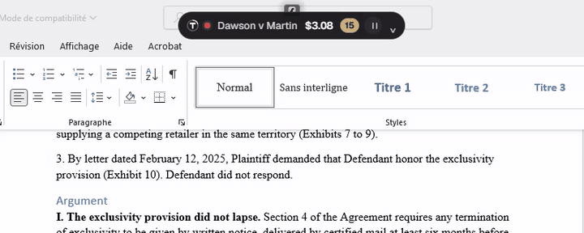
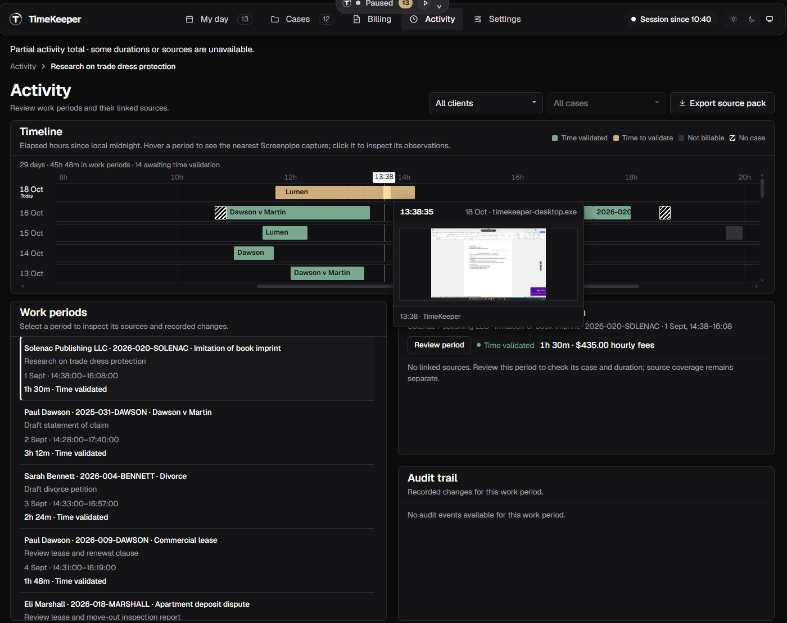
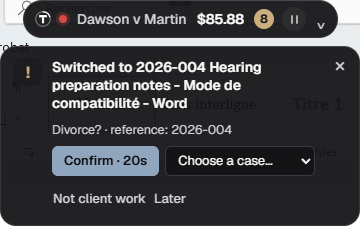
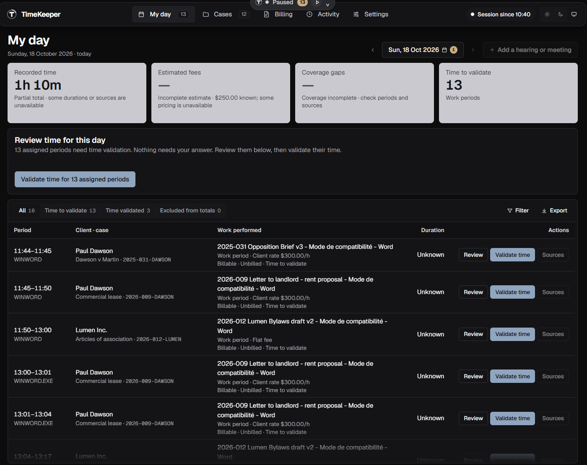
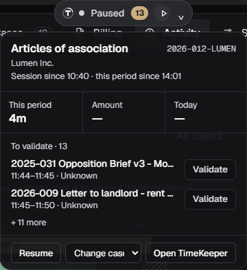
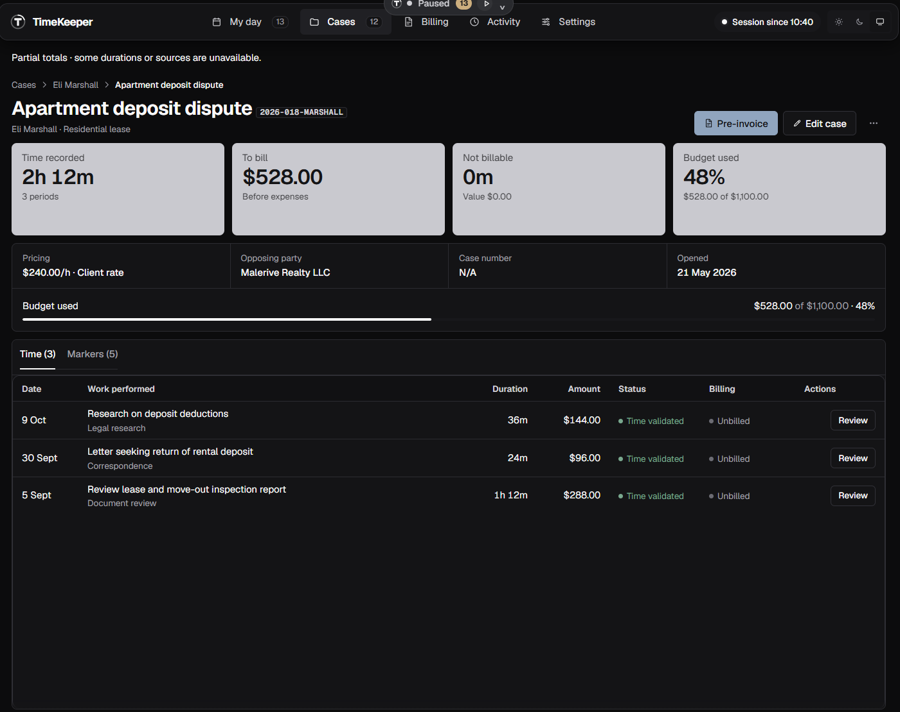
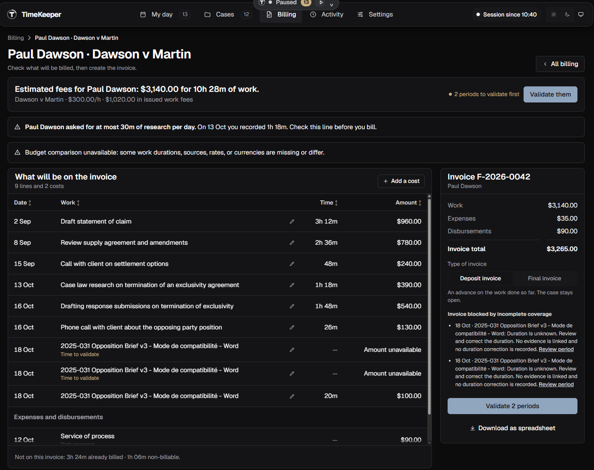
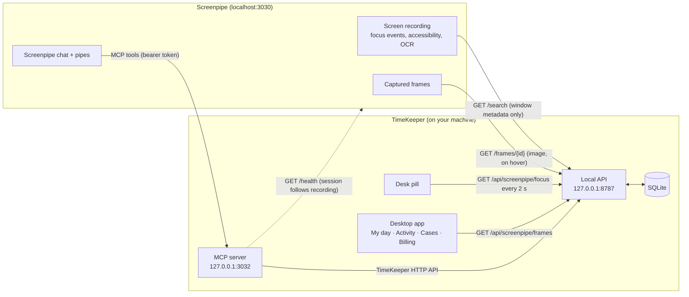
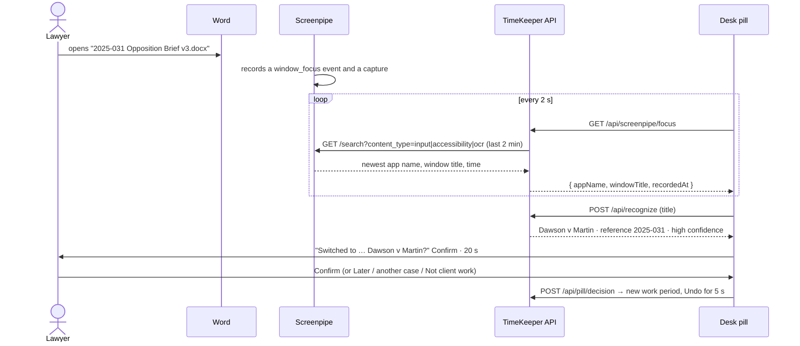

# TimeKeeper

**Your screen already knows which case you worked on. TimeKeeper turns it into billable time.**

<p align="center">
  
  <br>
  <em>Open another client's document and the desk pill switches case for you, in seconds, from what Screenpipe sees. Real recording, fictional data.</em>
</p>

TimeKeeper is a local desktop assistant for lawyers. It sits on top of [Screenpipe](https://screenpi.pe), which records what happens on your screen, and turns that recording into work periods assigned to the right client and case, ready to review, validate and invoice. Nothing leaves your machine.

It is an École 42 × Screenpipe hackathon project: a Tauri desktop app with a React interface, a local Node API and a SQLite database.

## How it works in 30 seconds

| 1. Work as usual                                                                                                                         | 2. TimeKeeper proposes the case                                                                  | 3. Review and bill                                                                         |
| ---------------------------------------------------------------------------------------------------------------------------------------- | ------------------------------------------------------------------------------------------------ | ------------------------------------------------------------------------------------------ |
| Open your documents, emails and files. [Screenpipe](https://screenpi.pe) records your screen locally; TimeKeeper reads what it recorded. | The desk pill sees `2025-031 Opposition Brief v3.docx` and asks _"Dawson v Martin?"_. One click. | My day lists every period. Validate the time, then Billing turns it into an invoice draft. |
|                                                           |                                                  |                                                           |

## Why lawyers want it

Lawyers lose billable time every day: a short call, a quick look at a brief, a reply to opposing counsel. Rebuilding the day from memory on Friday evening is slow, inaccurate, and every missed minute is lost revenue.

- **It notices.** When you switch to `2025-031 Opposition Brief v3.docx`, Screenpipe records it and TimeKeeper recognises case **2025-031 · Dawson v Martin** from the reference in the title.
- **It asks, it does not guess.** A small notice proposes the case. One click confirms it, **Undo** reverts it for five seconds, and an unknown document becomes a question for you instead of a wrong entry.
- **It keeps proof.** Every work period links back to what Screenpipe recorded. Hover the timeline and you see the actual screen capture of that moment.
- **It stays local.** Screen text never leaves Screenpipe and your computer. TimeKeeper keeps references and window titles, not your documents.

## The desk pill

The pill is a small always-on-top bar, centred at the top of the screen. It is the only part of TimeKeeper you see while you work.

<p align="center">
  
  &nbsp;&nbsp;
  
</p>

**The bar**, left to right:

| Element        | Meaning                                                                                                      |
| -------------- | ------------------------------------------------------------------------------------------------------------ |
| Status dot     | Red: TimeKeeper is watching Screenpipe for document switches. Grey: paused. Amber: Screenpipe not connected. |
| Case           | The case of the current work period (or _Which case?_ when it is still unknown).                             |
| Amount or time | Fees accruing for the current period, its duration, or nothing (choose in Settings → Desk pill).             |
| Badge          | Periods of today still to validate.                                                                          |
| ⏸ / ▶          | Pause or resume document detection. Screenpipe keeps recording; only the pill stops reacting.                |
| ⌄              | Opens the panel. Drag the logo to move the pill; double-click it to put it back.                             |

**When you open a document of another case**, a notice appears under the bar:

| Action              | What happens                                                                                                  |
| ------------------- | ------------------------------------------------------------------------------------------------------------- |
| **Confirm** · 20 s  | Starts a new work period on the proposed case. With a single strong match, the countdown confirms it for you. |
| **Choose a case…**  | Starts the period on another case.                                                                            |
| **Not client work** | Starts a period excluded from billing.                                                                        |
| **Later** / ✕ / Esc | Closes the notice without changing anything.                                                                  |
| **Undo**            | Appears on the bar for five seconds after any choice and reverts it.                                          |

A document TimeKeeper cannot place (no reference, no marker) asks _"Which case was this?"_ instead of guessing. **The panel** shows the current case, this period's time and amount, today's total, the periods to validate (with **Validate** once a period has a case and a duration), and buttons to pause, change the case or open TimeKeeper.

## The screens

| My day                                                                   | Activity                                                                                                                   |
| ------------------------------------------------------------------------ | -------------------------------------------------------------------------------------------------------------------------- |
|                                         |                                                                                       |
| Today's periods, questions to answer and one-click time validation.      | Timeline of every period (green validated, amber to validate). Hover a period: the nearest **Screenpipe capture** appears. |
| **Cases**                                                                | **Billing**                                                                                                                |
|                                           |                                                                                         |
| Each case with time recorded, fees to bill, budget used and its markers. | What goes on the invoice, client rules (for example research caps), expenses and the invoice draft.                        |

**Settings** holds clients, case rates (sortable), task types, client rules, capture preferences and the pill options.

## How TimeKeeper works with Screenpipe

Screenpipe records the screen; TimeKeeper never records anything itself. TimeKeeper reads Screenpipe's local API, and Screenpipe can call TimeKeeper back through MCP.



### 1. Detecting the document you work on



- **Source of truth:** Screenpipe. The pill reads the newest focused window from Screenpipe's focus events (`window_focus`, `app_switch`), accessibility and OCR captures, read one after another because Screenpipe answers concurrent searches with "search is busy" (TimeKeeper retries those).
- **Stability:** a window must be seen on two consecutive reads before it triggers a notice, so windows you only pass through are ignored. TimeKeeper's own windows are ignored too.
- **Recognition:** case references (`2025-031`), case numbers, opposing parties, client names and the markers you add to each case in Cases. A single strong match counts down and confirms itself; anything ambiguous waits for you.
- **Timing:** a notice appears once Screenpipe has made the focus searchable, usually within a few seconds and up to about 20 seconds.

### 2. Showing the evidence

Activity asks `GET /api/screenpipe/frames?start=…&end=…` for the captures of the hovered period, then loads the nearest one through `GET /api/screenpipe/frames/{id}/image`. TimeKeeper fetches the image from Screenpipe with the API key on the server side, so the browser view never sees the key.

### 3. Letting Screenpipe drive the session

The MCP server (`npm run mcp:serve`) gives Screenpipe chat and pipes a scoped set of tools on top of the TimeKeeper API:

| Tool                     | What it does                                                 |
| ------------------------ | ------------------------------------------------------------ |
| `timekeeper_status`      | Is TimeKeeper running, which session and period are active.  |
| `start_session`          | Starts a session (idempotent) through `/api/commands/start`. |
| `end_session`            | Ends the active session through `/api/commands/end`.         |
| `list_cases`             | Active cases with their client.                              |
| `list_work_periods`      | Periods of a session, with case, duration and status.        |
| `list_questions`         | Periods waiting for "which case was this?".                  |
| `answer_question`        | Answers one, bound to the period's assignment revision.      |
| `screenpipe_link_status` | State of the Screenpipe session link.                        |

With `--screenpipe-link`, the TimeKeeper session follows Screenpipe's recording: when Screenpipe starts recording a session starts, and when it stops for longer than the grace period the session ends at the last moment it was recording. **Start** and **End** pipes give you explicit buttons in Screenpipe.

### Privacy by design

- TimeKeeper only returns window **metadata** (application, title, URL, time). Screen text and typed input stay inside Screenpipe.
- Searches are local only (`include_cloud=false`). TimeKeeper never reads Screenpipe's database and never writes Screenpipe memories.
- The Screenpipe API key stays in TimeKeeper's API process. The MCP server listens on `127.0.0.1` only and requires its own bearer token.
- Captures appear only when you hover a period; nothing is copied into TimeKeeper's database.

## Try it in five minutes

### 1. Install

Use the Node version in [`.nvmrc`](.nvmrc), then from the repository root:

```sh
nvm install && nvm use
node install.mjs
```

Install and start [Screenpipe](https://screenpi.pe) separately (see the [setup guide](docs/SETUP.md)).

### 2. Give TimeKeeper read access to Screenpipe

Screenpipe protects its API with a local token. Print it with Screenpipe's CLI and put it in `.env` at the repository root (this file is ignored by git):

```sh
screenpipe auth token
```

```dotenv
SCREENPIPE_URL=http://127.0.0.1:3030
SCREENPIPE_API_KEY=<the token>
```

For the installed desktop app, save the token in a file named `screenpipe-api-key` in the app's data folder (`%APPDATA%\com.timekeeper.desktop` on Windows). The app passes that path to its API.

### 3. Start with demo data

Normal startup creates an empty workspace. For a demo, create a separate database with fictional clients and cases (Dawson v Martin, Lumen Inc, Bennett divorce, …):

```sh
TIMEKEEPER_DB=data/demo.db node --import tsx tests/fixtures/create-database.ts
TIMEKEEPER_DB=data/demo.db npm run dev
```

Open `http://127.0.0.1:5173`, or run the desktop app with `npm run dev:server` in one terminal and `npx tauri dev` in another.

### 4. Walk through it

1. **Open a case document.** Create or open any file whose name contains a case reference, for example `2025-031 Opposition Brief v3.docx` or `2026-012 Lumen Bylaws draft v2.docx`, and keep it in front.
2. **Watch the pill.** Within seconds to about 20 seconds it shows _Switched to … · Dawson v Martin? · reference 2025-031_ with a countdown.
3. **Confirm in one click.** The bar now shows the case and the fees accruing; **Undo** stays available for five seconds. Try **Later**, ✕ or **Not client work** on the next document.
4. **Open the pill panel** (chevron): the current period, its amount, today's total and the periods to validate.
5. **Open My day** to validate today's periods, or answer the question for a document TimeKeeper could not place.
6. **Open Activity** and hover today's row: the preview shows Screenpipe's capture of that moment. Click a period to see its sources and audit trail.
7. **Open Cases and Billing** to see recorded time against last month, fees to bill and the invoice draft.

## Test it

### Without Screenpipe: the pill simulator

Run the demo (step 3 above) and open `http://127.0.0.1:5173/pill.html` in a browser. Pick a document in **Simulate file switch**: the notice appears at once, without waiting for Screenpipe. Try **Confirm** then **Undo**, **Later**, **Not client work**, and _Program Manager_ (a Windows shell window, ignored).

### With Screenpipe: check the connection

With the API running and `SCREENPIPE_API_KEY` set:

```sh
curl http://127.0.0.1:8787/api/screenpipe/focus
# {"status":"ok","focus":{"appName":"WINWORD.EXE","windowTitle":"2025-031 Opposition Brief v3 - Word",...}}
```

`"unauthorized"` means the key is missing or wrong; `"unavailable"` means Screenpipe is not running. To list the captures of the last 10 minutes (metadata only):

```sh
curl "http://127.0.0.1:8787/api/screenpipe/frames?start=$(date -u -d '-10 min' +%FT%TZ)&end=$(date -u +%FT%TZ)"
```

### The MCP server

```sh
TIMEKEEPER_MCP_TOKEN=change-me npm run mcp:serve
curl -X POST http://127.0.0.1:3032/mcp \
  -H "Authorization: Bearer change-me" -H "content-type: application/json" \
  -d '{"jsonrpc":"2.0","id":1,"method":"tools/call","params":{"name":"timekeeper_status","arguments":{}}}'
```

The answer shows whether TimeKeeper runs, the active session and the open period. Without the token the server answers `401`.

### Automated tests

```sh
npm test                      # the whole suite
npx vitest run tests/integration/screenpipe-*.test.ts tests/integration/mcp-*.test.ts \
  tests/integration/pill-routes.test.ts tests/unit/pill-desk.test.tsx tests/unit/activity-frames.test.tsx
(cd src-tauri && cargo check) # desktop host
```

The Screenpipe, MCP and pill tests run against a fake Screenpipe and the real TimeKeeper API on a fixture database: no network and no recording needed. On Windows, `tests/integration/setup.test.mjs` needs an LF checkout (`git config core.autocrlf false`), and `tests/unit/comparison-samples.test.ts` can time out when the whole suite runs at once; both pass on their own.

## Connect Screenpipe chat (optional)

1. Add `TIMEKEEPER_MCP_TOKEN=<random token>` to `.env`, then run `npm run mcp:serve` next to TimeKeeper.
2. In Screenpipe, add a custom MCP connection named `timekeeper`: URL `http://127.0.0.1:3032/mcp`, header `Authorization: Bearer <token>`.
3. Copy [`integrations/screenpipe/timekeeper/SKILL.md`](integrations/screenpipe/timekeeper/SKILL.md) to `~/.screenpipe/skills/timekeeper/SKILL.md`, and the Start/End pipes to Screenpipe's pipes folder.

Then ask Screenpipe chat _"Start TimeKeeper"_, _"What did I work on this morning?"_ or _"Which periods still need a case?"_. Details and every variable: [Screenpipe integration](integrations/screenpipe/README.md).

## Configuration

| Variable                  | Default                 | Use                                                    |
| ------------------------- | ----------------------- | ------------------------------------------------------ |
| `TIMEKEEPER_DB`           | `data/timekeeper.db`    | SQLite database.                                       |
| `TIMEKEEPER_PORT`         | `8787`                  | Local API port.                                        |
| `UI_PORT`                 | `5173`                  | Development interface port.                            |
| `SCREENPIPE_URL`          | `http://127.0.0.1:3030` | Screenpipe API (`SCREENPIPE_API_URL` is accepted too). |
| `SCREENPIPE_API_KEY`      | none                    | Screenpipe token for `/search` and `/frames`.          |
| `SCREENPIPE_API_KEY_FILE` | none                    | File holding the token; set by the desktop app.        |
| `TIMEKEEPER_MCP_TOKEN`    | none                    | Bearer token required by the MCP HTTP server.          |

## What we built

Starting from the canonical data layer and the five screens, this branch adds:

- **Desk pill on the canonical API.** Recognition (`POST /api/recognize`), confirmed document switches (`POST /api/periods/switch`), one-click decisions with a five-second Undo (`POST /api/pill/decision`, `/api/pill/undo`), all written through the same use cases and revision guards as the review screens, documented in the OpenAPI contract and covered by tests.
- **Screenpipe-only detection.** The native Windows window watcher is gone; the pill reads `GET /api/screenpipe/focus` (focus events, accessibility and OCR, metadata only), tolerates Screenpipe's "search is busy" replies, and shows when Screenpipe is not connected.
- **Evidence in Activity.** `GET /api/screenpipe/frames` and `/frames/{id}/image` bring Screenpipe's captures into the timeline preview, with the key kept server-side.
- **Screenpipe MCP server, session link, Start/End pipes and skill**, ported from the team's `mcp-and-api-merge` work onto the canonical API, with a mandatory bearer token and strict JSON-RPC validation.
- **Desktop packaging.** The Node API ships as a Tauri sidecar that starts and stops with the app; the `Windows desktop installer` workflow builds the NSIS installer; Screenpipe's key reaches the installed app through `screenpipe-api-key`.
- **Interface polish.** A full-width Activity timeline that opens on 8 h–20 h with 2-hour ticks and a sticky hour axis, green/amber status colours, compact summary tiles and card headers, a Cases sort limited to To bill, Name and Last activity, and a bento Rates page with sortable case rates.

## Status and limits

This is hackathon software. What works today on this branch:

- Window detection through Screenpipe, case recognition, one-click decisions with Undo, and the Screenpipe capture preview in Activity, verified against a running Screenpipe on Windows.
- The MCP server, session link and Start/End pipes, covered by automated tests against the real API; the connection from Screenpipe chat is not yet verified end to end.
- A Windows installer built by the `Windows desktop installer` workflow.

Not yet:

- JEV, the AI assessment of ambiguous case switches, is not ported (it needs a TypeSafe key and an approved selection of recorded fields).
- Durations come from period boundaries and corrections; automatic duration reconstruction from Screenpipe evidence is still an open design question.
- macOS packaging and native acceptance tests.

## Development

Run `npm run format:check`, `npm run lint`, `npm test`, `npm run typecheck` and `npm run build`. Use `npm run format` or `npm run lint:fix` for available fixes, and `npm run contract:gen` after changing `src/contracts/openapi.yaml`.

Prettier and ESLint exclude generated output and local data; they do not check Rust or SQL. Run [browser acceptance](tests/acceptance/README.md) separately with an isolated database. `npm run db:reset` deletes the selected database: use it only for disposable data.

### Sample comparisons

```sh
npm run db:samples -- --database data/comparison-preview.db
TIMEKEEPER_DB=data/comparison-preview.db TIMEKEEPER_PORT=8788 UI_PORT=5174 npm run dev
```

Open `http://127.0.0.1:5174/` and select Cases: two labelled sample companies with a 2:1 monthly time comparison. The importer requires `--database PATH`, preserves existing records and human edits on rerun, backs up compatible databases, and accepts `--dry-run`. Setup and startup never import samples.

## Documentation

| Topic                                      | Document                                                    |
| ------------------------------------------ | ----------------------------------------------------------- |
| Installation and desktop builds            | [Setup](docs/SETUP.md)                                      |
| Screenpipe MCP, pipes and skill            | [Screenpipe integration](integrations/screenpipe/README.md) |
| Provider API and event research            | [Screenpipe research](docs/SCREENPIPE_INTEGRATION.md)       |
| Business rules and open decisions          | [Requirements](docs/REQUIREMENTS.md)                        |
| System, modules, and implementation limits | [Architecture](docs/ARCHITECTURE.md)                        |
| Schema, migrations, and fixtures           | [Database](docs/DATABASE.md)                                |
| Visual standards and screen behavior       | [Design](design.md)                                         |
| Historical French schema                   | [Original database](docs/reference/ORIGINAL_DATABASE.md)    |
| Browser checks                             | [Acceptance](tests/acceptance/README.md)                    |
| Contributor rules                          | [AGENTS.md](AGENTS.md)                                      |
