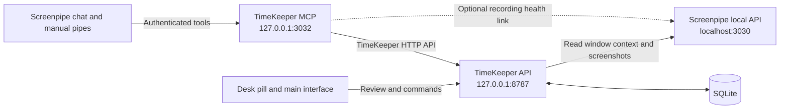

# TimeKeeper

TimeKeeper helps lawyers review working time by client and case, correct work periods, validate time, and prepare invoices. It uses [Screenpipe](https://screenpi.pe) recordings to suggest the case associated with the current window.

<p align="center">
  
  <br>
  <em>Illustration with fictional clients and cases. Normal setup starts with an empty workspace.</em>
</p>

Built during an École 42 and Screenpipe hackathon, TimeKeeper uses React, TypeScript, a local Node API, SQLite, and a Tauri desktop host.

## What it does

1. Screenpipe records window context while you work.
2. During an active session, the desk pill suggests a case from the recorded application name and window title.
3. In **My day**, you review assignments, correct durations, and validate time. **Billing** prepares invoice drafts from eligible periods.

Case detection and billing review exist, but automatic duration reconstruction remains incomplete. Closing a period or ending a session does not calculate its worked duration. Time validation, source review, and billing status remain separate actions.

MCP, JEV, and Screenpipe skills are implemented with validation pending. JEV source integration into this checkout is also pending. The [feature backlog and validation tracker](docs/FEATURES.md) records implementation locations, missing features, and acceptance work.

## The desk pill

The desktop pill is a floating bar that shows the current case and opens a panel with period details and review actions.

<p align="center">
  
  &nbsp;&nbsp;
  
</p>

A window must appear in two consecutive focus reads before the pill reacts. TimeKeeper ignores its own windows. A single high-confidence match applies automatically after a 20-second countdown. Other suggestions wait for your answer.

| Action                      | Result                                                                              |
| --------------------------- | ----------------------------------------------------------------------------------- |
| **Confirm**                 | Starts a work period on the proposed case.                                          |
| **Choose a case…**          | Starts a period on another case.                                                    |
| **Not client work**         | Starts a period excluded from billing.                                              |
| **Later**, close, or Escape | Dismisses the notice without creating a period or a question.                       |
| **Undo**                    | Reverts the last pill decision within five seconds, if no later change prevents it. |
| Pause                       | Stops pill detection. Screenpipe recording and the TimeKeeper session continue.     |

An unrecognized document can produce a **Which case?** notice. Dismissing that notice does not save an unresolved period. Existing unresolved periods and their questions remain available for review.

In the desktop app, closing the main window hides it. Tray **Quit** exits the app. Neither action ends the stored session.

## The screens

The images below show illustrative fictional records, not startup data or acceptance results.

| My day                                                                            | Activity                                                                                                           |
| --------------------------------------------------------------------------------- | ------------------------------------------------------------------------------------------------------------------ |
|                                                  |                                                                               |
| Review periods, case assignments, questions, source review, and time corrections. | Inspect period history and audit records. Hover a period to request a nearby Screenpipe screenshot when available. |
| **Cases**                                                                         | **Billing**                                                                                                        |
|                                                    |                                                                                 |
| Manage cases, references, recognition markers, rates, flat fees, and budgets.     | Prepare invoices, expenses, disbursements, and CSV exports. Issued invoices retain their saved amounts.            |

**Settings** manages clients, workspace options, and the desk pill. Capture exclusions and retention controls are not yet active.

## How to run it

Use Node `24.22.0`, as specified in [`.nvmrc`](.nvmrc), and npm. Install [Screenpipe](docs/SETUP.md#connect-screenpipe) and keep its local service running for recording and evidence reads. Its visible application window does not need to stay open.

From this checkout's repository root, with nvm installed:

```sh
nvm install
nvm use
node install.mjs
npm run dev
```

Open [TimeKeeper](http://127.0.0.1:5173). The API runs at `http://127.0.0.1:8787`. Browser development does not require Rust or the desktop build tools.

Setup creates a missing root `.env` from [`.env.example`](.env.example) and installs dependencies. It preserves business data, existing nonblank credentials, and other configuration. Repeating full setup replaces `node_modules`.

### Connect the Screenpipe API key

Setup tries to retrieve a missing key through the installed Screenpipe CLI and saves it to `.env` without printing it. It does not start recording. To retry only key setup, run:

```sh
npm run setup:auth
```

If automatic discovery cannot find the CLI, set `SCREENPIPE_CLI` to its absolute executable path and retry. You can also run `screenpipe auth token` with the installed CLI, then save its token as `SCREENPIPE_API_KEY` in the root `.env`. Keep the key private. The [setup guide](docs/SETUP.md#connect-screenpipe) covers token files and connection recovery.

Run `npm run setup:check` to check prerequisites, credential configuration, and public health. That check does not establish protected API access or recent capture. For interface development before connecting Screenpipe, use `node install.mjs --skip-screenpipe`.

### Try the workflow from source

1. Start TimeKeeper with `npm run dev`.
2. Add a client in **Settings**, then add cases in **Cases**. Give each case a distinct reference. Add recognition markers where needed.
3. In a second terminal at the repository root, start a session with the explicit TimeKeeper command:

   ```sh
   node --env-file-if-exists=.env --import tsx src/mcp/start-session.ts
   ```

4. Open the [browser pill](http://127.0.0.1:5173/pill.html). Open a document whose window title contains one of your case references.
5. Wait for Screenpipe to make the window context searchable. Confirm the proposed case, or choose another case. A strong match can apply after the countdown.
6. Switch to a document for another case. Use **Later** to dismiss its notice, or confirm it to change the active period.
7. End the session with the explicit command:

   ```sh
   node --env-file-if-exists=.env --import tsx src/mcp/end-session.ts
   ```

8. Open **My day** to review the periods and correct their durations before time validation. Ending the session does not derive durations.
9. Open **Activity** to inspect period history and available screenshot previews. Review eligible time in **Billing**.

The browser pill is a preview. Its simulator does not create clients, cases, or sessions. For repeatable checks with fictional records, use the [isolated browser acceptance procedure](tests/acceptance/README.md).

### Run or build the Windows desktop app

Follow [desktop setup](docs/SETUP.md#prepare-desktop-development) for Rust, Windows build tools, and sidecar prerequisites. Run `npm run dev:server` in one terminal, then `npm run desktop:dev` in another. Tauri starts the interface.

Build the installer on Windows with `npm run desktop:build`, or use the [Windows installer workflow](.github/workflows/desktop-windows.yml) for the revision being tested. Native release acceptance remains pending. The current sidecar build does not support macOS.

The installed app uses its application-data directory for SQLite and does not load the source checkout's `.env`. Configure its environment separately, or save the Screenpipe token in its application-data `screenpipe-api-key` file. The package includes the local API, but Screenpipe and the MCP process run separately. Run the installed app and the source API one at a time because both use port `8787` by default.

## How Screenpipe is used

Screenpipe owns recording. TimeKeeper reads its local HTTP API for recent window context and activity screenshots. It does not open Screenpipe's database, create another recorder, or write Screenpipe memories. Evidence searches use `include_cloud=false`.



The pill polls recent window context while a session is active and detection is enabled. The backend returns normalized application, title, URL, and timestamp fields. The current matcher uses the application name and window title.

Activity requests frame metadata for a period and proxies a nearby screenshot through the API. The Screenpipe key stays in the backend. These previews do not import stored evidence into periods or calculate duration. Screenshots prove observations, not continuous work.

TimeKeeper stores its workspace locally. Screenpipe chat and future hosted JEV inference have separate data flows and provider settings. Hosted JEV inference is not local processing. See [Screenpipe behavior and limits](docs/SCREENPIPE_INTEGRATION.md).

### Connect Screenpipe chat

The MCP server exposes eight tools through the TimeKeeper API:

| Tool                     | Purpose                                                                                          |
| ------------------------ | ------------------------------------------------------------------------------------------------ |
| `timekeeper_status`      | Reports API availability and the active session and period.                                      |
| `start_session`          | Starts a session, or returns the active session.                                                 |
| `end_session`            | Ends the active session.                                                                         |
| `list_cases`             | Lists active cases and their clients.                                                            |
| `list_work_periods`      | Lists a session's periods with case, boundaries, assignment revision, and time-validation state. |
| `list_questions`         | Lists unresolved-case questions.                                                                 |
| `answer_question`        | Answers a question for its target period and assignment revision.                                |
| `screenpipe_link_status` | Reports the optional recording-session link's state.                                             |

Follow [integration setup](integrations/screenpipe/README.md#set-up) for the separate `TIMEKEEPER_MCP_TOKEN`, Screenpipe connection, chat skill, and manual Start/End pipes. These integrations still need installed-workflow validation.

`npm run mcp:serve` starts the HTTP MCP server **with the recording-session link enabled**. It can start a session immediately when Screenpipe reports recording. It can end the session after Screenpipe stops or becomes unreachable for the configured grace period. The link uses observed health times, not exact recorder event boundaries.

To expose tools without that automatic link, use the manual-only command after configuring the MCP token:

```sh
node --env-file-if-exists=.env --import tsx src/mcp/server.ts --http 3032
```

## Resolve common problems

| Symptom                                            | Check                                                                                                                       |
| -------------------------------------------------- | --------------------------------------------------------------------------------------------------------------------------- |
| The pill shows no active session.                  | Start a session through the explicit command or the configured Screenpipe integration.                                      |
| Screenpipe is unavailable or protected reads fail. | Check its service, recording permissions, URL, and API key. Follow [connection recovery](docs/SETUP.md#connect-screenpipe). |
| No case is proposed.                               | Check the active session, pause state, case references, window title, and whether Screenpipe has indexed recent context.    |
| A closed period has no duration.                   | Enter or correct its duration in My day. Automatic reconstruction is incomplete.                                            |
| Activity has no screenshot.                        | Check capture availability for that period. A missing preview does not create evidence or duration.                         |
| The API cannot bind port `8787`.                   | Check for another source API or installed TimeKeeper instance.                                                              |

Configuration variables and recovery details belong in [setup](docs/SETUP.md#configure-local-settings).

## Development

Run the project checks after dependency installation:

```sh
npm run format:check
npm run lint
npm test
npm run typecheck
npm run build
```

`npm run contract:gen` regenerates shared contracts. Browser, native, and real Screenpipe acceptance run separately from unit tests. See the [browser smoke workflow](tests/acceptance/README.md) and the [integration validation tracker](docs/FEATURES.md).

`npm run db:reset` deletes the selected database. Optional [comparison samples](docs/SETUP.md#comparison-sample-tooling) require an explicitly selected database and never load during normal startup.

## Documentation

| Topic                                                     | Guide                                                    |
| --------------------------------------------------------- | -------------------------------------------------------- |
| Installation, configuration, desktop builds, and recovery | [Setup](docs/SETUP.md)                                   |
| Business rules, acceptance examples, and open decisions   | [Requirements](docs/REQUIREMENTS.md)                     |
| Features to complete and integration validation           | [Feature backlog](docs/FEATURES.md)                      |
| Modules, lifecycle, and implementation limits             | [Architecture](docs/ARCHITECTURE.md)                     |
| HTTP and MCP integration contracts                        | [API](docs/API.md)                                       |
| Screenpipe reads, session link, and provider research     | [Screenpipe integration](docs/SCREENPIPE_INTEGRATION.md) |
| MCP connection, chat skill, and manual pipes              | [Integration setup](integrations/screenpipe/README.md)   |
| Schema, migrations, and fixtures                          | [Database](docs/DATABASE.md)                             |
| Visual standards and screen behavior                      | [Design](design.md)                                      |
| Contributor rules                                         | [AGENTS.md](AGENTS.md)                                   |
| Preserved French schema                                   | [Original database](docs/reference/ORIGINAL_DATABASE.md) |
