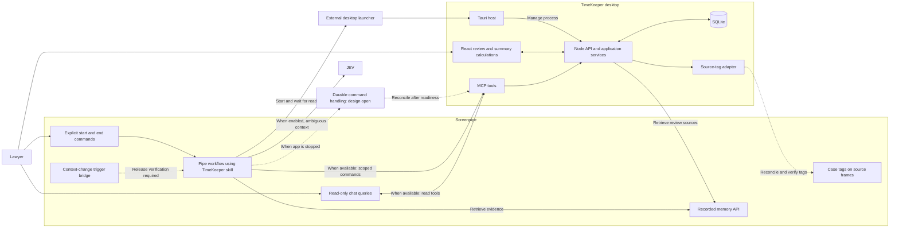

# TimeKeeper architecture

## Scope and ownership

This document describes the intended implementation of the [requirements](REQUIREMENTS.md). The application is not implemented. Screenpipe integration findings are source research, not runtime verification.

TimeKeeper uses a Tauri desktop host, React, a local Node.js backend, and SQLite. Tauri owns the backend process lifecycle. The packaged application must include the backend runtime or executable. Exact versions and packaging remain to be selected. See Tauri's [sidecar documentation](https://v2.tauri.app/develop/sidecar/) for the external binary mechanism.

Screenpipe owns workflow execution after triggers. Node validates commands and writes application records. React calculates summaries. The intended source tree and dependency rules are in [AGENTS.md](../AGENTS.md).

## Components and flows



The diagram describes required behavior. It does not claim that these integrations work. The pending-command box represents an unresolved contract, not an implemented queue or a verified Screenpipe capability.

| Component | Responsibility |
| --- | --- |
| Screenpipe recorder and API | Capture activity and expose recorded observations and sources. |
| Screenpipe bridge and workflow | Receive verified signals, retrieve evidence, resolve cases, ask about unknown folders, and submit commands. |
| JEV, optional | Help the Screenpipe workflow judge ambiguous context using known candidates. Never create case IDs or validate time. |
| External launcher | Start or activate the installed Tauri app before its API is reachable. |
| MCP server | Translate scoped workflow commands and read-only queries into API requests. Never access SQLite directly. |
| Node application services | Validate commands, preserve revisions and corrections, and persist records through one write path. |
| Source-tag adapter | Deliver committed assignments, retry failures, and verify the resulting tags. |
| React interface | Review evidence, edit periods, validate records, manage billing status, and calculate summaries. |
| SQLite | Store detail records and technical recovery state. No stored aggregate totals. |

## Session lifecycle and application lifecycle

The [session requirements](REQUIREMENTS.md#sessions-and-desktop-lifecycle) define start, end, replay, and command-order behavior. Tauri manages process startup and shutdown independently of persisted session state.

Commands carry stable IDs, a session ID, effective timestamps, and revision checks. The start response supplies the authoritative session ID for subsequent commands. Receipt time must not replace the effective timestamp. The transport must preserve causal prerequisite information for recovery. Application services enforce these contracts through the [technical persistence records](DATABASE.md#technical-persistence).

While TimeKeeper is closed, its API, MCP server, and SQLite writer are unavailable. Session commands, case changes, and lawyer answers must survive this interval. Recordings alone do not guarantee that those decisions can be reconstructed.

Two implementation options remain open: durable command storage outside the desktop process, or relaunching TimeKeeper when a command requires persistence. A SQLite queue inside the stopped app does not solve command reception. Selecting and testing this contract is required before claiming that end commands or assignments work while the app is closed.

## Case assignment and evidence flow

The [case and work-period requirements](REQUIREMENTS.md#cases-and-work-periods) define assignment behavior. Folder identification and effective-boundary rules remain open. The matching ideas in the [integration research](SCREENPIPE_INTEGRATION.md#resolving-the-correct-case) are proposals.

The intended assignment flow is:

1. A verified Screenpipe signal wakes the Screenpipe workflow.
2. The workflow retrieves persisted observations through the Screenpipe API.
3. The workflow retrieves candidate cases through MCP and the application API.
4. The workflow resolves an existing case, uses JEV when enabled and needed, or asks the lawyer.
5. The workflow submits the assignment and its evidence through a scoped MCP command.
6. Node checks the session boundary, case identity, expected revision, and manual corrections.
7. One transaction saves the period assignment and pending source-tag delivery.
8. The adapter reconciles the tags and records successful verification or retryable failure.

Workflow question and answer payloads carry the identifiers and assignment guard defined in the requirements. The [pending-question records](DATABASE.md#technical-persistence) persist that guard across deliveries. Application services own answer validation and reconstruction-conflict persistence.

Source retrieval progress advances only after the corresponding records are committed. Recovery rereads overlapping windows to handle delayed indexing and deduplicates source identities.

The trigger transport and producer remain subject to the [event verification gate](SCREENPIPE_EVENTS.md). A signal can arrive before its evidence is searchable. An empty initial query does not prove that no activity occurred.

## Evidence, durations, and summaries

The [evidence and rounding requirements](REQUIREMENTS.md#evidence-duration-and-rounding) define duration semantics and incomplete totals. The [state transitions](REQUIREMENTS.md#state-transitions) define validation behavior. Storage preserves the [precise detected duration and override](DATABASE.md#duration-rounding-and-consolidation) separately.

React calculates summaries from the complete detail set supplied by the API. With the proposed millisecond representation, the calculation is:

```text
combined_minutes = ceil(sum(effective_duration_ms) / 60000)
```

The backend supplies detail records and retrieval-completeness information. It does not calculate aggregate summaries.

## Screenpipe assignment synchronization

Use TimeKeeper-owned tags on affected Screenpipe source frames. The selected format is:

```text
timekeeper:<workspace-id>:client:<client-id>
timekeeper:<workspace-id>:case:<case-id>
```

The workspace ID prevents collisions between TimeKeeper databases. SQLite owns case identity and assignment revisions. The adapter derives the client ID from the assigned case.

Screenpipe documents [adding tags](https://docs.screenpipe.com/api-reference/tags/add-tags) and [removing tags](https://docs.screenpipe.com/api-reference/tags/remove-tags). Verify the content type and behavior in the target release. These APIs provide metadata, not a native legal-case entity.

Evidence record identity and provider tag-target identity are separate. Several returned records may refer to one underlying frame. The adapter maps taggable records to a canonical key containing the Screenpipe instance, provider target type, and provider target ID. The actual mapping requires release verification; do not infer it from matching timestamps or text.

All evidence aliases for a canonical target must agree on its owning period and desired case. Conflicting aliases block synchronization and require resolution. Deduplicate delivery and serialize tag updates and ownership changes by the canonical target, not by a local evidence row.

Reconcile only TimeKeeper-owned tags. Preserve unrelated tags. Remove obsolete associations and add the desired ones on explicitly affected targets. Check the target's current period, desired case, and latest revision before writing. An ownership move supersedes former pending deliveries. Verify the resulting tags before marking delivery complete. Failed or deleted targets remain visibly unsynchronized.

Synchronization retries must not undo a newer manual correction or trigger a detection loop. A chat response alone is not proof that Screenpipe stored the assignment. Native tag presentation remains untested.

## MCP and JEV boundaries

Chat queries follow `Screenpipe chat -> MCP -> application API -> SQLite`. Workflow writes use separately scoped commands. Corrections and validations use the desktop interface. Exact tool schemas, transport compatibility, and local access controls remain to be implemented.

JEV is an optional Screenpipe integration. TimeKeeper installation and startup must not require JEV configuration, a TypeSafe API key, or the TypeSafe SDK. When enabled, the Screenpipe workflow owns JEV calls and candidate selection. Backend services validate the proposed case and evidence without running a second inference workflow. This keeps model orchestration outside the Node application modules.

The [integration research](SCREENPIPE_INTEGRATION.md) records custom HTTP MCP support, skill import format, and JEV API evidence. An imported skill supplies instructions. It does not register the MCP connection or make an event listener. Hosted JEV inference also requires a decision about permitted source data.

When TimeKeeper is stopped, chat cannot read its API and must report that application details are unavailable. No hidden backend is assumed. Chat-calculated summaries are deferred beyond the MVP; read-only detail queries remain in scope when the services are available.

## Storage and implementation gates

The agreed logical model is defined in [DATABASE.md](DATABASE.md): clients, cases, sessions, work periods, sources, settings, and technical recovery records. The supplied task/subtask model remains a [historical reference](reference/ORIGINAL_DATABASE.md).

Resolve the [remaining decisions](DESIGN_REVIEW.md) before dependent implementation. Run the [requirements acceptance examples](REQUIREMENTS.md#acceptance-examples) on both macOS and Windows. Static documents do not establish provider or platform behavior.
