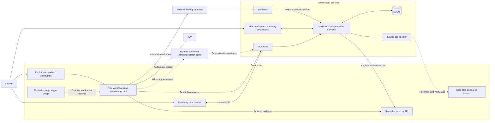

# TimeKeeper architecture

## Scope and ownership

TimeKeeper implements React, a local Hono API, application services, and SQLite persistence for the [requirements](REQUIREMENTS.md). Tauri hosts the desktop windows. In Windows release builds it launches the Node API sidecar with readiness checks, diagnostics, and parent-process cleanup. Development runs the API separately; macOS packaging and native acceptance remain open. Node uses [`.nvmrc`](../.nvmrc). Package and Cargo lockfiles record dependency versions.

Screenpipe owns recording and triggered workflows. Node validates commands and writes records. React calculates summaries. The [setup guide](SETUP.md) owns environment preparation. Its public-health check does not wire integrations. The Screenpipe release and native release acceptance remain open.

## Components and flows

The diagram includes planned connections. MCP, the JEV watcher, provider reads, and inbox consumption exist in source. Trigger transport, tag delivery, installed workflow packaging, and stopped-app command production still require implementation or provider acceptance. See [implemented modules](#implemented-modules) for the current call path and [AGENTS.md](../AGENTS.md) for dependency rules.



| Component                      | Responsibility                                                                                     |
| ------------------------------ | -------------------------------------------------------------------------------------------------- |
| Screenpipe recorder and API    | Capture activity and expose observations and sources.                                              |
| Screenpipe bridge and workflow | Receive signals, retrieve evidence, resolve cases, ask about unknown folders, and submit commands. |
| JEV                            | Judge ambiguous context using known candidates. Never create case IDs or validate time.            |
| External launcher              | Start or activate Tauri before waiting for API readiness.                                          |
| MCP server                     | Translate scoped commands and read queries into API requests. Never access SQLite directly.        |
| Node application services      | Validate commands and preserve revisions and corrections through one write path.                   |
| Source-tag adapter             | Deliver committed assignments and verify tags.                                                     |
| React interface                | Review, correct, validate, manage billing status, and calculate summaries.                         |
| SQLite                         | Store details, recovery state, and frozen issued invoices.                                         |

## Implemented modules

The current request path is `React -> typed API client -> Hono -> application services -> repository ports -> SQLite`. `src/contracts/openapi.yaml` owns HTTP payloads. `npm run contract:gen` generates domain-state values, API types, and request schemas. Hono uses Ajv 2020 and `ajv-formats`, limits request size, and returns sanitized errors. `application/errors.ts` owns stable error codes. ESLint checks dependency direction. `bootstrap.ts` constructs one service graph and clock on the same transaction connection. HTTP routers receive those services. `createApp(db)` remains a compatibility factory; runtime uses `createHttpApp(services)`.

| Owner                        | Responsibility                                                                                                   |
| ---------------------------- | ---------------------------------------------------------------------------------------------------------------- |
| `CatalogService`             | Scoped catalogue reads and writes.                                                                               |
| `CatalogProvisioningService` | Basic compatibility provisioning and rate queries.                                                               |
| `PeriodLifecycleService`     | Period boundaries, guarded transitions, reconstruction safeguards, manual periods, and switch undo.              |
| `WorkspaceService`           | Consistent workspace snapshots and calendar query boundaries.                                                    |
| `SessionCommandService`      | Command replay, prerequisites, and session boundaries.                                                           |
| `PeriodAssignmentService`    | Assignments and revision-bound questions.                                                                        |
| `PeriodReviewService`        | Details, duration, time validation, and billing transitions.                                                     |
| `RetrievalService`           | Bounded evidence reads, checkpoints, final overlap replay, and complete-range gap closure.                       |
| `EvidenceService`            | Evidence import, source review, and reconstruction notices.                                                      |
| `HistoryService`             | Explicit history jobs, workflow claims, draft review, and guarded acceptance.                                    |
| Invoice service              | Check ownership, validation, billing, revisions, pricing, expenses, tax, and amounts before freezing an invoice. |
| `SourceExportService`        | Source packs and issued invoice CSV reads.                                                                       |
| `core-row-mappers.ts`        | Decode rows and reject invalid stored states. Repositories own queries and writes on the transaction connection. |

`service.ts` is a compatibility facade over focused services with narrow repository ports. Lifecycle, assignment, and review services own compensating undo writes. `PillService` coordinates decisions and stores short-lived undo tokens; its responses include the server deadline `undoExpiresAt`. Scoped catalogue reads do not decode unrelated marker or client-rule collections. Source exports read the requested case and optional audit history. Deprecated compatibility routes translate explicit fields into the same commands and transactions. The legacy manual-entry route returns HTTP 501 because its payload lacks session and time boundaries. The canonical route accepts explicit boundaries, but its UI remains disabled pending product rules. Pause routes store annotations without controlling recording.

### Frontend ownership

Feature roots contain screen entries and screen-wide styles. Named folders under `components/` contain child components and their styles. Hooks use `hooks/`; helpers use `lib/`. Imports name implementation files directly. `shared/styles.css` preserves cascade order. Shared styles own controls, shell, and tokens; feature styles own feature selectors. Feature helpers can prepare commands and are not necessarily pure.

`App.tsx` owns navigation, resource selection, review lifetime, and source-return context. `Cases.tsx` coordinates commands and child views. `MyDay.tsx` presents the day; `useDayResources` owns scoped reads and `useDayCommands` owns assignment and validation. `PeriodActivity` switches between the complete saved-source list and `WorkPeriodActivity` review. `ImportedSources` reads the unscoped workspace snapshot, including references with no period, and owns source filters and pagination without writes or provider calls. Settings sections own forms and errors. Cases and Settings share `ClientEditorDialog` and its dirty-dismissal and pending-submit guards. `CaseSearch` owns search requests, stale responses, and keyboard selection. `dayView` owns grouping, filters, gaps, sorting, and CSV order.

Shared fetch hooks use `openapi-fetch` and own cancellation, stale-response guards, and refresh state. Visible resources poll every five seconds and refresh on focus or resume. Polls skip in-flight requests; explicit refresh can replace them. A refresh failure does not undo a committed mutation. Batch validation refreshes committed successes after a later failure. Read errors remain distinct from write errors.

`/api/workspace` reads catalogue and core records in one transaction. SQL applies calendar and ownership filters without per-period queries or silent truncation. Catalogue and active-session reads remain independent of audit, billing, and reconstruction. My day loads selected-day and month resources. Other screens request full snapshots when needed. Auxiliary failures expose unavailable data rather than empty collections.

`usePeriodReview` owns reviewed snapshots, conflicts, and writes. `usePeriodDraft` owns corrections. Shared edit helpers parse duration and create revision-bearing commands. My day and Billing share the editor. Failed writes retain drafts; validation and billing wait for save or discard. Source navigation retains the draft and originating resource. Question state resets by period identity. Native dialogs contain focus and restore it after closure. `PageHeader` and `ActionNotice` own shared headings and transient feedback. Forms and exports keep local errors.

React calculation modules own summaries, comparison eligibility, budgets, and invoice drafts. Fee results include the amount, known subtotal, currency, and completeness. Saved billed pricing takes precedence. Missing pricing or incompatible currencies prevents a complete total. Frozen invoice lines use `calculations/invoice-fees.ts`; shared invoice arithmetic validates drafts before issue. Issued dialogs and CSV use saved snapshots. `src/shared/csv.ts` quotes cells and handles formula-leading text. [Database formats](DATABASE.md#data-formats-in-the-application) define source packs and receipts.

`calculations/case-budget.ts` owns the 85% warning threshold, precise comparison, and warning text for Cases and Billing. Shared money and rate formatters preserve cents across views. Catalogue presentation hides blank text only; brackets and `N/A` can be legitimate user values.

The native page and Settings preview render the same production `Pill` and `WorkPill` path with shared design tokens. `usePillController` coordinates the screen, `nativePillView` derives display state, `usePillCommands` owns API writes and authoritative undo deadlines, and `usePillPosition` owns native geometry and browser positioning. Review selection includes past-day periods across sessions. Unknown work duration stays unknown in fee calculations. Rust emits `timekeeper:open-my-day` to the main window. Its WebView listener changes the view and unregisters on unmount. That native path remains unverified. [Design](../design.md) owns interface guidance.

### Remaining structural debt

| Module                                        | Constraint for future changes                                                                                              |
| --------------------------------------------- | -------------------------------------------------------------------------------------------------------------------------- |
| `PreInvoices.tsx`, `PeriodActivity.tsx`       | Substantial coordination and rendering remain. Extractions must preserve selection, source navigation, and pending writes. |
| Aggregate repository and `ScreenProps`        | Contracts remain broad. Focused services use `Pick<Repository, ...>`; extracted views use explicit props.                  |
| `compatibility.ts`                            | Translate deprecated contracts into canonical commands. Business rules remain in application services.                     |
| `core-repository.ts`, `catalog-repository.ts` | Preserve the transaction connection when moving queries.                                                                   |
| `shared/theme.css`, `legacy.css`              | Imported layout rules remain in lower cascade layers. Changes require checking affected selectors.                         |

Generated contracts, declarative mappings, and ordered migrations have distinct maintenance needs. File size alone does not justify splitting them. Historical migrations remain frozen. Domain state modules own named values and re-export the portable rate vocabulary from `src/shared/rate-policy.ts`. That module owns case/client/global precedence, explicit zero rates, and rate origins for both backend and frontend. Generated frontend members preserve transport values such as `RateOrigin.Case = "matter"`. [Database state ownership](DATABASE.md#why-fixed-states-are-text) defines the change requirements.

The watcher uses a separate operational `.watch.pid.sqlite` file to serialize ownership. Short SQLite transactions release their file locks if a process exits, and later starts replace dead owners. PID diagnostics remain separate. This coordinator never opens the TimeKeeper business database or Screenpipe storage; business reads and writes still use the HTTP API.

## Session lifecycle and application lifecycle

Session state is independent of process state. The Rust host hides the main window on close. Tray **Quit** exits Tauri and stops its owned release API sidecar. Development API processes run separately. The backend parent watchdog handles an orphaned owned sidecar. Process exit closes SQLite without ending the stored session. Native lifecycle acceptance remains separate from source checks.

| Action                             | Required effect                                                                                                          |
| ---------------------------------- | ------------------------------------------------------------------------------------------------------------------------ |
| Start command in Screenpipe        | Launch or activate TimeKeeper, wait for readiness, and create a session or return the existing active session unchanged. |
| Close the main window              | Hide the shell while preserving the API, open session, and period.                                                       |
| Quit from the tray                 | Exit Tauri and its owned release API while preserving the open session and period.                                       |
| Reopen TimeKeeper                  | Resume and reconcile history without duplicate periods or lost corrections.                                              |
| End command in Screenpipe          | End the target session and period. Repeated ends retain the original boundary. Explicit End keeps Screenpipe recording.  |
| Receive evidence after session end | Reconcile observations within the session boundaries without reopening or extending it.                                  |

Commands need stable IDs, the authoritative session ID returned by start, effective timestamps, and revision guards. Receipt time cannot replace effective time. Retries have no additional effect.

Recovery applies known prerequisites before dependents. An end waiting for its start stays pending. An end without a valid target cannot create a session. A new start dependent on a pending end waits instead of collapsing into the old session. Unresolved order remains pending or conflicting. A later end timestamp cannot revise an applied boundary.

When the app is stopped, its API, MCP, and SQLite writer cannot receive session commands, assignments, or lawyer answers. Durable storage outside the process or controlled relaunch remains to be chosen and tested. A local queue and recordings alone cannot preserve those decisions.

## Case assignment and evidence flow

Folder detection and effective boundaries remain undefined. Ordinary application switches preserve the active case. Unknown-folder questions use the [requirements guards](REQUIREMENTS.md#state-transitions), including a target period and expected assignment revision.

1. A verified Screenpipe signal wakes its workflow.
2. The workflow retrieves persisted observations through Screenpipe's API and candidate cases through MCP.
3. The workflow selects an existing case, uses JEV when needed, or asks the lawyer.
4. A scoped MCP command submits the assignment and evidence.
5. Node checks the session boundary, case identity, expected revision, and manual corrections.
6. One transaction saves the assignment and pending tag-delivery intent.
7. The adapter reconciles tags and records verification or retryable failure.

The JEV watcher and scoped MCP transition path implement the observation-to-command portion of this flow. Automatic tag-delivery intent and provider tag reconciliation remain planned. Delayed answers resolve only their original period. Closure and evidence imports preserve the assignment guard. A newer assignment, superseded question, or replaced period causes a conflict. Answers do not teach reusable folder rules.

Recovery rereads overlapping windows, deduplicates source identities, and advances retrieval progress only with committed records. A signal may precede searchable evidence. An empty query does not prove inactivity. [Screenpipe research](SCREENPIPE_INTEGRATION.md) covers transport and producer verification.

Late evidence cannot automatically split corrected or validated periods. Preserve the record, sources, and override. Store a reconstruction proposal separately without adding counted time. The resolution action remains undefined.

## Evidence, durations, and summaries

Screenshots establish observations, not continuous duration. Interval reconstruction and missing-recording behavior remain open. Detected boundaries and duration overrides stay separate. Changing an override does not rewrite observations.

Time validation covers the effective case and duration. Changes to either invalidate it. Identical replay and detected changes masked by an unchanged override preserve it. Source validation, time validation, and billing status remain distinct. [Requirements](REQUIREMENTS.md#state-transitions) owns the transition rules.

React uses an override when present and otherwise a supported detected duration. Each selected total uses the complete, precise input set:

```text
combined_minutes = ceil(sum(effective_duration_ms) / 60000)
```

Two 20-second periods total one minute. Zero remains zero. Rounded subtotals cannot be summed to obtain the overall total. Missing pages, unknown durations, and unavailable recordings must expose incomplete coverage.

## Screenpipe assignment synchronization

The planned adapter uses TimeKeeper-owned tags:

```text
timekeeper:<workspace-id>:client:<client-id>
timekeeper:<workspace-id>:case:<case-id>
```

SQLite owns assignment revisions and derives the client from the case. The workspace ID prevents collisions between databases. Screenpipe documents [adding](https://docs.screenpipe.com/api-reference/tags/add-tags) and [removing tags](https://docs.screenpipe.com/api-reference/tags/remove-tags). Target-release behavior and native display remain unverified.

Evidence identity differs from tag-target identity. Multiple records may refer to one frame. The canonical target key contains the Screenpipe instance, target type, and target ID. Do not infer that mapping from timestamps or text.

Aliases must agree on ownership and desired case. Conflicting aliases block synchronization. Deduplicate and serialize writes and ownership changes by canonical target. Check current ownership, desired tags, and revision before writing. A move supersedes former delivery intents. Preserve unrelated tags and verify the resulting tags before acknowledging the same revision. Failed or deleted targets remain unsynchronized. Retries cannot undo corrections or trigger detection loops. Chat text is not a storage acknowledgement.

## MCP and JEV boundaries

Chat reads follow `Screenpipe chat -> MCP -> application API -> SQLite`. Workflow writes use separate scoped commands. Desktop controls own corrections and validation. MCP tool schemas and Node stdio/HTTP transport exist. Current local access relies on loopback and origin checks; selected Screenpipe release transport acceptance remains required.

Screenpipe workflows own JEV calls and candidate selection. Node validates their chosen existing case without repeating inference. [Integration research](SCREENPIPE_INTEGRATION.md) records HTTP MCP, skill import, and JEV evidence. Skills are instructions. They neither register MCP connections nor listen for events. Hosted inference requires a decision about permitted source data.

Chat reports application details unavailable when the API is stopped. Read-only detail queries remain in scope when services are available. Chat-calculated summaries are deferred.

## Storage and implementation gates

[DATABASE.md](DATABASE.md) defines the logical model and physical constraints. Drizzle mappings in `src/backend/adapters/sqlite/tables.ts` use the existing `node:sqlite` connection. One cached Drizzle client per connection keeps query-builder operations and retained parameterized SQL inside the same savepoints. Domain and application ports do not depend on Drizzle.

`src/backend/adapters/sqlite/migrate.ts` alone owns schema upgrades, constraints, indexes, and triggers. Drizzle mappings do not generate migrations. Do not run schema push against existing workspaces.

`tag_targets` and `assignment_deliveries` exist, but assignments do not yet create delivery intent. The Screenpipe HTTP reader and catch-up worker run only when configured. Source-tag delivery remains unimplemented. Atomic delivery persistence, provider reconciliation, and verification remain required.

[Requirements](REQUIREMENTS.md) tracks dependent decisions and acceptance examples. Native acceptance must run separately on macOS and Windows.

## Current catalogue, activity, and calendar boundaries

Current screens use canonical catalogue and period APIs. `CatalogService` owns catalogue operations; `SourceExportService` owns source packs and invoice CSV reads. Deprecated compatibility routes translate permitted fields into the same use cases. They retain numeric aliases for older callers, but current screens do not use those aliases.

Period edits, assignment, validation, and billing require their relevant reviewed revisions. Conflicts remain visible. The interface does not silently reload and retry. React owns summaries and invoice drafts. Shared `src/shared/invoice-math.ts` arithmetic lets the invoice service verify proposed amounts against periods, expenses, rates, and tax before freezing them.

The period editor separates corrections, time validation, evidence review, and billing. Screenpipe owns open-period assignment. Issued invoice membership locks edits. A read-only endpoint exposes reconstruction proposals without implying an apply or reject action.

`src/shared/dates.ts` owns calendar conversion and arithmetic. The [calendar policy](DATABASE.md#calendar-dates-and-timestamps) specifies date-only values, instants, explicit timezone, and start-day grouping. Whole-period display does not resolve clipping or midnight-splitting rules. Precise durations and historical invoice snapshots remain authoritative.

## Compatibility recognition

Imported mockup recognition is deterministic. Canonical assignments and guarded answers neither run it nor learn cues. It is not the agreed folder-identification rule. Normal startup has no capture blocks, and recognition makes no Screenpipe, JEV, or model calls.

`recognize(signals, catalog)` in `src/backend/domain/recognition.ts` is pure. It accepts app, window title, optional browser URL, OCR, transcripts, speakers, and previous-block context, plus clients, matters, and markers. The SQLite compatibility adapter supplies neither browser URLs nor previous-block continuity.

The full matter reference and its `YYYY-NNN` prefix count as one implicit cue. Client name is another. Default weights are `reference` and `case_number` 0.95, `opposing_party` and `file` 0.60, `client_name` 0.30, `email` 0.45, `domain` 0.35, and `keyword` 0.15. Explicit marker weights can range from 0 to 1. Domain markers match only browser URLs. Matching ignores case and accents, treats underscores as spaces, and requires whole-word boundaries. Each distinct cue contributes once per matter. Results retain its type, value, signal location, and weight.

```text
score = min(0.99, 1 - product(1 - cue_weight) + continuity)
```

Continuity adds 0.1 when the previous block has the same matter, app, and title. `decision(candidates, threshold)` assigns at `max(threshold, 0.5)`. Scores from 0.5 up to that threshold propose a matter with `to_check`. Lower scores and tied shared-client-only matches propose none. The compatibility caller uses `confidence_threshold`, 0.8 in the historical fixture.

Only explicit fixture setup refreshes confidence, marker `hits`, and `last_seen_at`. A hit counts one explicit cue per block and candidate, including proposals. Historical assignments stay unchanged, even below the threshold. `GET /api/blocks/{id}/recognition` neither changes counts nor learns cues. Reusable learning remains deferred in [requirements](REQUIREMENTS.md).

## Start and end buttons and tab detection

[API D7](API.md#d7-the-lawyer-starts-and-ends-a-session-with-a-button-in-screenpipe) owns the button and recording-link contracts. The link runs only when explicitly started. Its persisted observations and stable retry identities preserve known boundaries. Login startup and stopped-app command production remain open.

JEV is the only active automatic detector. The native watcher no longer starts, and the pill no longer runs local recognition or countdown writes. The original source is recoverable from [the native recognition backup](../backups/native-recognition-d575502/README.md). The pill polls accepted periods and questions and preserves manual answers, validation, undo, and navigation. A local pause control was removed because it could not pause the separate JEV workflow.

The watcher captures period identity and assignment revision before inference. Its retry controller separates new inference from uncertain command delivery. Delivery retries preserve the original payload; newer focus invalidates pending work. Application and window title identify the observed context together. The application checks the captured guards atomically, preserves identical replay, rejects stale answers, and records protected reconstructions without splitting corrected or validated records. [API D10](API.md#d10-jev-confirmed-tab-changes-become-work-period-transitions) owns the payload and retry outcomes.

The launcher and watcher share `jev-check/environment.ts`. Inherited variables override the parsed watcher-local configuration. `tab-detection.ts` validates permitted fields and numeric settings, and `watcher-launch.ts` owns child-process and Windows WMI creation. WMI receives configuration over stdin and sets the child environment explicitly. Startup waits for the ownership record written after dependency handshakes; failed launches stop their process. Native launch acceptance remains separate.

The current JEV request gates case selection on a detected tab, window, or document switch. Changed content within the same tab does not pass that gate. The required same-tab case-change scenario remains an acceptance gap.

Node runs both source and built MCP/JEV entries. Bun is unnecessary. The API sidecar does not package the workflow's configuration or separate Screenpipe MCP dependency. See [setup](SETUP.md#configure-mcp-and-jev).

## History proposal workflow

Newly connected source adds `HistoryService`, its SQLite storage, `history-runner.ts`, history routes, MCP `generate_history_proposals`, and Activity's `HistoryProposals` feature. Explicit generation creates a persisted job. The backend dispatches Screenpipe's `generate-work-periods` pipe; the MCP workflow claims the job and sends permitted evidence to JEV. Drafts remain outside counted periods until explicit lawyer acceptance with a reviewed duration. This does not define automatic duration derivation or resolve protected-period reconstruction conflicts.

Private snapshots and claims stay in job storage, and public projections expose sanitized status. Backend shutdown aborts dispatch work. The Screenpipe installer copies the manual history pipe together with the MCP registration and skill. Installed files do not establish workflow readiness or start services. [API D14](API.md#d14-history-proposals-and-explicit-acceptance) owns the current contract and configuration differences. This source addition still requires runtime and provider acceptance.

## Inbox and evidence recovery

The inbox adapter consumes files already delivered to its folder; the missing external producer remains a limitation. Local consumption precedes readiness. Known prerequisites take priority over timestamp order, and unexpected storage or move errors leave commands retryable.

`RetrievalService`, the SQLite retrieval adapter, and the catch-up worker share existing transaction and evidence services. One backend coordinator owns automatic and manual import runs, their status, and connection tests. Overlapping imports share one run. Authentication failure pauses scheduled retries; successful explicit testing or import can resume them. Changed environment configuration requires a restart. Truncation cannot advance complete coverage. Final overlap scans can find late-indexed references inside that overlap; they do not establish provider completeness or duration. [API D11](API.md#d11-screenpipe-controls-in-settings) owns the Settings diagnostic contract and its runtime-status limits.

Session boundaries are rechecked around asynchronous reads. Closing the backend aborts reads before closing SQLite. The API retains its existing desktop parent watchdog. [API D8](API.md#d8-synchronization-at-startup-through-a-local-inbox-folder) defines timing, limits, and failure outcomes.

The search adapter normalizes bounded literal source text and observed app/window context. The internal evidence use case fills missing fields and permits guarded attachment of previously unlinked sources. Retrieval rechecks saved references against unique session and period bounds before provider reads. It preserves existing ownership and period state. Content-versioned checkpoints trigger one bounded replay of identity-only history. [API D13](API.md#d13-source-content-and-late-attachment) owns this contract; [requirements](REQUIREMENTS.md#screenpipe-interaction) own the attachment and retention rules.

## History proposals

Activity requests a bounded generation job through `HistoryService`. SQLite stores its evidence snapshot and review drafts separately from work periods. The backend runner checks the MCP capability and dispatches the named manual Screenpipe pipe. Screenpipe calls the MCP history command, whose integration helper runs permitted-field JEV judgments and submits the complete draft batch. The backend performs no model inference. Jobs expire when their workflow cannot claim or complete them; dispatch acknowledgement never marks them ready.

Explicit acceptance validates the snapshot and creates an additive, finished period in one transaction. It stores the lawyer's duration override and attaches eligible unlinked sources. It refuses existing-period overlap and preserves the live active period. Drafts remain outside workspace summaries. [API D14](API.md#d14-history-generation-and-proposal-review) owns endpoints, bounds and lifecycle details.
