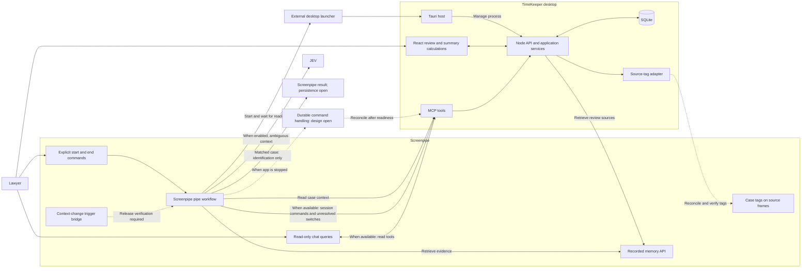

# TimeKeeper architecture

## Scope and ownership

This document describes the intended implementation of the [requirements](REQUIREMENTS.md). The application is not implemented. The repository provides a disabled Screenpipe pipe with instructions for optional JEV requests. It has no separate helper, SDK dependency, or setup script. Provider research and prompt review do not establish end-to-end runtime support.

TimeKeeper uses a Tauri desktop host, React, a local Node.js backend, and SQLite. Tauri owns the backend process lifecycle. The packaged application must include the backend runtime or executable. Exact versions and packaging remain to be selected. See Tauri's [sidecar documentation](https://v2.tauri.app/develop/sidecar/) for the external binary mechanism.

Screenpipe owns workflow execution after triggers. Node validates commands and writes application records. React calculates summaries. The intended source tree and dependency rules are in [AGENTS.md](../AGENTS.md).

## Components and flows



The diagram describes required behavior. It does not claim that these integrations work. The pending-command box represents an unresolved contract, not an implemented queue or a verified Screenpipe capability.

| Component | Responsibility |
| --- | --- |
| Screenpipe recorder and API | Capture activity and expose recorded observations and sources. |
| Screenpipe bridge and workflow | Receive verified signals, retrieve evidence, resolve cases, ask about unknown folders, and submit commands. |
| JEV, optional | Help the Screenpipe workflow judge ambiguous context using known candidates. Never create case IDs or validate time. |
| External launcher | Start or activate the installed Tauri app before its API is reachable. |
| MCP server | Translate scoped workflow commands and read-only queries into API requests. Never access SQLite directly. |
| Node application services | Validate commands, preserve revisions and corrections, and persist records through one write path. |
| Source-tag adapter | Deliver committed assignments, retry failures, and verify the resulting tags. |
| React interface | Review evidence, edit periods, validate records, manage billing status, and calculate summaries. |
| SQLite | Store detail records and technical recovery state. No stored aggregate totals. |

## Session lifecycle and application lifecycle

The [session requirements](REQUIREMENTS.md#sessions-and-desktop-lifecycle) define start, end, replay, and command-order behavior. Tauri manages process startup and shutdown independently of persisted session state.

Commands carry stable IDs, a session ID, effective timestamps, and revision checks. The start response supplies the authoritative session ID for subsequent commands. Receipt time must not replace the effective timestamp. The transport must preserve causal prerequisite information for recovery. Application services enforce these contracts through the [technical persistence records](DATABASE.md#technical-persistence).

While TimeKeeper is closed, its API, MCP server, and SQLite writer are unavailable. Session commands, case changes, and lawyer answers must survive this interval. Recordings alone do not guarantee that those decisions can be reconstructed.

Two implementation options remain open: durable command storage outside the desktop process, or relaunching TimeKeeper when a command requires persistence. A SQLite queue inside the stopped app does not solve command reception. Selecting and testing this contract is required before claiming that end commands or assignments work while the app is closed.

## Case assignment and evidence flow

The [case and work-period requirements](REQUIREMENTS.md#cases-and-work-periods) define assignment behavior. Folder identification and effective-boundary rules remain open. The matching ideas in the [integration research](SCREENPIPE_INTEGRATION.md#resolving-the-correct-case) are proposals.

The selected pipe flow is:

1. A verified Screenpipe signal wakes the Screenpipe workflow.
2. The workflow retrieves persisted observations through the Screenpipe API.
3. The workflow retrieves candidate cases through MCP and the application API.
4. The workflow assesses continuity and, for a supported switch, tries to identify the destination among existing cases.
5. A unique supported match remains in the Screenpipe result, without an MCP write or direct API write. Saving that match and advancing the authoritative active case remain open integration decisions.
6. Only a supported switch with no unique destination after a completed lookup is submitted through a scoped MCP command for application handling. Initial assignment, uncertain evidence, and lookup failures do not use this handoff.
7. Node checks the original target, session boundary, expected revision, and manual corrections before creating an unresolved period and its guarded lawyer question. The command schema and effective-boundary rule still require implementation.
8. The application processes a later lawyer answer through its single assignment write path. A committed assignment and pending source-tag delivery belong in one transaction. The adapter then reconciles and verifies the tags.

Workflow question and answer payloads carry the identifiers and assignment guard defined in the requirements. The [pending-question records](DATABASE.md#technical-persistence) persist that guard across deliveries. Application services own answer validation and reconstruction-conflict persistence.

Source retrieval progress advances only after the corresponding records are committed. Recovery rereads overlapping windows to handle delayed indexing and deduplicates source identities.

The trigger transport and producer remain subject to the [event verification gate](SCREENPIPE_EVENTS.md). A signal can arrive before its evidence is searchable. An empty initial query does not prove that no activity occurred.

## Evidence, durations, and summaries

The [evidence and rounding requirements](REQUIREMENTS.md#evidence-duration-and-rounding) define duration semantics and incomplete totals. The [state transitions](REQUIREMENTS.md#state-transitions) define validation behavior. Storage preserves the [precise detected duration and override](DATABASE.md#duration-rounding-and-consolidation) separately.

React calculates summaries from the complete detail set supplied by the API. With the proposed millisecond representation, the calculation is:

```text
combined_minutes = ceil(sum(effective_duration_ms) / 60000)
```

The backend supplies detail records and retrieval-completeness information. It does not calculate aggregate summaries.

## Screenpipe assignment synchronization

Use TimeKeeper-owned tags on affected Screenpipe source frames. The selected format is:

```text
timekeeper:<workspace-id>:client:<client-id>
timekeeper:<workspace-id>:case:<case-id>
```

The workspace ID prevents collisions between TimeKeeper databases. SQLite owns case identity and assignment revisions. The adapter derives the client ID from the assigned case.

Screenpipe documents [adding tags](https://docs.screenpipe.com/api-reference/tags/add-tags) and [removing tags](https://docs.screenpipe.com/api-reference/tags/remove-tags). Verify the content type and behavior in the target release. These APIs provide metadata, not a native legal-case entity.

Evidence record identity and provider tag-target identity are separate. Several returned records may refer to one underlying frame. The adapter maps taggable records to a canonical key containing the Screenpipe instance, provider target type, and provider target ID. The actual mapping requires release verification; do not infer it from matching timestamps or text.

All evidence aliases for a canonical target must agree on its owning period and desired case. Conflicting aliases block synchronization and require resolution. Deduplicate delivery and serialize tag updates and ownership changes by the canonical target, not by a local evidence row.

Reconcile only TimeKeeper-owned tags. Preserve unrelated tags. Remove obsolete associations and add the desired ones on explicitly affected targets. Check the target's current period, desired case, and latest revision before writing. An ownership move supersedes former pending deliveries. Verify the resulting tags before marking delivery complete. Failed or deleted targets remain visibly unsynchronized.

Synchronization retries must not undo a newer manual correction or trigger a detection loop. A chat response alone is not proof that Screenpipe stored the assignment. Native tag presentation remains untested.

## MCP and JEV boundaries

Chat queries follow `Screenpipe chat -> MCP -> application API -> SQLite`. Workflow writes use separately scoped commands. The pipe sends only unresolved switch results through this write path; matched cases remain in Screenpipe. Read-only case queries are allowed for both branches. Corrections and validations use the desktop interface. Exact tool schemas, transport compatibility, and local access controls remain to be implemented.

JEV is an optional Screenpipe integration. TimeKeeper installation and startup must not require JEV configuration, a TypeSafe API key, or the TypeSafe SDK. When enabled, the Screenpipe workflow owns JEV calls and candidate selection. Backend services validate the proposed case and evidence without running a second inference workflow. This keeps model orchestration outside the Node application modules.

The [integration research](SCREENPIPE_INTEGRATION.md) records custom HTTP MCP support, skill import format, and JEV API evidence. An imported skill supplies instructions. It does not register the MCP connection or make an event listener. Hosted JEV inference also requires a decision about permitted source data.

When TimeKeeper is stopped, chat cannot read its API and must report that application details are unavailable. No hidden backend is assumed. Chat-calculated summaries are deferred beyond the MVP; read-only detail queries remain in scope when the services are available.

### JEV pipe workflow

The self-contained [pipe.md](../integrations/screenpipe/pipes/timekeeper/pipe.md) contains the workflow instructions. Screenpipe's agent makes a direct HTTP request to TypeSafe through its available tools. No separate JavaScript helper, TypeSafe SDK, npm package, or imported skill is required.

The pipe requests the authoritative active case, existing candidates, the target period, and its assignment revision through connected services. If search omits the active case, fetch its record separately and include it. A missing record is incomplete input, not an absent active case. Missing application tools block a run.

Continuity assessment compares one previous recorded observation associated with that active case and revision against a newer observation in the same session. The workflow retrieves both through Screenpipe's API and checks their order locally. It must supply this comparison in each request rather than assume JEV remembers previous calls. Missing or out-of-order comparison evidence produces an uncertain result without inference. The workflow does not require another component to establish a switch before asking JEV.

One HTTP request contains two independent `Choice` questions. `case_transition` selects `same_case`, `case_switch`, or `uncertain`. `case_selection` asks which existing case would be the destination if a switch is supported, with an explicit unresolved option. The agent consumes the selection only for a switch. For initial assignment with no active case, the request contains only `case_selection` and reports `transition: not_evaluated`.

| Assessment | Workflow outcome |
| --- | --- |
| Same case | Report `no_change` and propose no new period. Ignore the destination answer. |
| Uncertain | Report `unresolved` without a switch proposal. Preserve an ordinary ambiguous assignment without claiming continuity was established. Ignore the destination answer. |
| Switch to another existing case | Return an automatically identified match to Screenpipe, with the original and destination case IDs and `applied: false`. Send no write command. |
| Switch with no unique supported destination | Request application handling through a scoped MCP tool after a completed lookup. The application owns the unresolved period and lawyer question. Do not assign the new work to the previous case. |
| Switch selects the active case | Report conflicting model results as uncertain. |
| Initial assignment | Return a case proposal or unresolved result. Do not label it a switch or use the switch handoff. |

An independently established unknown-folder transition with no identified destination after a completed lookup bypasses inference and follows the same MCP handoff, including when JEV is disabled or comparison evidence is missing. Operational failures, incomplete lookup, malformed responses, and uncertain switch evidence do not qualify as unmatched switches. A model result does not establish a verified folder-identification mechanism, a transition timestamp, or continuous duration. The [acceptance examples](REQUIREMENTS.md#jev-continuity-assessment) cover these distinctions.

The agent retains the evaluated target, baseline case, available source references and capture timestamps, and expected revision locally. It must not replace the revision after a delayed response. An unsaved match must not become the authoritative baseline; subsequent runs can therefore detect the same switch again until matched-case persistence is defined. Initial assignment proposals still require review. Application commands must check session boundaries, revisions, and manual corrections before saving anything, and case eligibility when assigning a case.

The case assessment reports `applied: false`; it does not itself save an assignment. The unresolved-switch handoff separately reports what the actual MCP tool acknowledged. Missing tools mean blocked and not sent. A timeout after dispatch means unconfirmed delivery; receipt or pending processing is not completion. No tool schema or durable retry mechanism exists yet. Do not invent a tool name, switch timestamp, or application-issued period or question ID. Do not replace missing MCP support with a direct API write.

This is an agent workflow, not a versioned CLI input/output contract. It does not directly create periods or execute session commands. Application services own any unresolved records and question guards created by a future MCP command. Matched output alone does not update Screenpipe source tags.

### JEV configuration and data boundary

The installed pipe's `.env` controls whether JEV is available. If it is absent, the workflow skips JEV even when the process environment contains a TypeSafe key. An inaccessible file blocks the optional request. If the file exists, it must contain a nonempty key and a permitted field selection before a request can proceed. There is no separate enable flag.

The agent resolves the file relative to the installed pipe, independently of its shell working directory. It loads settings, sends the request, checks the response, and returns a sanitized result in the same tool invocation. The pipe instructs it to treat settings as literal data without exposing credentials. Automatic environment-file loading is not assumed.

| Setting | Instruction |
| --- | --- |
| `TYPESAFE_API_KEY` | Required in the pipe's `.env` when it exists. An empty key prevents a request. Keep it out of prompts, source control, and logs. |
| `JEV_ALLOWED_FIELDS` | Deployment-approved comma-separated fields. An empty or unsupported selection prevents a request. |
| `TYPESAFE_MODEL` | Defaults to `jev-latest`, a model alias rather than a pinned version. |

The [pipe](../integrations/screenpipe/pipes/timekeeper/pipe.md#load-local-settings) lists the selectable fields. `previous_observation.*` fields require their own explicit selection; permission for `observation.*` does not include historical text. Continuity assessment needs permitted nonblank text for both observations and each candidate description. Initial assignment needs only the new observation and candidate descriptions.

The agent must send only approved text, with temporary aliases for candidate and client IDs. Actual IDs, source timestamps, and revisions stay outside the TypeSafe request. Field selection does not redact private information inside approved text. This selection applies to the TypeSafe request; it does not configure the Screenpipe agent's own AI provider.

The pipe specifies a fixed HTTPS endpoint, a ten-second timeout, no retries or redirects, and response checks before a proposal. These are instructions followed by an agent, not checks enforced by application code. The script-based checks and tests have been removed for the selected pipe-only design. Configuration loading, request content, failure handling, and credential handling require verification in the selected Screenpipe runtime. Hosted inference sends the permitted context to TypeSafe.

### Screenpipe development setup

Import the pipe with Screenpipe's supported local import. Create its local `.env` only to use JEV; leave the file absent to skip it. The repository supplies only `pipe.md`; it does not create credentials or register TimeKeeper's MCP connection. No separate skill import is needed. See [README](../README.md#optional-jev-integration-for-screenpipe) for setup instructions.

The pipe ships with `schedule: manual` and `enabled: false`. A working Screenpipe AI preset and request tools are still required. Application services, folder identification, a verified trigger, and durable command delivery remain unimplemented. Importing the pipe does not make these components available.

## Storage and implementation gates

The agreed logical model is defined in [DATABASE.md](DATABASE.md): clients, cases, sessions, work periods, sources, settings, and technical recovery records. The supplied task/subtask model remains a [historical reference](reference/ORIGINAL_DATABASE.md).

Resolve the [remaining decisions](DESIGN_REVIEW.md) before dependent implementation. Run the [requirements acceptance examples](REQUIREMENTS.md#acceptance-examples) on both macOS and Windows. Static documents do not establish provider or platform behavior.
