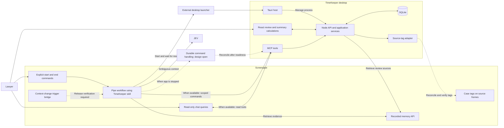

# TimeKeeper architecture

## Online demo deployment

The shareable [web demo](https://timekeeper-demo.vercel.app) serves the Vite build as static files and mounts the existing Hono API through `api/index.ts` on Vercel Node 22. The function creates `/tmp/timekeeper.db` on a cold start with the same schema, seed, recognition refresh, and canonical demo seed used by `npm run db:reset`. The local development database and desktop process are separate from this deployment.

Vercel function storage is temporary and scoped to an instance. A cold start can restore the fictional seed, and concurrent requests can reach different instances with different state. The demo is suitable for inspecting the interface and trying individual actions, but it does not provide durable or globally consistent records. A shared persistent database is needed before treating an online validation or billing action as durable.

## Scope and ownership

This document describes the intended implementation of the [requirements](REQUIREMENTS.md). The application is not implemented. Screenpipe integration findings are source research, not runtime verification.

TimeKeeper uses a Tauri desktop host, React, a local Node.js backend, and SQLite. Tauri owns the backend process lifecycle. The packaged application must include the backend runtime or executable. Exact versions and packaging remain to be selected. See Tauri's [sidecar documentation](https://v2.tauri.app/develop/sidecar/) for the external binary mechanism.

Screenpipe owns workflow execution after triggers. Node validates commands and writes application records. React calculates summaries. The intended source tree and dependency rules are in [AGENTS.md](../AGENTS.md).

## Components and flows



The diagram describes required behavior. It does not claim that these integrations work. The pending-command box represents an unresolved contract, not an implemented queue or a verified Screenpipe capability.

| Component | Responsibility |
| --- | --- |
| Screenpipe recorder and API | Capture activity and expose recorded observations and sources. |
| Screenpipe bridge and workflow | Receive verified signals, retrieve evidence, resolve cases, ask about unknown folders, and submit commands. |
| JEV | Help the Screenpipe workflow judge ambiguous context using known candidates. Never create case IDs or validate time. |
| External launcher | Start or activate the installed Tauri app before its API is reachable. |
| MCP server | Translate scoped workflow commands and read-only queries into API requests. Never access SQLite directly. |
| Node application services | Validate commands, preserve revisions and corrections, and persist records through one write path. |
| Source-tag adapter | Deliver committed assignments, retry failures, and verify the resulting tags. |
| React interface | Review evidence, edit periods, validate records, manage billing status, and calculate summaries. |
| SQLite | Store detail records and technical recovery state. No stored aggregate totals. |

## Session lifecycle and application lifecycle

Session state is independent of desktop process state.

| Action | Required effect |
| --- | --- |
| Start command in Screenpipe | Launch or activate TimeKeeper and wait for readiness. Create a session only if none is active. Otherwise, return the active session ID without resetting its start boundary. |
| Close TimeKeeper | Exit Tauri and Node. Keep the session and active work period open. |
| Reopen TimeKeeper | Resume the existing session and reconcile recorded history without duplicate periods or lost corrections. |
| End command in Screenpipe | End the explicitly targeted session and close its active period. Later end requests for that session return its original end boundary. Do not stop Screenpipe recording. |
| Receive evidence after session end | Accept historical reconciliation for recorded activity inside the session boundary. Do not reopen or extend the session. |

Only one session can be active per workspace. Commands need stable IDs, a session ID, effective timestamps, and revision checks. The start response supplies the authoritative session ID for subsequent commands. Receipt time must not replace the effective timestamp. Command retries must have no additional effect.

An end without a valid target reports that no matching session exists and does not create one. During recovery, an end whose prerequisite start is known but not yet applied stays pending until that start is processed. Pending receipt is not successful session termination. A contradictory end timestamp cannot revise an already applied end boundary.

Recovery must apply known causal prerequisites before dependent commands. A new start must not be treated as a repeated start merely because an earlier end is still pending recovery. Unresolved order is reported as pending or conflicting, not guessed from delivery order. The chosen transport must preserve this ordering information.

While TimeKeeper is closed, its API, MCP server, and SQLite writer are unavailable. Session commands, case changes, and lawyer answers must survive this interval. Recordings alone do not guarantee that those decisions can be reconstructed.

Two implementation options remain open: durable command storage outside the desktop process, or relaunching TimeKeeper when a command requires persistence. A SQLite queue inside the stopped app does not solve command reception. Selecting and testing this contract is required before claiming that end commands or assignments work while the app is closed.

An explicit end at 12:00 must allow later import of recordings from 11:00 to 12:00. It must reject new tracked activity after 12:00. Recovery preserves corrections and must not assign the reopen time as the session end.

## Case assignment and evidence flow

Folder identification remains undefined. The matching ideas in the [integration research](SCREENPIPE_INTEGRATION.md) are proposals. Ordinary application switches preserve the active case. A detected unknown-folder transition starts an unresolved period and asks the lawyer. The precise detection and effective-boundary rules remain open.

The intended assignment flow is:

1. A verified Screenpipe signal wakes the Screenpipe workflow.
2. The workflow retrieves persisted observations through the Screenpipe API.
3. The workflow retrieves candidate cases through MCP and the application API.
4. The workflow resolves an existing case, uses JEV when needed, or asks the lawyer.
5. The workflow submits the assignment and its evidence through a scoped MCP command.
6. Node checks the session boundary, case identity, expected revision, and manual corrections.
7. One transaction saves the period assignment and pending source-tag delivery.
8. The adapter reconciles the tags and records successful verification or retryable failure.

The work period owns its case assignment. Its client is derived from the case. Changing one period preserves other periods. A historical correction does not change the current active case.

Questions about unknown folders carry a question ID, session ID, period ID, and expected assignment revision. An answer resolves that period, even if the lawyer has since opened another case. Duplicate answers have no additional effect. Ordinary period closure and evidence imports do not invalidate the assignment guard. A newer assignment, superseded question, or replacement of the target period causes a visible conflict instead of an overwrite. Answering a question does not teach a reusable folder rule in the MVP.

Replayed observations must not duplicate time. Delayed inference must not overwrite a newer manual correction. Source retrieval progress advances only after the corresponding records are committed. Recovery rereads overlapping windows to handle delayed indexing and deduplicates source identities.

If late evidence suggests splitting a lawyer-corrected or validated period, preserve the existing period, its sources, and its override. Record the proposed reconstruction as a review conflict. Do not automatically split the period or copy, discard, or distribute its override. Proposed replacement periods do not contribute additional time to totals. The detailed conflict-resolution flow remains to be defined before implementing that action.

The trigger transport and producer remain subject to the [event verification gate](SCREENPIPE_EVENTS.md). A signal can arrive before its evidence is searchable. An empty initial query does not prove that no activity occurred.

## Evidence, durations, and summaries

A screenshot proves an observation at a recorded timestamp. It does not by itself prove continuous work between observations. Screenshot counts, model response times, and application uptime are not duration inputs.

The interval reconstruction rule remains a product decision. It must define usable boundaries and missing-recording behavior without adding inactivity subtraction. Precise detected intervals and a lawyer's duration override remain distinct. Editing duration does not silently rewrite observed timestamps.

Time validation applies to the effective case and duration that the lawyer reviewed. A change to either value from any origin invalidates that validation. Identical replay preserves it. A changed detected duration also preserves validation if a lawyer override keeps the effective duration unchanged. Technical synchronization retries do not invalidate time. See the [state transitions](REQUIREMENTS.md#state-transitions) for billing and rate decisions that remain open.

React uses the lawyer's override when present, otherwise the supported detected duration. It sums unrounded durations in the selected group and rounds the combined total upward:

```text
combined_minutes = ceil(sum(effective_duration_ms) / 60000)
```

Two 20-second periods produce one combined minute. A zero total remains zero. Each case, client, or selected-range total is calculated from its underlying precise durations, not from rounded subtotals. Therefore, rounded subtotals can sum to more than the rounded overall total.

The database stores details and corrections. React calculates totals after receiving the complete input set. Missing pages, missing duration evidence, or unavailable recordings must be visible as incomplete coverage. Source validation, time validation, and billed status remain separate.

## Screenpipe assignment synchronization

Use TimeKeeper-owned tags on affected Screenpipe source frames. The selected format is:

```text
timekeeper:<workspace-id>:client:<client-id>
timekeeper:<workspace-id>:case:<case-id>
```

The workspace ID prevents collisions between TimeKeeper databases. SQLite owns case identity and assignment revisions. The adapter derives the client ID from the assigned case.

Screenpipe documents [adding tags](https://docs.screenpipe.com/api-reference/tags/add-tags) and [removing tags](https://docs.screenpipe.com/api-reference/tags/remove-tags). Verify the content type and behavior in the target release. These APIs provide metadata, not a native legal-case entity.

Evidence record identity and provider tag-target identity are separate. Several returned records may refer to one underlying frame. The adapter maps taggable records to a canonical key containing the Screenpipe instance, provider target type, and provider target ID. The actual mapping requires release verification; do not infer it from matching timestamps or text.

All evidence aliases for a canonical target must agree on its owning period and desired case. Conflicting aliases block synchronization and require resolution. Deduplicate delivery and serialize tag updates and ownership changes by the canonical target, not by a local evidence row.

Reconcile only TimeKeeper-owned tags. Preserve unrelated tags. Remove obsolete associations and add the desired ones on explicitly affected targets. Check the target's current period, desired case, and latest revision before writing. An ownership move supersedes former pending deliveries. Verify the resulting tags before marking delivery complete. Failed or deleted targets remain visibly unsynchronized.

Synchronization retries must not undo a newer manual correction or trigger a detection loop. A chat response alone is not proof that Screenpipe stored the assignment. Native tag presentation remains untested.

## MCP and JEV boundaries

Chat queries follow `Screenpipe chat -> MCP -> application API -> SQLite`. Workflow writes use separately scoped commands. Corrections and validations use the desktop interface. Exact tool schemas, transport compatibility, and local access controls remain to be implemented.

The Screenpipe workflow owns JEV calls and candidate selection. Backend services validate the proposed case and evidence without running a second inference workflow. This keeps model orchestration outside the Node application modules.

The [integration research](SCREENPIPE_INTEGRATION.md) records custom HTTP MCP support, skill import format, and JEV API evidence. An imported skill supplies instructions. It does not register the MCP connection or make an event listener. Hosted JEV inference also requires a decision about permitted source data.

When TimeKeeper is stopped, chat cannot read its API and must report that application details are unavailable. No hidden backend is assumed. Chat-calculated summaries are deferred beyond the MVP; read-only detail queries remain in scope when the services are available.

## Storage and implementation gates

The agreed logical model is defined in [DATABASE.md](DATABASE.md): clients, cases, sessions, work periods, sources, settings, and technical recovery records. The supplied task/subtask model remains a [historical reference](reference/ORIGINAL_DATABASE.md).

Resolve the [remaining decisions](DESIGN_REVIEW.md) before implementation that depends on them. The first acceptance journey covers start, case A, unknown folder, case B, delayed answer, close, end through Screenpipe, reopen, review, correct, validate, and calculate the combined rounded total. Run desktop acceptance on both macOS and Windows. Static documents do not establish provider or platform behavior.
