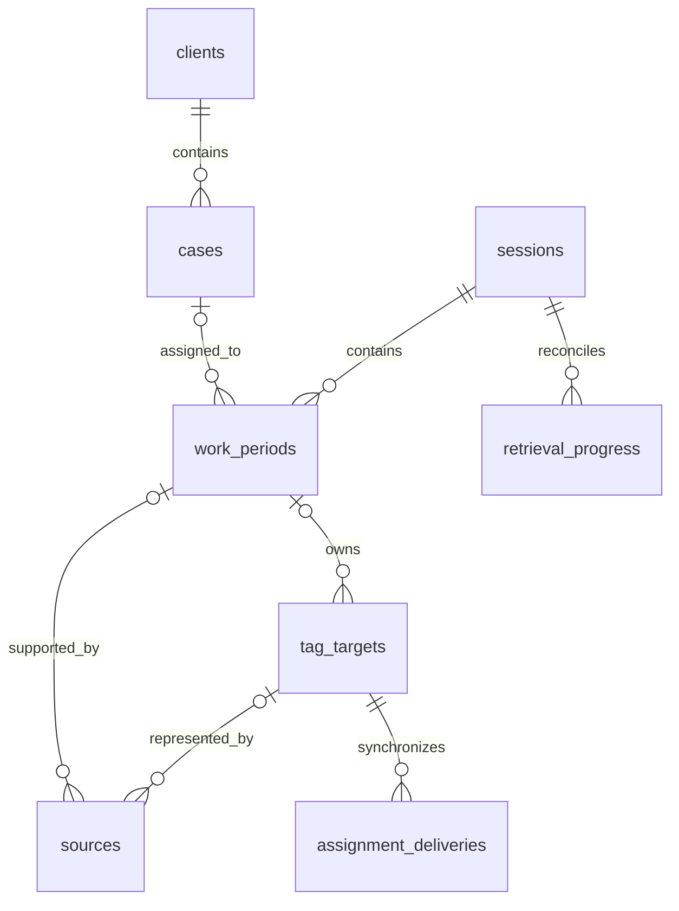

# SQLite data model

TimeKeeper has a local SQLite database, separate from Screenpipe storage. This is a documentation design, not an implemented schema. No migration exists. The [requirements](REQUIREMENTS.md) define business behavior; the [architecture](ARCHITECTURE.md) defines component ownership.

The agreed logical model replaces the original task/subtask hierarchy with work periods. English entity names below identify the current design. The [original schema](reference/ORIGINAL_DATABASE.md) preserves the supplied identifiers and earlier review notes.

## Agreed structure



A case has one client foreign key. A work period has one session foreign key and a nullable case foreign key. It has no independent client assignment. Each source references at most one period; unmatched evidence can remain unlinked. These relationships implement the [case and work-period rules](REQUIREMENTS.md#cases-and-work-periods).

Different source records can identify the same provider tag target. That target has one authoritative owner, and all its source aliases must agree with that ownership.

## Proposed fields and constraints

The fields below make the agreed model concrete for implementation review. Exact SQL types, enum names, indexes, and migration syntax remain proposals. Use stable opaque IDs, explicit foreign keys, and a consistent timestamp representation with UTC meaning and unrounded precision. Store event time separately from ingestion time. Integer milliseconds are proposed for duration storage; the interface expresses working time in minutes.

### `clients`

| Field | Purpose or constraint |
| --- | --- |
| `id` | Primary key. |
| `name` | Required display name; not an identity key. |
| `active` | Boolean catalogue status. |
| `created_at`, `updated_at` | Record timestamps. |

### `cases`

| Field | Purpose or constraint |
| --- | --- |
| `id` | Primary key. |
| `client_id` | Required foreign key to `clients`. |
| `reference`, `title` | Case catalogue information; folder-matching rules remain undefined. |
| `hourly_rate` | Optional nonnegative case rate; `NULL` uses the global rate. |
| `status` | Case catalogue status; allowed values to define. |
| `created_at`, `updated_at` | Record timestamps. |

Case reference uniqueness and folder aliases remain undecided. Do not use a client name, case title, or file path as the case primary key.

### `sessions`

| Field | Purpose or constraint |
| --- | --- |
| `id` | Stable session identity carried by workflow commands. |
| `started_at` | Explicit Screenpipe start boundary. |
| `ended_at` | Nullable explicit Screenpipe end boundary; cannot precede `started_at`. |
| `revision` | Monotonic version for stale-command checks. |
| `created_at`, `updated_at` | Local persistence timestamps, distinct from boundaries. |

Enforce at most one row with no end boundary per workspace in storage and application services. Committed start and end boundaries are immutable. `ended_at` records the explicit command boundary independently of process state and retrieval completeness. Command behavior follows the [session lifecycle rules](REQUIREMENTS.md#sessions-and-desktop-lifecycle); pending commands use the [technical persistence records](#technical-persistence).

### `work_periods`

| Field | Purpose or constraint |
| --- | --- |
| `id`, `session_id` | Primary key and required session foreign key. |
| `case_id` | Nullable case foreign key; `NULL` represents an unresolved assignment. |
| `started_at`, `ended_at` | Recorded boundaries, with nullable end while a period is open. |
| `detected_duration_ms` | Nullable unrounded derived duration; derivation is not defined yet. |
| `duration_override_ms` | Nullable lawyer correction, converted from minutes; zero differs from no correction. |
| `assignment_origin` | Distinguish automatic assignment from lawyer assignment. |
| `time_validation_status` | Review state, independent of source validation and billing. |
| `effective_revision` | Version of the effective case and duration; increments only when either effective value changes. |
| `validated_effective_revision` | Nullable version explicitly validated by the lawyer. |
| `time_validated_at` | Optional timestamp of the current validation. |
| `billing_status`, `billed_at` | Period-level billed/unbilled status and associated timestamp. |
| `applied_hourly_rate`, `applied_currency` | Nullable rate snapshot; capture timing and currency policy remain open. |
| `revision`, `assignment_revision` | Versions protecting record edits and period assignments; provider delivery also has its own target revision. |
| `created_at`, `updated_at` | Record timestamps. |

Require nonnegative durations. Known boundaries must fall within the session. An end boundary cannot precede its start. Do not replace missing duration with zero. A newly opened period has no accumulated time; lack of evidence later must remain distinguishable from a confirmed zero duration.

Store overrides independently of recorded boundaries and detected duration. Evidence updates must not overwrite override or manual-assignment fields. The [duration representation](#duration-rounding-and-consolidation) defines the effective value. Increment `effective_revision` only when the effective case or duration changes. Validation applies only when `validated_effective_revision` equals `effective_revision`. These constraints implement the [review transitions](REQUIREMENTS.md#state-transitions).

Store proposed reconstruction boundaries in `reconstruction_conflicts`, separately from counted work-period rows. Preserve protected rows and their overrides while resolution is pending. Resolution must atomically preserve or replace the affected counted records so both versions cannot appear in totals. The [protected-period rule](REQUIREMENTS.md#cases-and-work-periods) governs this operation; its resolution flow remains open.

Scope assignment writes to the target period and its sources. Do not store computed client totals, case totals, or monetary totals here.

### `sources`

| Field | Purpose or constraint |
| --- | --- |
| `id` | Local primary key. |
| `work_period_id` | Nullable period foreign key for evidence awaiting assignment. |
| `screenpipe_instance_id` | Stable identity of the source recording store, not a hostname alone. |
| `content_type`, `external_id` | Provider record type and identity, such as a frame reference. |
| `tag_target_id` | Nullable foreign key to the canonical provider target, once its mapping is verified. |
| `recorded_at`, `ingested_at` | Observation time and local import time. |
| `app_name`, `window_name`, `url` | Optional observed context, stored separately. |
| `validation_status`, `validated_at` | Lawyer source-review state and timestamp. |
| `availability_status`, `availability_checked_at` | Retrieval availability and last check. |

Use a unique key on `(screenpipe_instance_id, content_type, external_id)` to prevent duplicate imports. IDs from separate Screenpipe stores must not collide. The instance identity format remains part of the adapter contract. Source references are external identifiers, not foreign keys into Screenpipe's database.

The source record key is not necessarily the provider's tag-operation key. Resolve that mapping before a tag write. Several records, including different content types, can refer to one target. When `tag_target_id` is present, source ownership must agree with the target's authoritative `work_period_id`; a source cannot independently select a different period or case. An unresolved mapping must remain visibly unsynchronized.

Retain source references, availability state, and review history when an external recording becomes unavailable or is deleted. Failed retrieval alone is insufficient to mark a source deleted. The [evidence requirements](REQUIREMENTS.md#evidence-duration-and-rounding) define the user-visible behavior.

### `tag_targets`

This small proposed table separates imported record identity from the actual provider object that receives tags.

| Field | Purpose or constraint |
| --- | --- |
| `id` | Local primary key. |
| `screenpipe_instance_id`, `target_type`, `target_id` | Unique canonical identity used by the provider tag API. |
| `work_period_id` | Nullable authoritative owner; derive the desired case through this period. |
| `target_revision` | Monotonic version of target ownership and desired TimeKeeper tags. |

All aliases of a target must agree with its owner. Changing the owner or its desired case increments `target_revision`. Do not compare revisions from two different periods as if they were one sequence. A move supersedes previous delivery intents and reconciles this single target to the new desired tags. The exact provider target mapping remains an adapter verification requirement.

### `settings`

| Field | Purpose or constraint |
| --- | --- |
| `id` | Single local settings record; constrain to a fixed identity. |
| `global_hourly_rate` | Nonnegative fallback rate. |
| `currency` | Currency configuration; change policy remains open. |
| `workspace_id` | Stable local identity used in TimeKeeper-owned Screenpipe tags. |
| `updated_at` | Record timestamp. |

Monetary representation must be chosen before migrations. Use an exact representation suitable for the selected currency; do not carry the original diagram's `REAL` choice into implementation without a decision. A case rate of zero is valid and must not trigger the fallback.

## Technical persistence

Keep these small records in the same local database. They support recovery and do not imply a separate service or general queue framework.

| Record | Minimum proposed contents | Integrity requirement |
| --- | --- | --- |
| `processed_commands` | Producer identity, command ID, payload fingerprint, session ID, command kind, status, prerequisite ID, terminal result, timestamps. | Unique producer/command pair. Distinguish pending from applied or rejected. Only terminal outcomes are final replay results. A changed payload under the same ID is rejected. |
| `pending_questions` | `question_id`, `session_id`, `work_period_id`, `expected_assignment_revision`, status, response command ID and result. | Unique question ID and session/period/assignment-revision tuple. An answer targets this period and revision only. Duplicate answers reuse the result; stale answers produce a visible conflict. |
| `reconstruction_conflicts` | Conflict ID, protected period ID, expected revision, proposed boundaries and source references, status. | Store a proposal separately from counted periods; never include it in totals before explicit resolution. |
| `retrieval_progress` | Session ID, Screenpipe instance, requested interval, pagination cursor/checkpoint, last completed range, retrieval status. | Advance progress with committed detail records. A partial or failed read must not claim complete coverage. |
| `assignment_deliveries` | Canonical tag target ID, target revision, intended TimeKeeper tags, status, attempts, next retry, acknowledgement. | Unique target/revision delivery. Deduplicate and serialize by the canonical target, not a source alias or period ID. |

Commands, domain changes, and delivery intent must commit atomically where they form one local operation. Retain pending command payloads and prerequisite references for recovery. Reconsider pending commands after prerequisite commits; do not cache pending status as an applied result. Validate session references before any domain write. The [session lifecycle rules](REQUIREMENTS.md#sessions-and-desktop-lifecycle) define ordering and rejection behavior.

A pending question retains its original session, period, and expected assignment revision. Use `assignment_revision`, not the general record revision, as the answer guard: closure and evidence imports can change the latter without changing the assignment. Check question status and target identity in the same transaction as the answer. Deduplicate question creation and response commands. The [question and answer rules](REQUIREMENTS.md#cases-and-work-periods) define stale-answer behavior.

Before each tag mutation, verify current target ownership, revision, and desired tags. Serialize ownership changes and provider operations per canonical target, including every source alias. Prevent an old owner from completing writes after a committed move; defer the move until any prior target operation is resolved, then reconcile the new revision. Remove only obsolete TimeKeeper-owned tags. Verify the same target and revision before acknowledging synchronization; a stale acknowledgement cannot mark the new owner synchronized.

These records cannot receive commands while the Node backend is stopped. The mechanism that preserves an explicit Screenpipe end command during that interval remains unresolved. Do not imply that a local command table alone solves delivery outside the running application.

## Duration, rounding, and consolidation

Store observation timestamps, period boundaries, and detected durations at their original precision. The proposed millisecond representation keeps corrections in `duration_override_ms` without rewriting evidence. Its effective duration is:

```text
effective_duration_ms = COALESCE(duration_override_ms, detected_duration_ms)
```

`NULL` means no override or no established detected duration. Zero is a valid duration or explicit override. If both duration fields are `NULL`, the effective duration remains unknown. Retrieval completeness and source availability are separate fields, not values inferred from duration.

Store precise detail records without rounded or aggregate totals. React applies the [duration and rounding rules](REQUIREMENTS.md#evidence-duration-and-rounding) to the complete detail set. The [acceptance examples](REQUIREMENTS.md#failure-and-recovery-examples) cover replay, corrections, missing evidence, and combined totals.

## Decisions required before migration

Resolve the [open product decisions](REQUIREMENTS.md#decisions-still-required) and [integration gates](DESIGN_REVIEW.md#decisions-needed-before-dependent-implementation) before the dependent migrations. Storage choices still required are:

- Final SQL types, review-state enums, constraints, and indexes.
- Unmatched-evidence association and concrete retrieval checkpoints.
- Monetary representation and monetary rounding.
- Deletion and archival behavior, retention, and audit history.

Do not cascade-delete sessions, periods, or evidence when a client or case is removed. Prefer archival for referenced catalogue records; finalize deletion and retention rules before implementation. Validate revisions and relationships in application services as well as database constraints.

Return to the [requirements](REQUIREMENTS.md), [architecture](ARCHITECTURE.md), or [README](../README.md).
