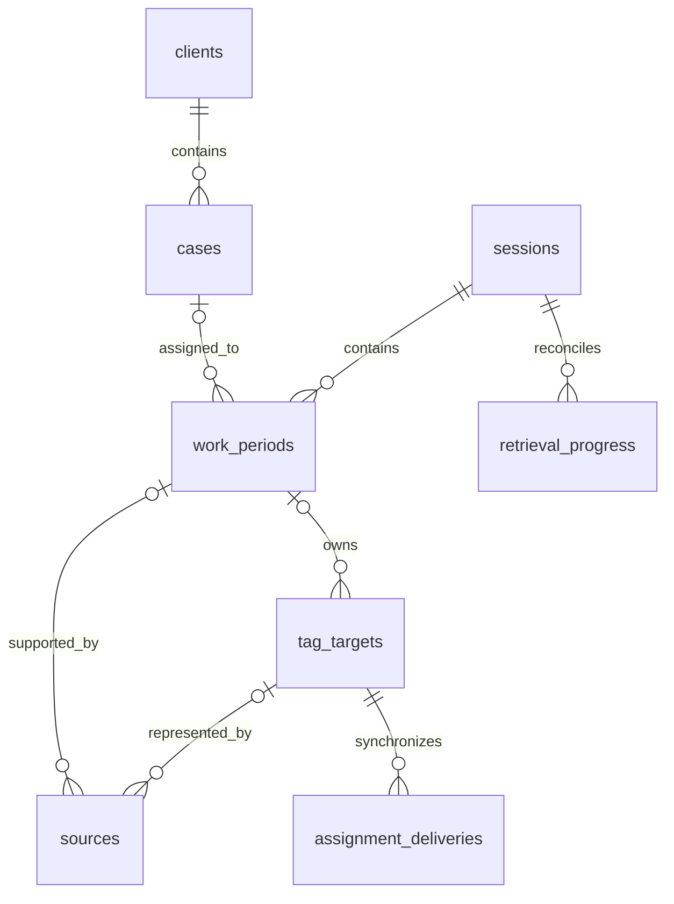

# SQLite data model

TimeKeeper has a local SQLite database, separate from Screenpipe storage. This document distinguishes the agreed logical design from the implemented MVP core schema. An initial migration now exists at `src/backend/adapters/sqlite/migrate.ts`; integration-dependent behavior remains proposed. The [requirements](REQUIREMENTS.md) define business behavior; the [architecture](ARCHITECTURE.md) defines component ownership.

The agreed logical model replaces the original task/subtask hierarchy with work periods. English entity names below identify the current design. The [original schema](reference/ORIGINAL_DATABASE.md) preserves the supplied identifiers and earlier review notes.

Runtime queries use Drizzle table mappings in `src/backend/adapters/sqlite/tables.ts` over `node:sqlite`. Existing migrations remain the sole schema authority, including their constraints and triggers. The mapping-parity and upgrade tests check that the query model matches migrated databases. See [storage ownership](ARCHITECTURE.md#storage-and-implementation-gates) for the retained SQL and transaction boundaries.

## How to read the schema

Start with the work period. It records one piece of work, belongs to one session, and can be assigned to one case. The case supplies its client. A source is an observation linked to that work; it does not establish continuous worked time.

| Table                       | What one row means                                            | Main relationships                                          |
| --------------------------- | ------------------------------------------------------------- | ----------------------------------------------------------- |
| `clients`                   | A client                                                      | Has cases.                                                  |
| `cases`                     | A legal case                                                  | `client_id` identifies its client.                          |
| `sessions`                  | An explicitly started recording-workflow session              | Contains work periods between its start and end boundaries. |
| `work_periods`              | A piece of work to assign, correct, validate, and mark billed | `session_id` is required; `case_id` can be unknown.         |
| `sources`                   | A recorded observation or evidence reference                  | `work_period_id` can be unknown until reconciliation.       |
| `task_types`                | An editable category such as drafting or document review      | A period can reference it through `task_type_id`.           |
| `invoices`, `invoice_lines` | An issued invoice and its frozen lines                        | Link billed work and expenses to the invoice.               |

The client is not copied onto a work period as a second assignment. Source validation, time validation, and billing status are independent. `NULL` means unknown or unset, not zero.

### Why some IDs are strings

The main business and workflow identities use SQLite `TEXT` and JSON strings. New clients, cases, and manual periods normally receive UUIDs. Workflow commands can supply other stable opaque strings for sessions, periods, and sources. An opaque ID identifies a record; applications must not parse it to obtain its client, date, or display name. The case's human-readable `reference` is separate from its ID.

String IDs let a producer identify a record before a database insert and reuse the same identity during delayed delivery, replay, and retries. An integer sequence is more compact, but would require another mapping for externally assigned identities. Changing existing IDs to integers would affect foreign keys, saved commands, evidence references, exports, and API callers without resolving a current business problem.

Local categories, invoices, expenses, audit rows, and export receipts use integer IDs where a local database sequence is sufficient. These are valid different choices for different identities. Historical numeric aliases belong only to the deprecated API.

### Why fixed states are text

SQLite has no native `ENUM` column type. A fixed state uses a readable text value and a database constraint limiting the allowed values. For example, `billing_status` permits `unbilled` and `billed`; it does not accept an arbitrary string. Drizzle's enum configuration also narrows TypeScript types, but does not replace database checks.

| Column                                | Allowed states                        | Meaning                                                     |
| ------------------------------------- | ------------------------------------- | ----------------------------------------------------------- |
| `cases.status`                        | `active`, `archived`                  | Whether the case remains in the active catalogue.           |
| `work_periods.assignment_origin`      | `unresolved`, `automatic`, `lawyer`   | How its current assignment was made.                        |
| `work_periods.time_validation_status` | `unvalidated`, `validated`            | Whether the effective case and duration have been reviewed. |
| `work_periods.billing_status`         | `unbilled`, `billed`                  | Whether the work has been billed.                           |
| `sources.validation_status`           | `unvalidated`, `validated`            | Whether the observation has been reviewed.                  |
| `sources.availability_status`         | `unknown`, `available`, `unavailable` | Whether the referenced evidence is retrievable.             |

Do not turn every fixed state into a lookup table. Separate tables are useful for editable catalogues such as `task_types`, where users can change labels and settings. Integer status codes would still need an allowed-value constraint and a translation to readable labels.

### Which schema file owns which responsibility

| File                                          | Responsibility                                                                                                                                   |
| --------------------------------------------- | ------------------------------------------------------------------------------------------------------------------------------------------------ |
| `src/backend/adapters/sqlite/migrate.ts`      | Creates and upgrades the physical SQLite schema, constraints, indexes, and triggers.                                                             |
| `src/backend/adapters/sqlite/tables.ts`       | Maps SQLite columns to typed Drizzle queries. It does not apply migrations.                                                                      |
| `src/contracts/openapi.yaml`                  | Defines HTTP routes, JSON fields, allowed values, and request/response contracts. It is not an OpenAI configuration file or the database schema. |
| `src/contracts/generated.ts`                  | Generated TypeScript API types. Do not edit directly.                                                                                            |
| `src/contracts/request-contract.generated.ts` | Generated request schemas used by API validation. Do not edit directly.                                                                          |
| `src/backend/adapters/sqlite/schema.sql`      | Historical imported schema retained for initialization, upgrades, and fixture compatibility. It does not define the canonical period model.      |

The project file is `openapi.yaml`, not `openai.yml`. It currently contains JSON syntax, which is valid YAML. `npm run contract:gen` regenerates the two contract files after an OpenAPI change. SQL column names use `snake_case`; JSON attributes use `camelCase`.

The physical database retains old singular tables such as `client`, `matter`, and `time_entry` alongside canonical tables such as `clients`, `cases`, and `work_periods`. Current screens use the canonical model. Retention supports older installations and fixtures; it is not a second authoritative client/case model. Fresh initialization still creates the historical tables. Separating that bootstrap from upgrade handling requires a preservation migration and remains distinct from changing IDs or enum storage.

### Units and defaults

Durations are integer milliseconds. Monetary amounts and rates are integer minor units with a separate currency. A research-cap rule's `value` uses tenths of an hour: `5` means 30 minutes. A `nonbillable_travel` row enables the travel rule; its value is not a duration. User-visible rule descriptions must follow the saved value.

New-workspace USD currency, zero base rate, zero tax, the singleton settings row, unit-conversion factors, and viewport dimensions are explicit defaults or constants. They do not stand in for recorded client data, elapsed work, configured rates, provider capabilities, or the current date. Tests may fix a date or use sample IDs; normal startup does not load those records.

Migration 10 strengthens new writes without renumbering records or rebuilding tables. It rejects null or blank text identities, fractional or unsafe integer amounts and durations, and invalid currency codes. Inserts check all guarded fields. Updates check changed fields so an unrelated edit can preserve a historical value that predates the guards. The Drizzle mappings also narrow fixed states to their allowed TypeScript values; SQL remains responsible for runtime enforcement.

### Reviewed revisions in API requests

An edit must identify the version that the user reviewed. The canonical API requires `expectedRevision` for period details, duration corrections, and billing status; `expectedEffectiveRevision` for time validation; and `expectedAssignmentRevision` for case assignment. Missing guards produce an invalid request. A stale guard produces a conflict instead of approving or overwriting newer data. The interface preserves drafts and requires an explicit reload before submitting a changed period again.

## Data formats in the application

SQLite stores the application records. The local HTTP API sends JSON objects to React. Drizzle maps SQL columns to TypeScript values on the backend. The OpenAPI contract in `src/contracts/openapi.yaml` defines the JSON fields and generates the client types and request validators.

The current interface reads `/api/catalog` for settings, clients, cases, work categories, explicit markers, and client rules. It reads canonical session, work-period, source, audit, and billing endpoints for activity. `CatalogService` and its typed SQLite port read canonical tables directly. Screens do not consume the old `matter`, `block`, or `time_entry` payloads.

| Meaning              | SQLite column              | Current JSON field                                   |
| -------------------- | -------------------------- | ---------------------------------------------------- |
| Work-period identity | `work_periods.id`          | `WorkPeriod.id`, a string                            |
| Assigned case        | `work_periods.case_id`     | `caseId`, a string or `null`                         |
| Case owner           | `cases.client_id`          | `clientId`, a string                                 |
| Detected duration    | `detected_duration_ms`     | `detectedDurationMs`, integer milliseconds or `null` |
| Lawyer's correction  | `duration_override_ms`     | `durationOverrideMs`, integer milliseconds or `null` |
| Start time           | `started_at`               | `startedAt`, a UTC timestamp                         |
| Hourly rate          | `hourly_rate_cents`        | `hourlyRateCents`, integer cents or `null`           |
| Global hourly rate   | `global_hourly_rate_cents` | `settings.globalHourlyRateCents`, integer cents      |
| Unknown opening date | `opened_on IS NULL`        | `openedOn: null`, displayed as unknown               |

IDs identify records and have no numeric meaning. A work period derives its client through its case. Source identities and period identities remain separate. Audit events link through `periodId`. SQLite represents flags with `0` and `1`; JSON responses use `false` and `true`.

An effective duration of 900000 milliseconds is 15 minutes. React calculates totals from precise milliseconds, then rounds the combined total upward to whole minutes. `null` means unknown or unset; zero is a known value. Money uses integer cents and a separate currency. Issued invoices retain their own currency, calendar timezone, and frozen monetary snapshot. Unknown historical values are not invented.

### Calendar dates and timestamps

`src/shared/dates.ts` uses pinned `date-fns` 4.1.0 and `@date-fns/tz` 1.4.1. Date-only values such as `2026-03-31` retain their calendar meaning. Timestamps such as `2026-03-30T22:30:00Z` identify instants. Month subtraction clamps to the last valid day, including leap years. Impossible dates are rejected.

The interface uses the desktop's system timezone and sends it explicitly for date-filtered reads, invoices, and source exports. The backend uses the same shared conversion helpers. A period belongs to the day containing its start in that timezone for the current views and export selection. The implementation preserves the whole period and its duration; it does not split or clip midnight crossings. Cross-midnight billing rules remain an open product decision in the [design review](DESIGN_REVIEW.md).

Local midnight boundaries account for daylight saving changes. A calendar day can span 23 or 25 elapsed hours. Activity positions use elapsed time since local midnight, with actual local clock labels, so repeated or skipped hours do not change recorded durations. Previously issued invoices and saved exports keep their original snapshots.

### Retained compatibility API

`CompatibilityApiService` and `api/compatibility-routes.ts` retain deprecated contracts for older callers. They preserve existing numeric entry aliases and historical table names. Current screens and canonical exports do not allocate or join through these aliases. The old `tenths_of_hour` projection remains only in that compatibility API; one tenth is six minutes, and the projection does not round individual periods.

The compatibility tables remain for existing records and upgrade support. Their removal requires a separate data migration. Explicit fixture metadata such as `demoApp`, `demoWindowTitle`, and `demoConfidence` remains distinguishable from verified provider evidence. Normal startup creates no sample business records.

Deprecated catalogue writes translate their older field names and call the same `CatalogService` use cases as canonical writes. They cannot use mapped database columns as an unrestricted update API. Valid legacy response shapes remain available. Approval calls now require the revision that the caller reviewed: `expected_effective_revision` for one compatibility entry and `expected_effective_revisions` keyed by canonical period ID for bulk approval. Missing guards are invalid requests; stale guards report a conflict.

New source-export receipts use JSON arrays for canonical period IDs and options, with `source_exports.format_version = 2`. This receipt storage version is independent of the exported payload version. Existing mixed-format receipts remain version 1 and are not guessed or rewritten. Deprecated exporters retain their payload shape while sharing the canonical receipt writer and hashing the exact exported bytes.

Canonical source packs use version 2 JSON with string period and source IDs, exact durations, the selected timezone, and a receipt containing the exact SHA-256 payload hash. Client-name redaction applies to descriptive text while IDs, timestamps, and links remain intact. No media is fetched or blurred by this metadata export.

## Agreed structure

A case belongs to one client. A work period belongs to one session and has zero or one assigned case. An unknown folder creates an unresolved period while the lawyer decides. The client is derived from the assigned case; work periods do not store a second client assignment. Returning to an existing case creates another period for that case.

Assignment, time correction, time validation, and billed/unbilled status belong to the work period. Each source belongs to at most one period in the MVP; unmatched evidence can remain unlinked. Different source records can identify the same provider tag target. That target has one authoritative owner, and all its source aliases must agree with that ownership. Source validation and source availability are separate from time validation and billing.

## Proposed fields and constraints

The fields below make the agreed model concrete for implementation review. The initial SQL migration creates the listed tables, foreign keys, uniqueness rules, nonnegative duration and rate checks, session and period bounds, and restricted deletion. The service layer owns revision transitions and question-answer guards. Source-tag delivery, stopped-app command receipt, provider-dependent mapping, and unresolved product transitions remain proposals. Use stable opaque IDs, explicit foreign keys, and a consistent timestamp representation with UTC meaning and unrounded precision. Store event time separately from ingestion time. Integer milliseconds are proposed for duration storage; the interface expresses working time in minutes.

### `clients`

| Field                      | Purpose or constraint                       |
| -------------------------- | ------------------------------------------- |
| `id`                       | Primary key.                                |
| `name`                     | Required display name; not an identity key. |
| `active`                   | Boolean catalogue status.                   |
| `created_at`, `updated_at` | Record timestamps.                          |

### `cases`

| Field                      | Purpose or constraint                                                                       |
| -------------------------- | ------------------------------------------------------------------------------------------- |
| `id`                       | Primary key.                                                                                |
| `client_id`                | Required foreign key to `clients`.                                                          |
| `reference`, `title`       | Case catalogue information; folder-matching rules remain undefined.                         |
| `hourly_rate`              | Optional nonnegative case rate; `NULL` falls back to the client rate, then the global rate. |
| `status`                   | Case catalogue status; allowed values to define.                                            |
| `created_at`, `updated_at` | Record timestamps.                                                                          |

The current database enforces unique, immutable case references. The broader requirements decision about reference scope and folder aliases remains open; the implementation does not establish a folder-matching rule. Do not use a client name, case title, or file path as the case primary key. Client rates and fixed fees are retained extensions under the [requirements](REQUIREMENTS.md#purpose-and-scope).

### `sessions`

| Field                      | Purpose or constraint                                                   |
| -------------------------- | ----------------------------------------------------------------------- |
| `id`                       | Stable session identity carried by workflow commands.                   |
| `started_at`               | Explicit Screenpipe start boundary.                                     |
| `ended_at`                 | Nullable explicit Screenpipe end boundary; cannot precede `started_at`. |
| `revision`                 | Monotonic version for stale-command checks.                             |
| `created_at`, `updated_at` | Local persistence timestamps, distinct from boundaries.                 |

Allow at most one session with no end boundary per local workspace. Enforce this in storage and application services. After known causal prerequisites are applied, a start received while a session is active returns that session; it does not reset its start or create another one. A new start that depends on a pending end waits for that end instead of being collapsed into the earlier session. Application exit does not set `ended_at`. Reopening resumes the active session.

The first applied end fixes the boundary. Repeated ends return the existing outcome without moving it. Reconciliation can still import observations recorded within the session without reopening or extending it. Keep the end boundary independent of retrieval completeness. An end delivered before its known prerequisite start remains pending until that start is applied; record the effective end time without claiming the end has succeeded.

### `work_periods`

| Field                                     | Purpose or constraint                                                                                        |
| ----------------------------------------- | ------------------------------------------------------------------------------------------------------------ |
| `id`, `session_id`                        | Primary key and required session foreign key.                                                                |
| `case_id`                                 | Nullable case foreign key; `NULL` represents an unresolved assignment.                                       |
| `initial_case_id`, `initial_origin`       | Implemented immutable opening intent used to deduplicate a replay after later assignment corrections.        |
| `started_at`, `ended_at`                  | Recorded boundaries, with nullable end while a period is open.                                               |
| `detected_duration_ms`                    | Nullable unrounded derived duration; derivation is not defined yet.                                          |
| `duration_override_ms`                    | Nullable lawyer correction, converted from minutes; zero differs from no correction.                         |
| `assignment_origin`                       | Distinguish automatic assignment from lawyer assignment.                                                     |
| `time_validation_status`                  | Review state, independent of source validation and billing.                                                  |
| `effective_revision`                      | Version of the effective case and duration; increments only when either effective value changes.             |
| `validated_effective_revision`            | Nullable version explicitly validated by the lawyer.                                                         |
| `time_validated_at`                       | Optional timestamp of the current validation.                                                                |
| `billing_status`, `billed_at`             | Period-level billed/unbilled status and associated timestamp.                                                |
| `applied_hourly_rate`, `applied_currency` | Nullable rate snapshot; capture timing and currency policy remain open.                                      |
| `revision`, `assignment_revision`         | Versions protecting record edits and period assignments; provider delivery also has its own target revision. |
| `created_at`, `updated_at`                | Record timestamps.                                                                                           |

Require nonnegative durations. Known boundaries must fall within the session. An end boundary cannot precede its start. Do not replace missing duration with zero. A newly opened period has no accumulated time; lack of evidence later must remain distinguishable from a confirmed zero duration.

Preserve recorded boundaries and detected duration when the lawyer enters a duration override. Reprocessing evidence must preserve the override and manual assignment. The effective duration is the override when present, otherwise the detected duration. An actual change to the effective case or duration increments `effective_revision` and requires time validation again, whether the change is manual or automatic. Validation applies only when `validated_effective_revision` equals the current `effective_revision`.

Identical replay does not increment `effective_revision` or invalidate time. A detected-duration change hidden by an unchanged override also preserves validation. A zero override is an effective value, not a missing value. Source review states remain separate. Effects of edits to already billed periods remain a decision before implementation.

Do not automatically split, merge, or replace a lawyer-corrected or validated period during reconstruction. Preserve it and store the proposed conflicting boundaries in a separate `reconstruction_conflicts` record. A conflict proposal is not a work period and contributes no time. Resolving it must atomically preserve or replace the affected counted records so both versions cannot appear in totals.

Reassigning one period must not move other periods or their sources. A historical correction must not change the current active case. Do not store computed client totals, case totals, or monetary totals here.

### `sources`

| Field                                            | Purpose or constraint                                                                |
| ------------------------------------------------ | ------------------------------------------------------------------------------------ |
| `id`                                             | Local primary key.                                                                   |
| `work_period_id`                                 | Nullable period foreign key for evidence awaiting assignment.                        |
| `screenpipe_instance_id`                         | Stable identity of the source recording store, not a hostname alone.                 |
| `content_type`, `external_id`                    | Provider record type and identity, such as a frame reference.                        |
| `tag_target_id`                                  | Nullable foreign key to the canonical provider target, once its mapping is verified. |
| `recorded_at`, `ingested_at`                     | Observation time and local import time.                                              |
| `app_name`, `window_name`, `url`                 | Optional observed context, stored separately.                                        |
| `validation_status`, `validated_at`              | Lawyer source-review state and timestamp.                                            |
| `availability_status`, `availability_checked_at` | Retrieval availability and last check.                                               |

Use a unique key on `(screenpipe_instance_id, content_type, external_id)` to prevent duplicate imports. IDs from separate Screenpipe stores must not collide. The instance identity format remains part of the adapter contract. Source references are external identifiers, not foreign keys into Screenpipe's database.

The source record key is not necessarily the provider's tag-operation key. Resolve that mapping before a tag write. Several records, including different content types, can refer to one target. When `tag_target_id` is present, source ownership must agree with the target's authoritative `work_period_id`; a source cannot independently select a different period or case. An unresolved mapping must remain visibly unsynchronized.

Fetch recordings through the Screenpipe API. An unavailable or deleted recording does not delete reviewed time or erase the source's review history. Keep the reference and availability state. Do not assume every failed fetch proves deletion. Multiple screenshots attached to one period must not multiply its duration.

### `tag_targets`

This small proposed table separates imported record identity from the actual provider object that receives tags.

| Field                                                | Purpose or constraint                                                      |
| ---------------------------------------------------- | -------------------------------------------------------------------------- |
| `id`                                                 | Local primary key.                                                         |
| `screenpipe_instance_id`, `target_type`, `target_id` | Unique canonical identity used by the provider tag API.                    |
| `work_period_id`                                     | Nullable authoritative owner; derive the desired case through this period. |
| `target_revision`                                    | Monotonic version of target ownership and desired TimeKeeper tags.         |

All aliases of a target must agree with its owner. Changing the owner or its desired case increments `target_revision`. Do not compare revisions from two different periods as if they were one sequence. A move supersedes previous delivery intents and reconciles this single target to the new desired tags. The exact provider target mapping remains an adapter verification requirement.

### `settings`

| Field                | Purpose or constraint                                           |
| -------------------- | --------------------------------------------------------------- |
| `id`                 | Single local settings record; constrain to a fixed identity.    |
| `global_hourly_rate` | Nonnegative fallback rate.                                      |
| `currency`           | Currency configuration; change policy remains open.             |
| `workspace_id`       | Stable local identity used in TimeKeeper-owned Screenpipe tags. |
| `updated_at`         | Record timestamp.                                               |

Implemented storage proposal: `hourly_rate_cents`, `global_hourly_rate_cents`, and `applied_hourly_rate_cents` are nonnegative SQLite `INTEGER` values in minor currency units. This avoids floating-point rate storage; currency policy and monetary rounding remain open decisions. A case rate of zero is valid and must not trigger the fallback. The corresponding implemented columns are `cases.hourly_rate_cents`, `settings.global_hourly_rate_cents`, and `work_periods.applied_hourly_rate_cents`. The retained demo freezes the applied rate when a period becomes billed; this implementation does not settle the full billed-period edit policy.

### Implemented billing and compatibility extensions

Migrations 2 and 3 add the mockup features separately agreed on 2026-10-17: client code and hourly rate; case category, court number, opposing party, hourly or flat-fee mode, flat fee and budget; weighted markers and client rules; task types, per-period billability and exclusion; expenses, invoices and frozen invoice lines; audit events, source exports and Jev reviews. Migration 4 adds `demo_block_periods`, the compatibility link from an imported block to its work period, so recovery does not infer identity from colliding numeric IDs. `work_periods` keeps precise duration and revisions without a calculated amount. `invoices` stores the supplied issued snapshot and totals, and `invoice_lines` stores billed minutes, the applied rate, amount and selected period IDs. Canonical tables own business writes. Legacy tables remain as migration inputs and fictional capture metadata; [schema implementation](implementation/schema.md) distinguishes those records from the canonical model. This extension records implementation and does not redefine the agreed core rules or decide the open provider behavior.

Migrations 5–8 consolidate preferences, compatibility entry identities, source relocation history, invoice currency, and immutable case references. See [schema implementation](implementation/schema.md) for their scope. Startup uses the same migration ledger; it does not run a separate set of schema alterations.

Migration 9 adds validation guards and foreign-key indexes for the retained extensions. It preserves historical rows and rejects future invalid writes to guarded fields. Period queries order timestamps chronologically, including existing values with different fractional-second precision.

## Technical persistence

Keep these small records in the same local database. They support recovery and do not imply a separate service or general queue framework.

| Record                     | Minimum proposed contents                                                                                                           | Integrity requirement                                                                                                                                                                           |
| -------------------------- | ----------------------------------------------------------------------------------------------------------------------------------- | ----------------------------------------------------------------------------------------------------------------------------------------------------------------------------------------------- |
| `processed_commands`       | Producer identity, command ID, payload fingerprint, session ID, command kind, status, prerequisite ID, terminal result, timestamps. | Unique producer/command pair. Distinguish pending from applied or rejected. Only terminal outcomes are final replay results. A changed payload under the same ID is rejected.                   |
| `pending_questions`        | `question_id`, `session_id`, `work_period_id`, `expected_assignment_revision`, status, response command ID and result.              | Unique question ID and session/period/assignment-revision tuple. An answer targets this period and revision only. Duplicate answers reuse the result; stale answers produce a visible conflict. |
| `reconstruction_conflicts` | Conflict ID, protected period ID, expected revision, proposed boundaries and source references, status.                             | Store a proposal separately from counted periods; never include it in totals before explicit resolution.                                                                                        |
| `retrieval_progress`       | Session ID, Screenpipe instance, requested interval, pagination cursor/checkpoint, last completed range, retrieval status.          | Advance progress with committed detail records. A partial or failed read must not claim complete coverage.                                                                                      |
| `assignment_deliveries`    | Canonical tag target ID, target revision, intended TimeKeeper tags, status, attempts, next retry, acknowledgement.                  | Unique target/revision delivery. Deduplicate and serialize by the canonical target, not a source alias or period ID.                                                                            |

Commands, domain changes, and delivery intent must commit atomically where they form one local operation. Pending commands wait for known prerequisites and are reconsidered when those prerequisites arrive. Pending status is not a successful transition and must not be cached as an applied result. Unknown or conflicting session references must not create or reopen a session implicitly.

A pending question retains its original session, period, and expected assignment revision. A delayed answer cannot target the currently active period by default. Apply a valid answer to its original period only. Period closure and evidence imports can change the record revision without changing this assignment guard. A new assignment, superseded question, or replacement of the period invalidates the answer. Record a conflict and request a fresh decision without overwriting newer work. Deduplicate question creation and response commands so retries do not repeat prompts or writes.

Before each tag mutation, verify current target ownership, revision, and desired tags. Serialize ownership changes and provider operations per canonical target, including every source alias. Prevent an old owner from completing writes after a committed move; defer the move until any prior target operation is resolved, then reconcile the new revision. Remove only obsolete TimeKeeper-owned tags. Verify the same target and revision before acknowledging synchronization; a stale acknowledgement cannot mark the new owner synchronized.

These records cannot receive commands while the Node backend is stopped. The mechanism that preserves an explicit Screenpipe end command during that interval remains unresolved. Do not imply that a local command table alone solves delivery outside the running application.

## Duration, rounding, and consolidation

A screenshot proves an observation at a time. It does not prove continuous work until the next screenshot. Source count and application uptime are not duration measurements. The method for deriving work intervals from reviewed Screenpipe memory remains undefined. Do not silently count gaps, subtract inactivity, or invent a sampling interval.

The lawyer can correct time. An override takes precedence over a detected duration. Preserve unrounded observation times, boundaries, and any detected duration. The interface calculates effective minutes and summaries from the complete detail set, using reviewed memory and retained corrections. SQLite and the backend do not supply calculated dashboard summaries. Before issuing an invoice, the backend verifies its submitted amounts against authoritative records with shared arithmetic; this validation does not create stored running totals on periods.

Round upward only after combining the relevant effective durations. For the proposed millisecond representation, the interface uses `ceil(sum(effective_duration_ms) / 60000)`. An exact whole-minute total stays unchanged. A positive remainder rounds the total up. Do not round individual periods or persist rounded totals in place of precise detail records.

Two periods of 20 seconds total 40 seconds and display as 1 minute, not 2. Compute case, client, and overall totals independently from their underlying periods; do not add already-rounded subtotals. Unknown duration remains unknown, and an incomplete input set must not appear as a complete total. The effect of rounded minutes on monetary calculations remains to be defined.

## Integrity and recovery examples

1. Start a session, close TimeKeeper, and reopen it: retain the same active session and existing corrections.
2. End at 12:00 while the backend is stopped: after command recovery, accept later imports recorded before 12:00 within the session; reject attempts to extend its end.
3. Start while a session is active: return the active session. Retry its end after it has ended: retain the original end boundary. A known end that arrives before its start stays pending and is applied only after that start.
4. Open an unknown folder: preserve an unresolved period, ask the lawyer, and assign only after resolution.
5. Leave and return to a case: create two periods that reference the same case.
6. Correct the effective case or duration: invalidate its former time validation. Validate the correction, then replay identical evidence or update a detected duration hidden by the override: preserve that validation.
7. Lose access to a source: keep the period and its validation history while showing source unavailability.
8. Change the case rate: preserve any captured rate snapshots; the snapshot capture rule must be resolved first.
9. Receive reconstruction that would split a corrected or validated period: preserve it and create a conflict proposal that adds no time to totals.
10. Answer an old unknown-folder question after moving to another period: update only the original target if its question is current and expected assignment revision still matches. Ordinary closure or new evidence must not reject this answer. Otherwise report a conflict. Repeating the answer must not write again.
11. Import two source records that share a provider tag target: store their distinct source identities, but keep one authoritative owner and one target delivery sequence. An old owner's retry or acknowledgement cannot supersede the new owner.

## Decisions still required for dependent behavior

- Folder identification, case-reference uniqueness, and unmatched-evidence association.
- Duration derivation and overlap handling.
- Time/source review states, validation prerequisites, manual entries without sources, and the treatment of edits to billed periods.
- Rate snapshot timing, monetary rounding, and which states contribute to each displayed total. Exact integer-cent rate storage is implemented as a proposal. Advanced currency behavior is deferred.
- Off-app command durability, command contracts, and concrete retrieval checkpoints.
- Final SQL constraints, supported deletion/archive behavior, audit-history requirements, and indexes.

Do not cascade-delete sessions, periods, or evidence when a client or case is removed. Prefer archival for referenced catalogue records; finalize deletion and retention rules before implementation. Validate revisions and relationships in application services as well as database constraints.

Return to the [requirements](REQUIREMENTS.md), [architecture](ARCHITECTURE.md), or [README](../README.md).
