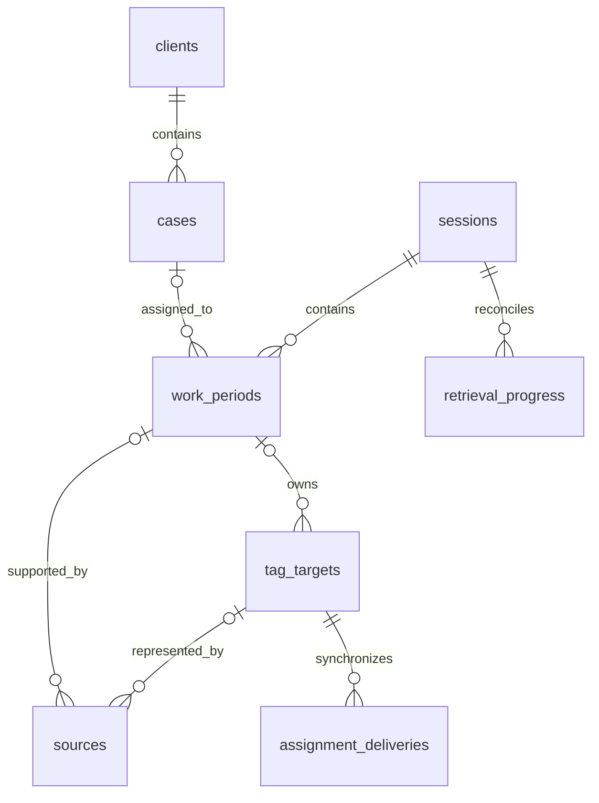

# SQLite data model

This reference distinguishes the agreed logical model from implemented SQLite storage. [Requirements](REQUIREMENTS.md) owns business behavior; [architecture](ARCHITECTURE.md) owns component boundaries. The [original schema](reference/ORIGINAL_DATABASE.md) preserves the earlier task/subtask design and French identifiers.

`src/backend/adapters/sqlite/migrate.ts` owns the versioned migrations, including constraints and triggers. Drizzle mappings in `src/backend/adapters/sqlite/tables.ts` describe runtime queries over `node:sqlite`. They do not migrate storage. [Storage ownership](ARCHITECTURE.md#storage-and-implementation-gates) defines retained SQL and transactions.

API startup initializes or upgrades `TIMEKEEPER_DB`, defaulting to `data/timekeeper.db` relative to the repository root. It creates neutral preferences and ten task types without business records. [Setup](SETUP.md) never opens the database.

## Migrations

| Migration | Scope                                                                                                            |
| --------- | ---------------------------------------------------------------------------------------------------------------- |
| 1         | Sessions, periods, evidence, and recovery.                                                                       |
| 2, 3      | Retained mockup fields and billing extensions.                                                                   |
| 4         | `demo_block_periods`, the explicit imported block-to-period link.                                                |
| 5         | Pill preferences under the migration ledger.                                                                     |
| 6         | Compatibility entry IDs and source relocation history for replay.                                                |
| 7         | Invoice currency, backfilled only when historical period snapshots establish it.                                 |
| 8         | Immutable canonical case references.                                                                             |
| 9         | Extension-field guards and foreign-key indexes.                                                                  |
| 10        | Nonempty identities, safe integer money, durations and revisions, currency codes, and versioned export receipts. |
| 11        | Original transition fingerprints for reconstruction-proposal replay.                                             |
| 12        | Retrieval content versions for bounded replay of older identity-only checkpoints.                                |
| 13        | Persisted history-generation jobs, private workflow snapshots, and reviewable proposals.                         |

Historical migrations remain frozen. New migrations preserve existing rows. Mapping, state-parity, upgrade, constraint, and chronological recovery tests cover local storage behavior, not provider integration.

## How to read the schema

| Table                       | What one row means                                            | Main relationships                                          |
| --------------------------- | ------------------------------------------------------------- | ----------------------------------------------------------- |
| `clients`                   | A client                                                      | Has cases.                                                  |
| `cases`                     | A legal case                                                  | `client_id` identifies its client.                          |
| `sessions`                  | An explicitly started recording-workflow session              | Contains work periods between its start and end boundaries. |
| `work_periods`              | A piece of work to assign, correct, validate, and mark billed | `session_id` is required; `case_id` can be unknown.         |
| `sources`                   | A recorded observation or evidence reference                  | `work_period_id` can be unknown until reconciliation.       |
| `task_types`                | An editable category such as drafting or document review      | A period can reference it through `task_type_id`.           |
| `invoices`, `invoice_lines` | An issued invoice and its frozen lines                        | Link billed work and expenses to the invoice.               |

A period derives its client from its case. Source review, time validation, availability, and billing are independent. `NULL` means unknown or unset. Zero is a known value. Sources establish observations, not continuous duration.

### Why some IDs are strings

Business and workflow IDs use SQLite `TEXT` and JSON strings. New clients, cases, and manual periods normally use UUIDs. Producers can supply stable opaque session, period, and source IDs before insertion. Those IDs survive delivery retries and replay. They encode no client, date, or display name. A case's readable `reference` is separate.

Local categories, invoices, expenses, audit rows, and export receipts use integer sequences. Numeric period aliases belong only to the deprecated API.

### Why fixed states are text

SQLite fixed states use constrained text. Drizzle narrows TypeScript values but does not replace SQL checks. Editable catalogues such as `task_types` use separate tables.

| Column                                | Allowed states                        | Meaning                                                     |
| ------------------------------------- | ------------------------------------- | ----------------------------------------------------------- |
| `cases.status`                        | `active`, `archived`                  | Whether the case remains in the active catalogue.           |
| `work_periods.assignment_origin`      | `unresolved`, `automatic`, `lawyer`   | How its current assignment was made.                        |
| `work_periods.time_validation_status` | `unvalidated`, `validated`            | Whether the effective case and duration have been reviewed. |
| `work_periods.billing_status`         | `unbilled`, `billed`                  | Whether the work has been billed.                           |
| `sources.validation_status`           | `unvalidated`, `validated`            | Whether the observation has been reviewed.                  |
| `sources.availability_status`         | `unknown`, `available`, `unavailable` | Whether the referenced evidence is retrievable.             |

`src/backend/domain/states/` owns runtime members and derived types, exposed and registered through `states.ts`. `BillingStatus.Billed` stores and transmits `"billed"`. Domain records, row readers, validators, and mappings reuse this vocabulary. Feature-local tabs and sort options remain feature-owned.

`scripts/sync-state-contract.ts` generates named OpenAPI state schemas and `src/contracts/states.generated.ts`. The frontend imports generated members instead of backend code. `npm run contract:gen` then regenerates API types and validators. Generated files are not edited directly. Persisted state changes require a new migration and transition rules. Historical SQL literals stay frozen.

`SystemTaskCode` owns the ten built-in task codes. These codes are reserved and immutable because invoice rules identify research and travel by code. Labels remain editable. Custom tasks can use other codes and rename them. Both current and deprecated API writes enforce these restrictions. Previously renamed built-in tasks require explicit repair because their identity cannot safely be inferred from a label.

Unsupported stored states produce integrity conflicts rather than defaults. Client, case, and settings updates can repair affected fields by validating the result and rolling back incomplete repairs. Raw preimages remain available for audit and removal of invalid markers or client rules. Invalid historical nonbillable reasons require an explicit valid replacement or `null`. Unrelated operations stay strict. An uninvoiced expense can be removed without decoding its invalid category. Revision guards, billing locks, and invoice ownership still apply.

### Schema and contract file ownership

| File                                          | Responsibility                                                                                   |
| --------------------------------------------- | ------------------------------------------------------------------------------------------------ |
| `src/backend/adapters/sqlite/migrate.ts`      | Creates and upgrades the physical SQLite schema, constraints, indexes, and triggers.             |
| `src/backend/adapters/sqlite/tables.ts`       | Maps SQLite columns to typed Drizzle queries. It does not apply migrations.                      |
| `src/backend/domain/states/` and `states.ts`  | Own runtime state values, types, and the generation registry.                                    |
| `scripts/sync-state-contract.ts`              | Generates named OpenAPI state components and frontend runtime values from the domain vocabulary. |
| `src/contracts/openapi.yaml`                  | Defines HTTP routes, JSON fields, and request/response contracts.                                |
| `src/contracts/states.generated.ts`           | Generated runtime state members and types for frontend use. Do not edit directly.                |
| `src/contracts/generated.ts`                  | Generated TypeScript API types. Do not edit directly.                                            |
| `src/contracts/request-contract.generated.ts` | Generated request schemas used by API validation. Do not edit directly.                          |
| `src/backend/adapters/sqlite/schema.sql`      | Historical schema for explicit fixtures. Upgrades preserve existing tables.                      |

`openapi.yaml` uses JSON syntax, which is valid YAML. `npm run contract:gen` regenerates state values, API types, and validators. SQL columns use `snake_case`. Current JSON fields use `camelCase`.

Fresh initialization omits historical singular tables such as `client`, `matter`, and `time_entry`. Upgrades preserve existing ones, and explicit fixtures can create them. Compatibility projections use canonical records. Missing optional historical capture collections return empty collections. Unsupported historical writes return controlled errors. Missing canonical storage remains an error.

### Units and defaults

Durations are integer milliseconds. Monetary amounts and rates are integer minor units with a separate currency. Research-cap `value` uses tenths of an hour: `5` means 30 minutes. A `nonbillable_travel` row enables the rule. Its value is not a duration.

`src/shared/client-rule-policy.ts` owns the existing 30-minute research-cap default and the six-minute conversion for each stored unit. The API and Settings reuse this policy without changing stored values.

New-workspace USD, zero base rate and tax, singleton settings, conversion factors, and viewport dimensions are explicit defaults or constants, not captured business data.

Migration 10 rejects null or blank text identities, fractional or unsafe integer amounts and durations, and invalid currency codes. Inserts check all guarded fields. Updates check changed fields, preserving untouched historical values. It does not renumber records or rebuild tables.

### Reviewed revisions in API requests

Period details, duration, and billing require `expectedRevision`. Time validation requires `expectedEffectiveRevision`. Assignment requires `expectedAssignmentRevision`. Missing guards are invalid requests. Stale guards produce conflicts. The interface retains drafts and requires an explicit reload before resubmission.

## Data formats in the application

Application records use `observedAppName`, `observedWindowTitle`, and `recognitionConfidence`. SQLite retains its existing `demo_app`, `demo_window_title`, and `demo_confidence` columns through explicit row mappings. HTTP responses also retain deprecated `demoApp`, `demoWindowTitle`, and `demoConfidence` aliases. Source-pack redaction covers both representations. This naming change requires no data migration.

The local API sends JSON to React. Drizzle maps SQL columns. OpenAPI defines payloads and generates types and request validators.

`/api/catalog` independently loads catalogue data. `/api/workspace` reads catalogue and core records in one transaction with optional calendar, client, and case filters. Audit and reconstruction reads expose separate availability. Their failure cannot block Settings. Current screens use canonical tables rather than historical `matter`, `block`, or `time_entry` payloads.

| Meaning              | SQLite column              | Current JSON field                                   |
| -------------------- | -------------------------- | ---------------------------------------------------- |
| Work-period identity | `work_periods.id`          | `WorkPeriod.id`, a string                            |
| Assigned case        | `work_periods.case_id`     | `caseId`, a string or `null`                         |
| Case owner           | `cases.client_id`          | `clientId`, a string                                 |
| Detected duration    | `detected_duration_ms`     | `detectedDurationMs`, integer milliseconds or `null` |
| Lawyer's correction  | `duration_override_ms`     | `durationOverrideMs`, integer milliseconds or `null` |
| Start time           | `started_at`               | `startedAt`, a UTC timestamp                         |
| Hourly rate          | `hourly_rate_cents`        | `hourlyRateCents`, integer cents or `null`           |
| Global hourly rate   | `global_hourly_rate_cents` | `settings.globalHourlyRateCents`, integer cents      |
| Unknown opening date | `opened_on IS NULL`        | `openedOn: null`, displayed as unknown               |

IDs carry no numeric meaning. Audit links use `periodId`. Source and period identities stay separate. SQLite flags use `0` and `1`. JSON uses booleans. An effective duration of 900000 milliseconds is 15 minutes. Issued invoices retain their currency, timezone, and monetary snapshots. Unknown historical values stay unknown.

### Calendar dates and timestamps

`src/shared/dates.ts` uses `date-fns` 4.1.0 and `@date-fns/tz` 1.4.1. Date-only values such as `2026-03-31` preserve calendar meaning. Timestamps such as `2026-03-30T22:30:00Z` identify instants. Impossible dates fail validation. Month subtraction clamps to the last valid day.

The interface sends the desktop system timezone explicitly for filtered reads, invoices, and exports. Current views select whole periods by their start day without clipping or midnight splitting. Those product rules remain open in [requirements](REQUIREMENTS.md).

Day boundaries account for daylight saving: a day can span 23 or 25 elapsed hours. Activity uses elapsed time since local midnight with actual clock labels. Skipped or repeated hours do not change durations. Issued invoices and saved exports preserve original snapshots.

### Retained compatibility API

`CompatibilityApiService` and `api/compatibility-routes.ts` preserve deprecated response shapes, numeric entry aliases, and upgrade support. Current screens and exports use canonical IDs. The old `tenths_of_hour` projection represents six-minute units without rounding individual periods. Removing historical tables requires a separate migration. Deprecated `demo*` response fields are aliases for observation metadata; their names do not identify fixture data or establish continuous work duration.

Deprecated writes translate explicit fields into canonical `CatalogService` or `PeriodReviewService` commands within the application transaction. They cannot update arbitrary mapped columns. Approval requires `expected_effective_revision`, or `expected_effective_revisions` keyed by canonical period ID for bulk approval. Missing guards fail validation. Stale guards conflict.

New `source_exports.format_version = 2` receipts store canonical IDs and options as JSON arrays. Historical mixed-format receipts remain version 1 without inference or rewriting. Receipt storage version and exported payload version are independent. Deprecated exporters share the receipt writer and hash exact bytes while retaining their payload shape.

Canonical version 2 source packs include string IDs, exact durations, timezone, and a SHA-256 receipt. Redaction affects descriptive text while preserving IDs, timestamps, and links. Metadata exports neither fetch nor blur media.

`src/backend/domain/states/source-export.ts` owns canonical source-pack scopes and options. Contract generation supplies the same values to API validation and React. Shared presentation maps own labels and dialog defaults. Deprecated export formats retain their separate wire values.

## Logical structure and implemented core fields

Canonical tables implement these relationships. Provider mapping and duration derivation remain open.

Each source belongs to at most one period. Unmatched evidence can remain unlinked. Multiple records can alias one provider target, whose authoritative owner applies to every alias.

## Proposed fields and constraints

Field tables use implemented physical names. Migration 1 enforces foreign keys, uniqueness, nonnegative values, session and period bounds, and restricted deletion. Application services own revision transitions and answer guards. Provider mapping, tag delivery, stopped-app receipt, and unresolved transitions remain proposed. UTC event and ingestion times stay separate and retain unrounded precision.

### `clients`

| Field                      | Purpose or constraint                           |
| -------------------------- | ----------------------------------------------- |
| `id`                       | Primary key.                                    |
| `name`                     | Required display name. Not an identity key.     |
| `active`                   | Boolean catalogue status, stored as `0` or `1`. |
| `created_at`, `updated_at` | Record timestamps.                              |

### `cases`

| Field                      | Purpose or constraint                                                                       |
| -------------------------- | ------------------------------------------------------------------------------------------- |
| `id`                       | Primary key.                                                                                |
| `client_id`                | Required foreign key to `clients`.                                                          |
| `reference`, `title`       | Case catalogue information. Folder-matching rules remain undefined.                         |
| `hourly_rate_cents`        | Optional nonnegative case rate; `NULL` falls back to the client rate, then the global rate. |
| `status`                   | Case catalogue status, either `active` or `archived`.                                       |
| `created_at`, `updated_at` | Record timestamps.                                                                          |

References are currently unique and immutable. Reference scope and folder aliases remain open in the requirements. Client names, titles, and paths are not primary keys. No folder-matching rule follows from these fields. Client rates and fixed fees are [retained extensions](REQUIREMENTS.md#purpose-and-scope).

### `sessions`

| Field                      | Purpose or constraint                                                   |
| -------------------------- | ----------------------------------------------------------------------- |
| `id`                       | Stable session identity carried by workflow commands.                   |
| `started_at`               | Explicit Screenpipe start boundary.                                     |
| `ended_at`                 | Nullable explicit Screenpipe end boundary. Cannot precede `started_at`. |
| `revision`                 | Monotonic version for stale-command checks.                             |
| `created_at`, `updated_at` | Local persistence timestamps, distinct from boundaries.                 |

Storage and services permit one active session per workspace. A repeated start returns it unchanged. A start dependent on a pending end waits. Process exit never sets `ended_at`.

The first applied end fixes the boundary. Repeated ends retain it. An end waiting for its known start remains pending with its effective timestamp. Later evidence can fill the recorded boundary without reopening or extending it. Retrieval completeness does not change the end.

### `work_periods`

| Field                                           | Purpose or constraint                                                                                        |
| ----------------------------------------------- | ------------------------------------------------------------------------------------------------------------ |
| `id`, `session_id`                              | Primary key and required session foreign key.                                                                |
| `case_id`                                       | Nullable case foreign key; `NULL` represents an unresolved assignment.                                       |
| `initial_case_id`, `initial_origin`             | Implemented immutable opening intent used to deduplicate a replay after later assignment corrections.        |
| `started_at`, `ended_at`                        | Recorded boundaries, with nullable end while a period is open.                                               |
| `detected_duration_ms`                          | Nullable unrounded derived duration. Derivation is not defined yet.                                          |
| `duration_override_ms`                          | Nullable lawyer correction, converted from minutes. Zero differs from no correction.                         |
| `assignment_origin`                             | Distinguish automatic assignment from lawyer assignment.                                                     |
| `time_validation_status`                        | Review state, independent of source validation and billing.                                                  |
| `effective_revision`                            | Version of the effective case and duration. Increments only when either effective value changes.             |
| `validated_effective_revision`                  | Nullable version explicitly validated by the lawyer.                                                         |
| `time_validated_at`                             | Optional timestamp of the current validation.                                                                |
| `billing_status`, `billed_at`                   | Period-level billed/unbilled status and associated timestamp.                                                |
| `applied_hourly_rate_cents`, `applied_currency` | Nullable rate snapshot. The final product policy for capture timing and currency remains open.               |
| `revision`, `assignment_revision`               | Versions protecting record edits and period assignments. Provider delivery also has its own target revision. |
| `created_at`, `updated_at`                      | Record timestamps.                                                                                           |

Durations are nonnegative. Known boundaries fall within the session, and end cannot precede start. Unknown duration differs from zero.

An override preserves observed boundaries, detected duration, and manual assignment during replay. Effective duration uses the override, including zero, or otherwise detected duration. A changed effective case or duration increments `effective_revision` and invalidates time validation. Validation requires `validated_effective_revision` to match. Identical replay and detected changes masked by an unchanged override preserve validation. Billed-period edit policy remains incomplete.

Reconstruction cannot automatically split, merge, or replace corrected or validated periods. Store proposed boundaries in `reconstruction_conflicts`, outside counted time. Resolution must atomically preserve or replace counted records without double counting.

A period reassignment preserves other periods and sources. Historical corrections cannot change the active case. Periods store no computed client, case, or monetary totals.

### `sources`

| Field                                            | Purpose or constraint                                                                |
| ------------------------------------------------ | ------------------------------------------------------------------------------------ |
| `id`                                             | Local primary key.                                                                   |
| `work_period_id`                                 | Nullable period foreign key for evidence awaiting assignment.                        |
| `screenpipe_instance_id`                         | Stable identity of the source recording store, not a hostname alone.                 |
| `content_type`, `external_id`                    | Provider record type and identity, such as a frame reference.                        |
| `tag_target_id`                                  | Nullable foreign key to the canonical provider target, once its mapping is verified. |
| `recorded_at`, `ingested_at`                     | Observation time and local import time.                                              |
| `app_name`, `window_name`, `url`                 | Optional observed context, stored separately.                                        |
| `excerpt`                                        | Optional literal source text, limited to 1,000 characters by the search importer.    |
| `validation_status`, `validated_at`              | Lawyer source-review state and timestamp.                                            |
| `availability_status`, `availability_checked_at` | Retrieval availability and last check.                                               |

`(screenpipe_instance_id, content_type, external_id)` is unique across imports. Instance identity must distinguish recording stores. Its format remains an adapter contract. External references are not foreign keys into Screenpipe storage.

Record and tag-target identities can differ. Verified `tag_target_id` mappings bind every alias to the target's authoritative owner. Unresolved mapping stays unsynchronized.

The search importer fills missing app/window context and excerpts without replacing stored content. Previously unlinked sources can attach to one existing period under the [source attachment rules](REQUIREMENTS.md#screenpipe-interaction). Identity, review history, and period state remain unchanged.

Recordings are fetched through Screenpipe's API. Unavailable evidence retains its reference and review history without deleting time. A failed fetch alone does not establish deletion, and multiple screenshots cannot multiply duration.

### `tag_targets`

This table exists. Live target mapping and synchronization remain unimplemented.

| Field                                                | Purpose or constraint                                                      |
| ---------------------------------------------------- | -------------------------------------------------------------------------- |
| `id`                                                 | Local primary key.                                                         |
| `screenpipe_instance_id`, `target_type`, `target_id` | Unique canonical identity used by the provider tag API.                    |
| `work_period_id`                                     | Nullable authoritative owner. Derive the desired case through this period. |
| `target_revision`                                    | Monotonic version of target ownership and desired TimeKeeper tags.         |

Ownership or desired-case changes increment `target_revision`. Revisions from different periods are not one sequence. An ownership move supersedes former delivery intents and reconciles the same target to its new tags. All source aliases must agree with its owner.

### `settings`

| Field                      | Purpose or constraint                                           |
| -------------------------- | --------------------------------------------------------------- |
| `id`                       | Single local settings record, constrained to `1`.               |
| `global_hourly_rate_cents` | Nonnegative fallback rate in integer cents.                     |
| `currency`                 | Currency configuration. Change policy remains open.             |
| `workspace_id`             | Stable local identity used in TimeKeeper-owned Screenpipe tags. |
| `updated_at`               | Record timestamp.                                               |

Rates are nonnegative integer minor units. Zero is valid and does not trigger fallback. The local application freezes effective rate and currency when a period becomes billed, clearing them when an uninvoiced period becomes unbilled. Final snapshot timing, currency policy, monetary rounding, and billed-edit rules remain open.

### Implemented billing and compatibility extensions

The 2026-10-17 decision retains client rates, case budgets and flat fees, markers, task types, expenses, issued invoices, and audit/export/review records. Invoices and lines store frozen amounts, billed minutes, applied rates, and selected period IDs. Work periods store precise duration and revisions.

Client rules currently enforce nonbillable travel and a daily research cap during invoice validation. Broader client-rule policy remains undefined. For one case on an invoice, proposed billed minutes equal `ceil(sum(selected effective_duration_ms) / 60000)`. Hourly work fees equal `round(billed_minutes * hourly_rate_cents / 60)`. The invoice service checks proposed values against authoritative periods, rates, expenses, tax, and reviewed revisions before freezing them. Issued invoice membership blocks ordinary unbilling. Final billed-edit and reversal rules remain open.

Canonical tables own writes. Compatibility projections list contract fields explicitly and keep numeric aliases separate from canonical string IDs. Historical tables remain upgrade inputs and explicit fixture capture metadata. These extensions do not define provider behavior or replace the core requirements.

Deprecated block recovery clears only the linked canonical period's exclusion flag. It preserves saved assignment, task, label, exact duration, non-billable reason, validation, and billing fields. Alias restoration and the audit event share the transaction. Recovery neither creates a replacement entry nor rewrites historical capture metadata.

`markers` and `client_rules` store configured recognition cues. `audit_events`, `source_exports`, and `jev_reviews` store audit, export, and review records. Their presence does not imply a live recognition or JEV workflow. [Compatibility recognition](ARCHITECTURE.md#compatibility-recognition) defines the imported algorithm.

## Technical persistence

These local records support recovery. They do not imply a separate queue service.

| Record                     | Implemented storage                                                                                                                 | Required integrity                                                                                                                                                                              |
| -------------------------- | ----------------------------------------------------------------------------------------------------------------------------------- | ----------------------------------------------------------------------------------------------------------------------------------------------------------------------------------------------- |
| `processed_commands`       | Producer identity, command ID, payload fingerprint, session ID, command kind, status, prerequisite ID, terminal result, timestamps. | Unique producer/command pair. Distinguish pending from applied or rejected. Only terminal outcomes are final replay results. A changed payload under the same ID is rejected.                   |
| `pending_questions`        | `question_id`, `session_id`, `work_period_id`, `expected_assignment_revision`, status, response command ID and result.              | Unique question ID and session/period/assignment-revision tuple. An answer targets this period and revision only. Duplicate answers reuse the result. Stale answers produce a visible conflict. |
| `reconstruction_conflicts` | Conflict ID, protected period ID, expected revision, proposed boundaries and source references, status.                             | Store a proposal separately from counted periods. Never include it in totals before explicit resolution.                                                                                        |
| `retrieval_progress`       | Session ID, Screenpipe instance, requested interval, pagination cursor/checkpoint, last completed range, retrieval status.          | Advance progress with committed detail records. A partial or failed read must not claim complete coverage.                                                                                      |
| `assignment_deliveries`    | Canonical tag target ID, target revision, intended TimeKeeper tags, status, attempts, next retry, acknowledgement.                  | Unique target/revision delivery. Deduplicate and serialize by the canonical target, not a source alias or period ID.                                                                            |

Commands, domain changes, and delivery intent must commit atomically when they form one operation. Pending commands wait for prerequisites and cannot be cached as successful transitions. Unknown or conflicting references cannot create or reopen sessions.

Question guards bind the original session, period, and assignment revision. Closure or evidence import may change record revision without invalidating that guard. New assignments, superseded questions, or replaced periods conflict. Creation and answers are deduplicated. A delayed answer cannot default to the active period.

Tag mutations and ownership moves serialize per canonical target across all aliases. Check owner, desired tags, and revision before writing. Resolve prior target operations before committing a move, then reconcile its new revision. Remove only obsolete TimeKeeper-owned tags. Acknowledge only verified tags for the same revision. Stale acknowledgements cannot synchronize a new owner.

Assignment writes create no delivery intent and no worker sends or verifies tags. The Screenpipe catch-up worker advances retrieval progress with committed source references; see [inbox and evidence recovery](ARCHITECTURE.md#inbox-and-evidence-recovery). A stopped Node process cannot receive commands. Off-app delivery remains unresolved.

Local reconstruction protects corrected or validated periods. Source aliases spanning a split boundary or a canonical target with committed delivery produce a conflict instead of an unsafe source move.

## Duration, rounding, and consolidation

SQLite preserves observations, detected durations, and overrides. Interval reconstruction remains undefined. Source counts and app uptime cannot measure duration. Inactivity subtraction stays excluded.

React calculates each selected total from complete precise records using `ceil(sum(effective_duration_ms) / 60000)`. Two 20-second periods total one minute. Each group uses underlying periods rather than rounded subtotals. Unknown duration or incomplete coverage cannot produce a complete total.

Backend invoice checks use shared arithmetic against authoritative records, without storing running period totals. Monetary rounding policy remains open.

## Integrity and recovery examples

[Requirements](REQUIREMENTS.md) owns acceptance examples for session ordering, delayed answers, replay, protected reconstruction, unavailable sources, and provider-alias scenarios. The fields and persistence constraints above support those cases. They do not establish live integration acceptance.

## Decisions still required for dependent behavior

[Requirements](REQUIREMENTS.md) tracks folder identification, duration reconstruction, review prerequisites, billed edits, rate snapshots, rounding, summary selection, and off-app delivery. Storage decisions still include unmatched-evidence association, retrieval checkpoints, retention, audit requirements, and provider-specific constraints.

Referenced clients and cases cannot cascade-delete sessions, periods, or evidence. Prefer archival until deletion and retention rules are agreed. Services validate revisions and relationships in addition to database constraints.

## Historical test fixture

`tests/fixtures/database.ts` loads the historical schema and `tests/fixtures/seed.sql`, converts records through `tests/fixtures/demo-core.ts`, and refreshes fictional recognition. The fixture uses USD and zero sales tax. Period 14 keeps a detected 2 hours 32 minutes and a separate 1 hour 48 minute override. Its failed retrieval interval remains incomplete coverage without inferred time. Invoice `F-2026-0041` is issued; the next number is `F-2026-0042`.

Fixtures run only in explicit test setup. `npm run db:reset` recreates an empty workspace and is limited to disposable data. [Browser acceptance](../tests/acceptance/README.md) uses an isolated database. No live capture or interval inference occurs.

## Comparison-sample importer

`npm run db:samples` invokes `scripts/load-comparison-samples.ts`, with planning and loading in `scripts/comparison-samples/`. It creates labelled fictional clients, cases, closed sessions, and periods with duration overrides for the current and previous months in the selected calendar timezone. It makes no Screenpipe calls.

The importer requires explicit `--database PATH`. Blank or missing paths fail before opening storage. It has no `TIMEKEEPER_DB` or default fallback. `--dry-run` prints the plan without opening a database. Authorized previews use a disposable target. Working-database writes require separate authorization. Existing targets receive a backup; existing sample periods and later edits remain. Setup and startup never call the importer.

## History proposal storage

History-generation source also stores `history_jobs` and `history_proposals` as JSON payloads under migration 13. Jobs retain their session range, snapshot, dispatch state, and private claim. Proposals reference their job and retain review revisions and acceptance results. Public projections omit private claims. Draft proposals contribute no worked time. Explicit acceptance creates a separate period through the application service. See [API D14](API.md#d14-history-proposals-and-explicit-acceptance). This newly connected source still requires runtime acceptance.

## Transition proposal replay

Migration 11 adds nullable `reconstruction_conflicts.transition_fingerprint`. New inferred proposals store a SHA-256 fingerprint of their original session, case, start timestamp, assignment origin, and mode. Mutable expected context revisions are excluded. Identical replay returns the stored proposal; changed payload reuse conflicts.

Existing proposal rows remain intact with a null fingerprint. Their original payload cannot be verified, so reusing their IDs returns a conflict. This migration does not add a reconstruction-apply action or change counted periods.

Retrieval uses the existing `retrieval_progress` table and transaction connection. Its `content_version` starts at zero for legacy identity-only reads. Current-version checkpoints require a successful read with bounded source content. This permits one bounded replay of older history without discarding saved references. Coverage gaps close only when their full requested range has complete reads. Final overlap replays remain bounded and preserve existing source ownership. [API D8](API.md#d8-synchronization-at-startup-through-a-local-inbox-folder) owns recovery behavior; [D13](API.md#d13-source-content-and-late-attachment) owns content replay.

## History generation storage

Migration 13 adds `history_jobs` and `history_proposals`. Jobs retain bounded evidence and catalogue snapshots, a private workflow claim, execution timestamps, completion replay identity and safe failure status. Proposals retain their review revision, source IDs, tentative boundaries, case, observed description and acceptance replay result. Ordinary status reads exclude the private snapshot and claim ID.

Drafts do not populate `work_periods` or calculations. Explicit acceptance inserts a finished canonical period with a lawyer duration override and preserves detected duration as unknown. The period, optional unresolved question, source attachments and proposal acceptance are committed atomically. [Requirements](REQUIREMENTS.md#work-period-proposals-from-history) define the guards.
