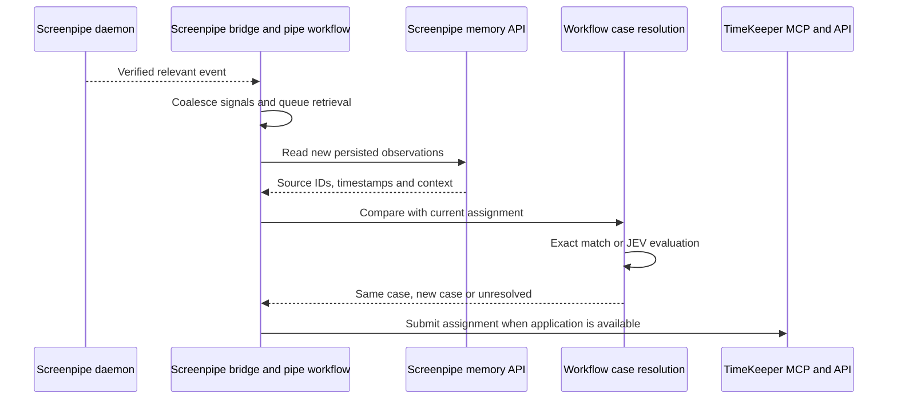

# Screenpipe event triggers

Source review date: 2026-10-17. This refines the earlier integration proposal. Findings concern the public `main` source, not a tested installed release. No connection to personal recordings was opened.

## Three different event mechanisms

| Mechanism | What was verified | Consequence for TimeKeeper |
| --- | --- | --- |
| Internal capture triggers | Screenpipe capture reacts to operating-system activity. | An internal capture trigger is not automatically an external event subscription. |
| SDK session events | `@screenpipe/sdk/session` exposes events for a recorder created by that session. | These do not establish a subscription to an existing Screenpipe desktop instance. |
| Daemon event WebSocket | The server registers `/ws/events` and forwards its internal event bus as JSON. | This is the external subscription candidate for the existing recorder, subject to producer and release verification. |

Sources: [capture architecture](https://docs.screenpipe.com/architecture), [SDK session implementation](https://github.com/screenpipe/screenpipe/blob/main/packages/sdk/session/index.js), and [server routes](https://github.com/screenpipe/screenpipe/blob/main/crates/screenpipe-engine/src/server.rs).

## Existing daemon subscription

The source registers this route outside its generated OpenAPI routes:

```text
ws://localhost:3030/ws/events?images=false
```

Use the configured instance address and required authentication rather than assuming the default address or anonymous access. The Screenpipe-side trigger bridge may use this transport if needed; it must be available independently of the stopped TimeKeeper backend. Keep credentials out of the interface and logs.

The server forwards JSON messages with `name` and `data`. Its query structure exposes `images`; no event-name subscription filter is defined there. Filter relevant messages in the Screenpipe trigger bridge. `images=false` removes the image field for `ocr_result` and `ui_frame`; it does not guarantee all remaining data is nonsensitive.

The handler also accepts incoming application events. TimeKeeper must not publish any. WebSocket protocol acknowledgements are separate from application messages.

Source: [WebSocket handler](https://github.com/screenpipe/screenpipe/blob/main/crates/screenpipe-engine/src/routes/websocket.rs).

## Capture-event producer is not established

The WebSocket handler recognizes the names `ui_frame` and `ocr_result` when removing images. That does not prove the current recorder emits them. The reviewed path from `event_driven_capture.rs` through `paired_capture.rs` to `insert_snapshot_frame_with_ocr` contains no matching event publication. No post-persistence frame notification was established in this path.

Therefore, neither `ui_frame`, `ocr_result`, nor a daemon-level `app_switched` can yet be specified as TimeKeeper's reliable capture trigger. This is a missing verified contract, not proof that no release or other producer can emit such events.

Sources: [capture engine](https://github.com/screenpipe/screenpipe/blob/main/crates/screenpipe-engine/src/event_driven_capture.rs), [paired capture](https://github.com/screenpipe/screenpipe/blob/main/crates/screenpipe-capture/src/paired_capture.rs), [frame persistence](https://github.com/screenpipe/screenpipe/blob/main/crates/screenpipe-db/src/db/frames.rs).

If the target release does not expose a usable notification and immediate event triggering is required, a Screenpipe-side integration change would be necessary: emit a notification after a frame is committed and ready for API retrieval. A proposed payload would include source identity, frame ID, capture timestamp, and schema version, without captured text or images. This event does not currently form a verified contract. It would require a separate authorized implementation and compatibility with protected reads.

## Delivery and availability limits

The event bus uses an in-memory broadcast channel. Its envelope has no durable cursor or replay protocol. A disconnected or slow consumer cannot rely on receiving every event. Use memory API retrieval with deduplication to recover missing observations. Source: [event manager](https://github.com/screenpipe/screenpipe/blob/main/crates/screenpipe-events/src/events_manager.rs).

Current source rejects `/ws/events` with `503 privacy_surface_unavailable` when protected reads are enabled. This response is marked nonretryable. History-only mode also excludes the event route and returns `409 search_only` while background work is suspended. Do not disable protections or continuously reconnect on these states; expose the unavailable event mode and use permitted memory reads. Sources: [privacy middleware](https://github.com/screenpipe/screenpipe/blob/main/crates/screenpipe-engine/src/routes/privacy_release.rs), [history-only middleware](https://github.com/screenpipe/screenpipe/blob/main/crates/screenpipe-engine/src/search_only.rs).

## SDK events are not daemon events

The reviewed SDK session creates its own native `Recorder`. Its `app_switched` event compares `appName`, `windowTitle`, and `browserUrl` through a timer whose default interval is one second. Therefore, the name can cover a window or URL change, not only an application change. It does not detect all content changes when those fields remain identical.

`frames_progress` reports recorder output counts and elapsed time on a default five-second timer. It does not supply a persisted memory frame ID or prove that `/search` can retrieve a capture. `paused` and `resumed` describe that recorder's filter state.

Do not add a second recorder solely to obtain these events. The earlier suggestion to use SDK events as a drop-in wake-up for the existing desktop recorder is withdrawn. Sources: [SDK session](https://github.com/screenpipe/screenpipe/blob/main/packages/sdk/session/index.js), [SDK types](https://github.com/screenpipe/screenpipe/blob/main/packages/sdk/session/index.d.ts).

## Proposed event-driven application flow

Use this flow only after verifying a suitable producer in the selected Screenpipe release:



The event wakes retrieval; stored API evidence supports the decision. A signal can precede indexing, so a first empty query must not establish that nothing happened. Retry within a bounded policy and report incomplete retrieval. Apply the [case and work-period requirements](REQUIREMENTS.md#cases-and-work-periods) when evidence is ambiguous or unavailable.

Subscribe before initial catch-up, coalesce signals while catching up, and deduplicate retrieved observations. After reconnecting, repeat catch-up from saved progress with overlap. Retain low-frequency reconciliation even when event mode works, because this bus is not a durable delivery log.

A content change may reveal a new case within the same tab. Select a trigger that covers persisted content changes, not just app switching. Only invoke JEV when changed evidence cannot be resolved reliably by existing case identifiers. A model response never serves as a recording timestamp or automatic lawyer validation.

## Release acceptance gate

Before choosing event mode as the normal path:

1. Pin the installed Screenpipe release and inspect its producer code.
2. Verify authenticated connection to `/ws/events` under the intended privacy settings.
3. Observe which messages follow app, window, tab, URL, and same-tab content changes on macOS and Windows.
4. Confirm each relevant observation becomes accessible through the memory API, including its stable identity and timestamp.
5. Measure event-to-memory availability and define bounded retries.
6. Verify reconnect, missed events, duplicate events, paused capture, and protected-read rejection.
7. Confirm the event subscriber publishes no arbitrary application events and creates no independent capture session. Case assignment delivery uses a separate verified contract, not an assumed write through this socket.

Until this gate passes, event-driven detection is a candidate architecture, not a verified working integration. Polling remains a fallback and recovery mechanism, not a substitute silently assumed to meet an immediate-trigger requirement.

Return to [integration research](SCREENPIPE_INTEGRATION.md) or the [architecture](ARCHITECTURE.md).

## Assignment after a case-change trigger

The [assignment synchronization contract](ARCHITECTURE.md#screenpipe-assignment-synchronization) defines the return path after resolution. This is distinct from subscribing to capture events. No built-in case-change event or durable assignment endpoint has been verified.

## Can an application switch trigger a skill?

The reviewed native pipe scheduler does not subscribe directly to `app_switch`, `app_switched`, or `window_focus`. It listens to meeting events, `workflow_event`, connection triggers, and pipe completion events. Configuration accepts `trigger.events`, but adding `app_switch` to that list does not connect an operating-system app-switch producer. Natural-language `trigger.custom` is explicitly parsed but not evaluated in the reviewed source. [Pipe configuration and scheduler](https://github.com/screenpipe/screenpipe/blob/main/crates/screenpipe-core/src/pipes/mod.rs).

A skill is instructions available to an agent, not an event listener. Imported skills are copied into pipe and chat sessions. A triggered pipe can instruct its agent to use the TimeKeeper skill, but the pipe needs a supported trigger first. [Skill importer](https://github.com/screenpipe/screenpipe/blob/main/apps/screenpipe-app-tauri/src-tauri/src/skills.rs).

The proposed missing bridge is therefore:

```text
Verified application/context change
  -> bridge to a supported pipe trigger or explicit pipe execution
  -> pipe agent uses the TimeKeeper skill
  -> read Screenpipe memory through API
  -> consult TimeKeeper cases through MCP
  -> keep the active case or resolve a new folder
```

Screenpipe documents explicit execution via `POST /pipes/{name}/run`. Calling that operation from a bridge is an implementation option, not an existing automatic app-switch binding. It also adds an automation-control call to Screenpipe beyond the earlier memory-read path. A Screenpipe-side producer could instead emit a supported workflow event. Either option needs implementation, deduplication, execution limits, and a verified event source. [Scheduled tasks](https://docs.screenpipe.com/scheduled-tasks).

Do not run a full agent on every app switch without filtering: app changes often retain the same case. Opening a different folder within the same file-manager application may not change applications at all. Folder identification remains undefined. The trigger must wake analysis without selecting a case; assignment behavior follows the [requirements](REQUIREMENTS.md#cases-and-work-periods).

This finding is based on source inspection, not a runtime test or installed-release verification. It narrows the previous uncertainty: supported event-triggered pipes exist, but direct app-switch-to-skill wiring is not implemented in the reviewed scheduler.

Product behavior and use cases are maintained in [REQUIREMENTS.md](REQUIREMENTS.md). Session lifecycle and command delivery while TimeKeeper is closed are defined in [ARCHITECTURE.md](ARCHITECTURE.md). This event research does not establish durable command delivery.
