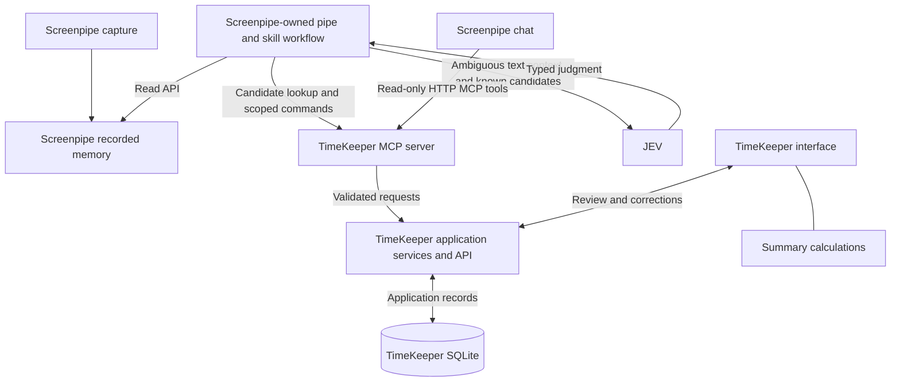

# Screenpipe integration research

Research date: 2026-10-17. This document separates documented provider capabilities from the proposed TimeKeeper design. Public documentation was reviewed; no personal recordings were accessed, no provider calls were executed against user data, and no integration was implemented. Pin and test the installed Screenpipe release before implementation.

## Required outcome

Screenpipe supplies all recorded screen evidence through its memory API. The Screenpipe-owned workflow detects context changes from that evidence and submits assignments to TimeKeeper. Screenpipe chat can query TimeKeeper to retrieve the same case identities and assignments. TimeKeeper returns case associations to Screenpipe for the affected activity. See the [architecture](ARCHITECTURE.md) for the required adapter; the selected tag-based mechanism is defined in the architecture and remains untested.

Screenpipe captures the visible context. TimeKeeper must resolve that context to its own case catalogue. An observed tab change does not by itself identify a legal case. A legal case can also change inside the same tab, and multiple tabs can belong to one case.

Here, "memory" means recorded activity accessible through Screenpipe's API. The specific `/memories` endpoint contains saved AI knowledge; it is not a complete stream of captured screen changes. Use recorded frames and text as primary evidence. [Screenpipe memories reference](https://docs.screenpipe.com/api-reference/memories/list-memories).

## Verified capabilities

| Capability | Documentation evidence | TimeKeeper use |
| --- | --- | --- |
| Capture changes in screen context | Screenpipe documents capture triggered by app switches, focus, interaction, and typing pauses, with accessibility text and OCR fallback. | Observe recorded context changes. This does not guarantee a public browser-tab-change event. |
| Read recorded activity | `GET /search` supports time bounds, pagination, content types, app/window/URL filters, and focus filtering. Frame results can include timestamp, frame ID, text, URL, and window metadata. | Retrieve new observations and compare them with previous observations. |
| Inspect a recorded frame | `GET /frames/{frame_id}/context` provides text, nodes, and extracted URLs. `GET /frames/{frame_id}` provides the recorded screenshot. | Enrich ambiguous observations and display evidence for review. |
| Let chat call an external MCP server | The changelog documents custom HTTP MCP connections with a name, URL, optional headers, connection testing, and enablement. | Connect Screenpipe chat to TimeKeeper's read-only tools. |
| SDK session events | Source confirms `app_switched` and `frames_progress` belong to a recorder created by the SDK session. | Not a drop-in subscription to the existing desktop recorder. See the event review. |
| Daemon event transport | Source registers `/ws/events`, forwarding the internal event bus. | Candidate trigger transport; relevant capture producers and release availability are not established. |

Sources: [capture architecture](https://docs.screenpipe.com/architecture), [search reference](https://docs.screenpipe.com/api-reference/search/search-screen-and-audio-content), [frame context](https://docs.screenpipe.com/api-reference/frames/get-frame-context), [frame image](https://docs.screenpipe.com/api-reference/frames/get-frame-by-id), and [Screenpipe changelog](https://docs.screenpipe.com/changelog).

The search reference and bundled skills can evolve at different speeds. Treat response fields as version-dependent and validate the actual returned content types. A field can be missing; a missing URL must not be interpreted as an unchanged case.

## Recommended two-way architecture



Screenpipe owns the pipe/skill workflow. The Node backend validates and persists its commands and provides shared case services; it does not orchestrate a parallel detection workflow. Summary calculations remain in the interface.

### Screenpipe queries TimeKeeper

Register a TimeKeeper HTTP MCP server in Screenpipe's Connections settings. The exact transport implementation must be tested against the chosen release; the documented support for HTTP does not by itself prove every transport variant works.

Proposed tools, not existing Screenpipe APIs:

| Tool | Input | Result |
| --- | --- | --- |
| `find_cases` | Search text and optional client ID | Existing case IDs, references, titles, client IDs, and status. |
| `get_case` | Case ID | Current case metadata. |
| `get_period_context` | Period ID or source references | Stored assignment and evidence references. Inference stays in the Screenpipe workflow. |
| `list_time_entries` | Time bounds and optional case/client ID | Stored entry details with validation and billing states. |

These tools use the application API, never direct SQLite access. Chat can ask which case a recorded period belongs to and receive the actual `case_id`. Tool responses do not create or update Screenpipe memories. Instruction text alone does not register an MCP connection or implement a tool. Current source defines an importable skill as a folder containing `SKILL.md` with YAML `name` and `description`, then Markdown instructions. Plan an explicitly imported `timekeeper/SKILL.md` separately from the MCP connection; the earlier generic `skills.md` placeholder is superseded. This is verified in current source, not in the installed app. [Official skill importer](https://github.com/screenpipe/screenpipe/blob/main/apps/screenpipe-app-tauri/src-tauri/src/skills.rs).

Keep this chat path read-only. The Screenpipe pipe/skill workflow submits assignment writes through separately scoped MCP/API commands validated by the Node backend. Answers to workflow questions use the scoped answer command and its target period, not a general chat-write tool. Chat-calculated totals are deferred beyond the MVP because summary calculation belongs to the interface.

### TimeKeeper queries Screenpipe

The intended trigger path is a verified daemon event followed by a bounded `/search` read. The [event source review](SCREENPIPE_EVENTS.md) establishes the WebSocket transport but not a reliable frame producer in the current capture path. Until that release acceptance gate passes, bounded polling is the available fallback; it must not be presented as satisfying an immediate event-trigger requirement. Use a configurable base URL, time window, and the installed instance's authentication. Keep results local with the supported local-only search configuration, such as `include_cloud=false`. Read focused screen evidence when available. Do not filter retrieval to the current client, case, or application: that would hide transitions to another one.

Example request shape, not an executed request:

```http
GET /search?content_type=accessibility&start_time=<RFC3339>&end_time=<RFC3339>&limit=20&offset=0&include_cloud=false
```

Use OCR records when accessibility evidence is unavailable. Retrieve all pages for a fixed window, deduplicate by source type and stable record identity, then sort observations by capture timestamp. Persist retrieval progress only after processing and saving the records. Revisit an overlapping window for delayed indexing and reconcile older ranges after interruption. Window overlap and polling interval require measurement; no latency guarantee is established.

Read `/frames/{frame_id}/context` only when extra context is needed, and load the screenshot for review on demand. Do not access Screenpipe's database files directly. Evidence retrieval does not write to Screenpipe. A separate assignment adapter is required to return case metadata. The selected mechanism is TimeKeeper-owned source tags, detailed in the architecture; its runtime behavior remains unverified.

## Choosing a detection method

| Method | Assessment |
| --- | --- |
| Daemon `/ws/events`, then REST memory reads | Preferred trigger path if a relevant producer is verified in the selected release. Source confirms the transport, not the required capture notification. |
| Poll recorded memory through REST | Fallback and recovery path. Supports replay using the same evidence. Detection follows recording and indexing latency. |
| SDK session events | Not selected: the reviewed SDK creates its own recorder rather than subscribing to the existing desktop instance. |
| Run a Screenpipe pipe using the TimeKeeper skill | Supported event-triggered tasks exist, but the reviewed scheduler does not directly subscribe to app switching. A bridge or explicit execution is required; see the event review. Choose one assignment writer. |
| Add an independent screen or browser watcher | Outside the requested Screenpipe-memory-only evidence path. Not recommended for this design. |

The REST documentation index omits the daemon WebSocket route. Source inspection establishes `/ws/events`, but no dedicated `tab_changed` or legal-case-change callback was verified. See [event triggers](SCREENPIPE_EVENTS.md) for producer gaps, authentication, delivery limits, and privacy restrictions.

## Resolving the correct case

The following algorithm is a proposal that satisfies the requested automatic-assignment goal without treating every screen change as a case change.

1. Load a new recorded observation with source ID, timestamp, app, window, URL, and relevant text when present.
2. Compare the observation with the previous context. Ignore irrelevant cosmetic changes, but inspect changed text even when the URL and window title stay the same.
3. Retrieve possible cases from TimeKeeper. Folder identification is deferred; the following is a candidate strategy, not an agreed rule. Match a case reference, a known document identifier, or a configured URL/path association before relying on a client name alone.
4. If one active case has an unambiguous identifying match with no conflicting evidence, assign that existing case automatically as an inference pending lawyer validation.
5. Otherwise, use JEV for semantic continuity and candidate selection.
6. Verify that the selected case exists, belongs to the selected client, remains eligible, and still matches the observation being processed.
7. Close and open inferred periods only when the case changes. Preserve unrelated sibling periods and manual corrections. If recovery proposes splitting a corrected or validated period, retain that period and flag a reconstruction conflict without adding candidate time to totals. Use capture timestamps rather than model-response time for the proposed boundary.
8. If ordinary screen content is ambiguous, retain the active case. If a new folder cannot be identified, ask the lawyer using a question ID tied to the affected period and expected assignment revision. Ordinary period closure and evidence imports do not make the answer stale. Keep that period unresolved until answered. Delayed answers must not change a newer active case. The precise transition boundary remains to be defined. Never invent a case ID.

A client name is insufficient when that client has several cases. A case reference appearing in a sidebar or quoted document is not necessarily the active case. Candidate matching must consider the active content and conflicting references. Deterministic rules also need evaluation; they are not automatically reliable simply because they avoid an AI call.

For a case change selected directly in TimeKeeper, the application already knows the chosen ID. Save that explicit user action as the authoritative assignment. Do not ask Screenpipe to rediscover it from the screen. Screenpipe chat obtains the updated assignment through MCP. Exclude the TimeKeeper review interface from automatic classification, or otherwise distinguish reviewing old evidence from doing new case work, to prevent feedback loops.

## JEV's role

TypeSafe's `Noul` returns the probability of a yes/no answer. Use separate questions for whether the client continues and whether the case continues. An uncertain result is not a hard boolean decision. [Noul reference](https://docs.typesafe.ai/primitives/noul).

Use `Choice` to select among known case IDs, with an explicit unresolved/no-match option. Provide references, titles, client relationships, and the recorded text as context. Code maps the selected option to an existing ID. JEV must not generate identifiers or silently create cases. [Choice reference](https://docs.typesafe.ai/primitives/choice).

Proposed evaluation state includes the previous assignment, the current observation, a bounded recent context, and candidate cases. Independent continuity and selection questions can share one request when all inputs are already available. If the first decision changes which candidates must be retrieved, make the second request after that retrieval.

Confidence thresholds must be evaluated with representative case changes, ambiguous names, and incomplete captures. A concentrated model distribution is not proof of a correct assignment. [Confidence guidance](https://docs.typesafe.ai/confidence).

The documented HTTP endpoint is `POST https://api.typesafe.ai/v1/systemone`. Its state accepts text or structured data. This proposal sends selected text context, not an assumed screenshot-understanding input. Using the hosted endpoint sends that context to TypeSafe, so this part of the application is not wholly local. Define the permitted fields and deployment choice before implementation. [TypeSafe API](https://docs.typesafe.ai/api).

## Persistence requirements

The [database design](DATABASE.md) now includes period assignment, source identity, revisions, retrieval progress, and command and delivery records. It is a documentation design, not an applied migration. Integration work must preserve:

- case-matching metadata, such as aliases and known document or URL associations, with explicit scope and precedence;
- source provenance sufficient for replay, including source type, instance/device identity where needed, recorded timestamp, and external record ID;
- assignment state separate from time validation, with method, selected case, candidate evidence, model version where applicable, and unresolved reason;
- retrieval progress and deduplication rules;
- a revision or equivalent stale-result guard so delayed inference cannot replace a newer manual assignment;
- independent period assignment so one correction does not change sibling periods.

Map evidence identity separately to the canonical provider tag target before synchronization. All aliases for one target must agree on its assignment. See the [architecture](ARCHITECTURE.md#screenpipe-assignment-synchronization) for target ownership and delivery ordering. Recorded API capabilities do not establish that this mapping has been verified in the installed release.

## Required acceptance checks

1. Two different tabs concern the same case: keep the case assignment.
2. Two cases belong to the same client: select the case reference, not only the client.
3. A case changes inside one tab without a URL change: use newly recorded content.
4. A detected new-folder transition has no reliable case match: keep its period unresolved and ask the lawyer. Ordinary ambiguous or background content does not clear the active case.
5. A lawyer manually changes the assignment before JEV responds: retain the manual correction.
6. Screenpipe capture is paused or indexing is delayed: display coverage uncertainty rather than inventing work time.
7. TimeKeeper restarts: replay API evidence without duplicating periods. Any change to effective case or duration clears time validation; identical replay preserves it. A proposed split of a corrected or validated period remains a review conflict.
8. Screenpipe chat asks about a period: return the same case ID and validation state as the interface.
9. The lawyer reviews an old case in TimeKeeper: do not count that display as new work on the old case by default.
10. All observations used for automatic assignment have Screenpipe API provenance. Assignment metadata is delivered separately to Screenpipe, with acknowledgement and revision checks; source recordings are not rewritten.

Return to the [architecture](ARCHITECTURE.md) or [README](../README.md).

Product behavior and use cases are maintained in [REQUIREMENTS.md](REQUIREMENTS.md). Session lifecycle, stopped-app command handling, JEV ownership, and source-tag synchronization are defined in [ARCHITECTURE.md](ARCHITECTURE.md).
