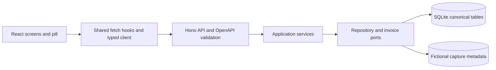

# Implemented architecture

The React and Vite interface calls a local Hono API. The API persists in SQLite through Drizzle and `node:sqlite`; Tauri hosts the main window and floating pill. The Node API is started separately during development and is not yet packaged in the installer. The desktop code must not be treated as proof of native Screenpipe capture, event delivery, tag display or installation behavior.

`src/contracts/openapi.yaml` defines HTTP payloads. `npm run contract:gen` regenerates TypeScript types and runtime request schemas from that contract. The Hono API validates JSON requests with Ajv 2020 and `ajv-formats`, applies a body limit, and returns sanitized errors. Integration tests call the same Hono app used by the Node server. The core service handles session commands, periods, guarded questions, precise corrections, separate validations, source state and billing status through ports. The invoice service validates period IDs, case ownership, time validation, billing state and expected effective revisions, then stores the React-supplied snapshot and freezes applied rates. It does not recalculate totals. React's pure `calculations/summary.ts` and `calculations/billing.ts` own displayed totals and proposed invoice arithmetic.

Current screens use the typed canonical catalogue through `CatalogService`, its port, and the Drizzle repository. Activity uses canonical periods, linked source excerpts, and audit events keyed by period ID. Settings and catalogue writes use `/api/catalog/*`. The old UI payloads and numeric entry aliases are absent from current screen state.

`CompatibilityApiService` and `api/compatibility-routes.ts` retain deprecated API contracts for older callers. Their projections do not depend on historical table introspection. They are separate from current catalogue and export services. See [data formats](../DATABASE.md#data-formats-in-the-application) for identities, field names, units, and retained storage compatibility.

The legacy manual-entry endpoint returns HTTP 501 without writing records because its input lacks explicit session and time boundaries. The canonical manual-period endpoint retains its explicit inputs; the interface remains disabled pending the product rules. Pause endpoints store annotations and do not control recording. Assignment does not learn markers. Invoice CSV formatting lives in `application/invoice-csv.ts` and uses the invoice's stored currency.

Shared fetch hooks own request cancellation, stale-response guards, and refresh state. The typed `openapi-fetch` client remains the transport. Mounted resources poll every five seconds while visible and refresh on focus or resume. Polls skip an in-flight request; an explicit refresh can replace it. This includes filtered day, calendar, and Activity queries, so they follow external and pill changes. A successful mutation remains successful if the subsequent refresh fails; batch validation refreshes committed successes after a later request fails. The interface reports refresh failures separately. Native modal dialogs provide focus containment and restoration without another UI dependency. These mechanisms do not establish an atomic snapshot across separate API reads.

Settings sections own their forms and errors. The Settings page owns navigation and save notifications; request bodies use generated contract types. Cases delegates search requests, stale-response handling, and keyboard selection to `CaseSearch`, while one hook records recent case identities. My day delegates grouping, filtering, gap insertion, sorting, and CSV order to the pure `dayView` calculation. Screen components retain requests, mutations, and focus handling.

`SourceExportService` reads one canonical snapshot and selects periods by their string IDs. It writes version 2 JSON with exact durations and the selected calendar timezone. The service redacts declared descriptive text fields, preserves structural values, hashes the exact payload, and commits the receipt and audit together. Source excerpts are stored observations; the export does not fetch or blur media. Invoice CSV uses a focused formatter and the issued invoice's frozen currency.

The shared date module uses `date-fns` 4.1.0 and `@date-fns/tz` 1.4.1. It separates date-only values from instants and supplies strict date validation, month arithmetic, timezone conversion, and daylight-saving-aware day bounds. See the [calendar policy](../DATABASE.md#calendar-dates-and-timestamps).

The user selected Drizzle on 2026-10-17 after reviewing its release-candidate requirement for the [native SQLite adapter](https://orm.drizzle.team/docs/sqlite/connect-node-sqlite). Runtime queries use its typed table mappings on the existing `node:sqlite` connection. Versioned SQL migrations and database constraints retain their authority. See [storage ownership](../ARCHITECTURE.md#storage-and-implementation-gates) for migration and transaction boundaries. No queue service or global state library is required by the implemented rules.

The source timeline positions canonical periods by elapsed time since local midnight and labels them with local clock times. Its preview shows linked stored observation text. It does not fetch media, infer continuous time or control Screenpipe recording. The shell and pill display the active session and current period; closing the UI does not end the stored session. They cannot accept commands while the Node API is stopped. Screenpipe workflow installation, stopped-app delivery and provider verification remain open.

The five tabs and pill retain the approved light and dark tokens in `src/frontend/shared/theme.css`. See [interface behavior](interface.md), [schema implementation](schema.md), [recognition](recognition.md) and [desktop shell](desktop.md).
