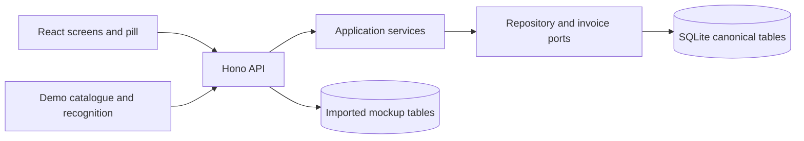

# Implemented architecture

The React and Vite interface calls a local Hono API. The API persists in SQLite through `node:sqlite`; Tauri hosts the main window and floating pill. The Node API is started separately during development and is not yet packaged in the installer. The desktop code must not be treated as proof of native Screenpipe capture, event delivery, tag display or installation behavior.

`src/contracts/openapi.yaml` defines HTTP payloads; `npm run contract:gen` regenerates `src/contracts/generated.ts`. The imported core service handles session commands, periods, guarded questions, precise corrections, separate validations, source state and billing status through ports. The invoice service validates period IDs, case ownership, time validation, billing state and expected effective revisions, then stores the React-supplied snapshot and freezes applied rates. It does not recalculate totals. React's pure `calculations/summary.ts` and `calculations/billing.ts` own displayed totals and proposed invoice arithmetic.

The imported mockup catalogue and recognition screens still read the old demo tables. Their API mutations enter the demo application service; its adapter synchronizes corresponding canonical records in one transaction. The canonical assignment path takes precedence for work periods. Marker recognition is a fictional deterministic suggestion source; it does not establish a folder-identification rule or run JEV inference.

The fictional source timeline can simulate a cursor over recorded references. It does not fetch media, infer continuous time or control Screenpipe recording. The shell and pill display the active session and current period; closing the UI does not end the stored session. They cannot accept commands while the Node API is stopped. Screenpipe workflow installation, stopped-app delivery and provider verification remain open.

The six screens retain the approved light and dark tokens in `src/frontend/shared/theme.css`. See [interface behavior](interface.md), [schema implementation](schema.md), [recognition](recognition.md) and [desktop shell](desktop.md).
