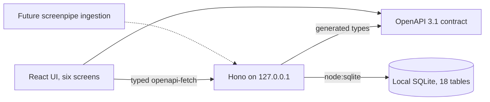

# Architecture

TimeKeepr is a local, single-lawyer application. The React and Vite UI calls only the Hono API on `127.0.0.1`; Hono reads and writes SQLite through Node's built-in `node:sqlite` module. Vite proxies `/api` during development. Tauri 2 hosts the main window and pill. The Node API remains a separately started process and is not bundled into the installer.

`src/contracts/openapi.yaml` is the only boundary between UI and server. Change it first, run `npm run contract:gen`, then update both sides and commit the generated `src/contracts/generated.ts`. The server owns pricing, client-rule alerts, invoice previews (including VAT and disbursements), validation, invoice issuance, source pack hashes and audit entries. The UI displays monetary values received from the server; it never computes an hourly rate or invoice tax. The research limit is presented as a warning before billing, while a non-billable travel rule sets the calculated amount to zero. Issued invoice lines remain frozen after later price changes.

| Screen       | Reads                                                   | Writes                                                           |
| ------------ | ------------------------------------------------------- | ---------------------------------------------------------------- |
| Desk         | block, time_entry, pause, matter                        | block, time_entry, pause, audit_event                            |
| My day       | block, time_entry, task, matter, client, source         | time_entry, block, marker, audit_event                           |
| Cases        | client, matter, marker, time_entry, invoice             | matter, marker, audit_event                                      |
| Pre-invoices | time_entry, expense, client_rule, invoice, invoice_line | invoice, invoice_line, time_entry, expense, setting, audit_event |
| Source       | time_entry, block, source, jev_review, audit_event      | source_export, audit_event                                       |
| Settings     | firm, client, matter, task, client_rule, setting        | the same tables and audit_event                                  |

The active data set is fictional and fixed to 16 October 2026. The Source timeline uses source references and a simulated frame cursor for the demo; there is no live media ingestion. `npm run db:reset` replaces the local SQLite file with the exact demo seed. The `POST /api/demo/reset` action resets the active database within a transaction. Both are for the demo, not for production records.

`src/backend/adapters/screenpipe/types.ts` defines a future consolidation boundary for screenpipe OCR and audio search results. It does not connect to screenpipe. Jev and local text generation are also outside this implementation.

The approved interface uses the light and dark tokens in `src/frontend/shared/theme.css`; `src/frontend/shared/legacy.css` keeps styling for API workflows that were already present. Geist and Geist Mono are bundled from Fontsource so the UI works offline under the desktop content security policy. Shared components each have their own file in `src/frontend/shared/components/`. Runtime dimensions for timelines, audio bars, and progress indicators are registered as CSS rules by `src/frontend/shared/geometry.ts`. See [Interface](interface.md) for screen behavior and controls.

## Recognition and case references

`src/backend/domain/recognition.ts` scores stored block signals against clients, matters, and markers without calling screenpipe. The API exposes `GET /api/blocks/{id}/recognition` for Source and My day. The response contains ranked candidates, matching cues, source locations, threshold, and decision. The server generates `YYYY-NNN-CODE` references on case creation and prevents edits afterward. Assigning a time entry learns a file or email cue from the window title when absent. See [Recognition](recognition.md) for scoring and demo examples.

Cases displays Time entries and Markers tabs. The UI shows case references with Geist Mono. The sidebar theme selector saves Light, Dark or Auto in localStorage; Auto follows the system preference. Keys 1–4 open My day, Cases, Pre-invoices and Source when focus is outside a form field.

## Code boundaries in this import

The recognition, nomenclature, and pricing calculations in `src/backend/domain/` are pure. The assignment update route calls `src/backend/application/assignment.ts` through `src/backend/ports/assignment.ts`, implemented by the SQLite adapter. Other mockup routes still combine use-case decisions with SQLite calls in the Hono handler; this is tracked in [Mockup gap](../MOCKUP_GAP.md). React reads and writes through the typed HTTP client only. The API still computes and stores monetary amounts, also tracked as a gap.
