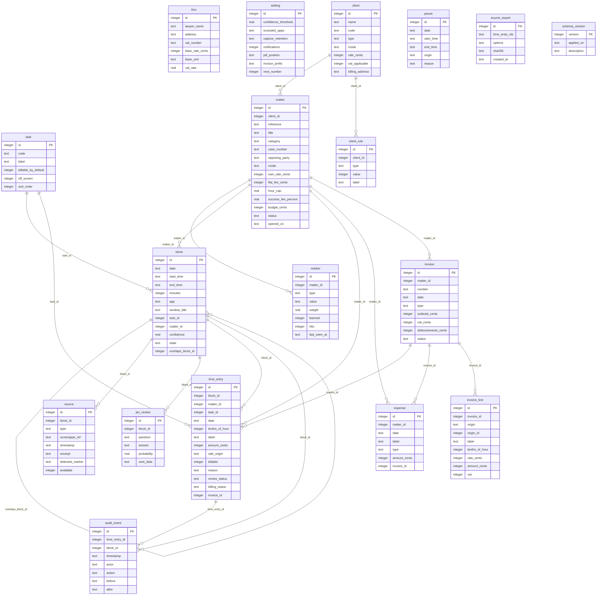

# Database model

SQLite is a provisional choice for a single-device application. The team must validate it before release. Media stays in screenpipe; `source` stores references and short excerpts only. All monetary values are integer cents, and tracked durations are tenths of an hour. The demo date is fixed at 2026-10-16.

Foreign keys are enabled for every application connection. The schema enforces enum values with `CHECK`, nonnegative amounts, valid Boolean integers, and useful indexes. An issued invoice is frozen in `invoice_line`; later rate changes cannot alter billed entries.

## Tables and columns

### `firm`

The sole lawyer and default pricing. Demo rows: **1**.

| Column            | SQLite type | Meaning and constraints                                                              |
| ----------------- | ----------- | ------------------------------------------------------------------------------------ |
| `id`              | `INTEGER`   | Stable primary key; primary key                                                      |
| `lawyer_name`     | `TEXT`      | Lawyer display name; required                                                        |
| `address`         | `TEXT`      | Firm address placeholder; required                                                   |
| `vat_number`      | `TEXT`      | VAT registration placeholder; required                                               |
| `base_rate_cents` | `INTEGER`   | Fallback hourly rate in integer cents; required; CHECK `base_rate_cents>=0`          |
| `base_unit`       | `TEXT`      | Label for fallback rate unit; required; CHECK `base_unit IN ('hour','intervention')` |
| `vat_rate`        | `REAL`      | VAT percentage; required; CHECK `vat_rate>=0 AND vat_rate<=100`                      |

### `setting`

Local preferences and invoice numbering. Demo rows: **1**.

| Column                 | SQLite type | Meaning and constraints                                                                         |
| ---------------------- | ----------- | ----------------------------------------------------------------------------------------------- |
| `id`                   | `INTEGER`   | Stable primary key; primary key                                                                 |
| `confidence_threshold` | `REAL`      | Minimum automatic assignment confidence; required; CHECK `confidence_threshold BETWEEN 0 AND 1` |
| `excluded_apps`        | `TEXT`      | Comma-separated capture exclusions; required                                                    |
| `capture_retention`    | `TEXT`      | Local retention policy text; required                                                           |
| `notifications`        | `INTEGER`   | Whether pill notifications are enabled; required; CHECK `notifications IN (0,1)`                |
| `pill_position`        | `TEXT`      | Placement of the desktop pill; required                                                         |
| `invoice_prefix`       | `TEXT`      | Prefix of generated invoice numbers; required                                                   |
| `next_number`          | `INTEGER`   | Next four-digit invoice suffix; required; CHECK `next_number>0`                                 |

### `task`

Work categories and default billability. Demo rows: **10**.

| Column                | SQLite type | Meaning and constraints                                                          |
| --------------------- | ----------- | -------------------------------------------------------------------------------- |
| `id`                  | `INTEGER`   | Stable primary key; primary key                                                  |
| `code`                | `TEXT`      | Short task code; required                                                        |
| `label`               | `TEXT`      | User-visible work label; required                                                |
| `billable_by_default` | `INTEGER`   | Default billability for new work; required; CHECK `billable_by_default IN (0,1)` |
| `off_screen`          | `INTEGER`   | Whether the task can be added manually; required; CHECK `off_screen IN (0,1)`    |
| `sort_order`          | `INTEGER`   | Display order; required                                                          |

### `client`

Clients and their hourly rate. Demo rows: **8** (three original and five additional fictional clients).

| Column            | SQLite type | Meaning and constraints                                                      |
| ----------------- | ----------- | ---------------------------------------------------------------------------- |
| `id`              | `INTEGER`   | Stable primary key; primary key                                              |
| `code`            | `TEXT`      | Unique uppercase short name, e.g. `DUPONT`; required                         |
| `name`            | `TEXT`      | Client display name; required                                                |
| `type`            | `TEXT`      | Category of this record; required; CHECK `type IN ('individual','company')`  |
| `mode`            | `TEXT`      | Pricing arrangement; required; CHECK `mode IN ('hourly','subscription')`     |
| `rate_cents`      | `INTEGER`   | Hourly rate in integer cents; required; CHECK `rate_cents>=0`                |
| `vat_applicable`  | `INTEGER`   | Whether VAT applies to the client; required; CHECK `vat_applicable IN (0,1)` |
| `billing_address` | `TEXT`      | Invoice address placeholder; required                                        |

### `matter`

Client matter, pricing mode and budget. The `matter` table is displayed as a “case” in the interface. Demo rows: **12** (seven additional fictional cases, one closed).

| Column                | SQLite type | Meaning and constraints                                                                                   |
| --------------------- | ----------- | --------------------------------------------------------------------------------------------------------- |
| `id`                  | `INTEGER`   | Stable primary key; primary key                                                                           |
| `client_id`           | `INTEGER`   | Owning client; required; FK → `client.id`                                                                 |
| `reference`           | `TEXT`      | Immutable unique `YYYY-NNN-CODE` reference; required                                                      |
| `title`               | `TEXT`      | Matter name; required                                                                                     |
| `category`            | `TEXT`      | Legal practice area; required                                                                             |
| `case_number`         | `TEXT`      | Court reference or N/A; required                                                                          |
| `opposing_party`      | `TEXT`      | Other party or N/A; required                                                                              |
| `mode`                | `TEXT`      | Pricing arrangement; required; CHECK `mode IN ('hourly','flat_fee')`                                      |
| `own_rate_cents`      | `INTEGER`   | Optional matter-specific hourly rate; nullable; CHECK `own_rate_cents>=0`                                 |
| `flat_fee_cents`      | `INTEGER`   | Agreed flat fee in integer cents; nullable; CHECK `flat_fee_cents>=0`                                     |
| `hour_cap`            | `REAL`      | Optional negotiated hour ceiling; nullable; CHECK `hour_cap>=0`                                           |
| `success_fee_percent` | `REAL`      | Optional result-based percentage; not calculated; nullable; CHECK `success_fee_percent BETWEEN 0 AND 100` |
| `budget_cents`        | `INTEGER`   | Optional client budget in integer cents; nullable; CHECK `budget_cents>=0`                                |
| `status`              | `TEXT`      | Lifecycle status; required; CHECK `status IN ('open','closed')`                                           |
| `opened_on`           | `TEXT`      | Matter opening date; required                                                                             |

### `marker`

Explicit recognition cue for a matter. Demo rows: **25**. The matter reference and client name are implicit cues, read directly from `matter` and `client`.

| Column         | SQLite type | Meaning and constraints                                                                              |
| -------------- | ----------- | ---------------------------------------------------------------------------------------------------- |
| `id`           | `INTEGER`   | Primary key                                                                                          |
| `matter_id`    | `INTEGER`   | Owning matter; FK → `matter.id`                                                                      |
| `type`         | `TEXT`      | `reference`, `case_number`, `opposing_party`, `client_name`, `file`, `email`, `domain`, or `keyword` |
| `value`        | `TEXT`      | Cue text; unique with matter and type                                                                |
| `weight`       | `REAL`      | Recognition weight, between 0 and 1                                                                  |
| `learned`      | `INTEGER`   | Set to 1 after a user assignment                                                                     |
| `hits`         | `INTEGER`   | Recognition count; default 0                                                                         |
| `last_seen_at` | `TEXT`      | Last recognized local date and time, nullable                                                        |

Client codes are unique. Matter references are unique, and a trigger prevents later edits. `POST /api/matters` allocates the next firm-wide number for the current calendar year inside a transaction. The seed has two 2025 references (`2025-030-TELAVRONE`, `2025-031-DUPONT`) and ten 2026 references; the latest is `2026-021-VALDORME`, so the next 2026 reference is `2026-022-CODE`. `setting.next_number` remains 42 for the next invoice, `F-2026-0042`.

### `client_rule`

Client billing constraints. Demo rows: **2**.

| Column      | SQLite type | Meaning and constraints                                                                        |
| ----------- | ----------- | ---------------------------------------------------------------------------------------------- |
| `id`        | `INTEGER`   | Stable primary key; primary key                                                                |
| `client_id` | `INTEGER`   | Owning client; required; FK → `client.id`                                                      |
| `type`      | `TEXT`      | Category of this record; required; CHECK `type IN ('daily_research_cap','nonbillable_travel')` |
| `value`     | `INTEGER`   | Marker text or rule limit in tenths of an hour; required; CHECK `value>=0`                     |
| `label`     | `TEXT`      | User-visible work label; required                                                              |

### `block`

Observed activity period. Demo rows: **18**.

| Column              | SQLite type | Meaning and constraints                                                                            |
| ------------------- | ----------- | -------------------------------------------------------------------------------------------------- |
| `id`                | `INTEGER`   | Stable primary key; primary key                                                                    |
| `date`              | `TEXT`      | ISO calendar date; required                                                                        |
| `start_time`        | `TEXT`      | Local start time HH:MM; required                                                                   |
| `end_time`          | `TEXT`      | Local end time HH:MM; null while open; nullable                                                    |
| `minutes`           | `INTEGER`   | Raw block length in minutes; required; CHECK `minutes>=0`                                          |
| `app`               | `TEXT`      | Observed application; required                                                                     |
| `window_title`      | `TEXT`      | Observed window caption; required                                                                  |
| `task_id`           | `INTEGER`   | Detected or approved task category; nullable; FK → `task.id`                                       |
| `matter_id`         | `INTEGER`   | Owning matter; nullable; FK → `matter.id`                                                          |
| `confidence`        | `REAL`      | Assignment probability from zero to one; required; CHECK `confidence BETWEEN 0 AND 1`              |
| `state`             | `TEXT`      | Block workflow state; required; CHECK `state IN ('assigned','to_check','in_progress','discarded')` |
| `overlaps_block_id` | `INTEGER`   | Parent block when activity overlaps; nullable; FK → `block.id`                                     |

### `source`

Pointer to an OCR frame or audio chunk. Demo rows: **20**.

| Column            | SQLite type | Meaning and constraints                                                          |
| ----------------- | ----------- | -------------------------------------------------------------------------------- |
| `id`              | `INTEGER`   | Stable primary key; primary key                                                  |
| `block_id`        | `INTEGER`   | Source block; required; FK → `block.id`                                          |
| `type`            | `TEXT`      | Category of this record; required; CHECK `type IN ('screen','audio','manual')`   |
| `screenpipe_ref`  | `TEXT`      | Frame or audio chunk identifier; no media copied; required                       |
| `timestamp`       | `TEXT`      | Local time or date-time; required                                                |
| `excerpt`         | `TEXT`      | OCR text or transcript excerpt; required                                         |
| `detected_marker` | `TEXT`      | Recognition cue found in the source; required                                    |
| `available`       | `INTEGER`   | Whether the referenced source is available; required; CHECK `available IN (0,1)` |

### `pause`

Capture pause interval. Demo rows: **1**.

| Column       | SQLite type | Meaning and constraints                                                                    |
| ------------ | ----------- | ------------------------------------------------------------------------------------------ |
| `id`         | `INTEGER`   | Stable primary key; primary key                                                            |
| `date`       | `TEXT`      | ISO calendar date; required                                                                |
| `start_time` | `TEXT`      | Local start time HH:MM; required                                                           |
| `end_time`   | `TEXT`      | Local end time HH:MM; null while open; nullable                                            |
| `origin`     | `TEXT`      | Source of pause, invoice line or price; required; CHECK `origin IN ('button','automatic')` |
| `reason`     | `TEXT`      | Reason for non-billing or pause; required                                                  |

### `jev_review`

Stored fictitious closed-question review. Demo rows: **4**.

| Column        | SQLite type | Meaning and constraints                                                      |
| ------------- | ----------- | ---------------------------------------------------------------------------- |
| `id`          | `INTEGER`   | Stable primary key; primary key                                              |
| `block_id`    | `INTEGER`   | Source block; required; FK → `block.id`                                      |
| `question`    | `TEXT`      | Closed question sent to Jev in demo; required                                |
| `answer`      | `TEXT`      | Stored Jev answer; required                                                  |
| `probability` | `REAL`      | Stored Jev answer probability; required; CHECK `probability BETWEEN 0 AND 1` |
| `sent_data`   | `TEXT`      | Masked data sent in demo; required                                           |

### `time_entry`

Time to review and bill. Demo rows: **25**. Eight additional approved, unbilled entries dated before 2026-10-16 cover four new cases; their amounts use the client or case rate.

| Column           | SQLite type | Meaning and constraints                                                                                           |
| ---------------- | ----------- | ----------------------------------------------------------------------------------------------------------------- |
| `id`             | `INTEGER`   | Stable primary key; primary key                                                                                   |
| `block_id`       | `INTEGER`   | Source block; nullable; FK → `block.id`                                                                           |
| `matter_id`      | `INTEGER`   | Owning matter; nullable; FK → `matter.id`                                                                         |
| `task_id`        | `INTEGER`   | Detected or approved task category; required; FK → `task.id`                                                      |
| `date`           | `TEXT`      | ISO calendar date; required                                                                                       |
| `tenths_of_hour` | `INTEGER`   | Rounded duration: 10 means one hour; required; CHECK `tenths_of_hour>0`                                           |
| `label`          | `TEXT`      | User-visible work label; required                                                                                 |
| `amount_cents`   | `INTEGER`   | Calculated or frozen amount in integer cents; required; CHECK `amount_cents>=0`                                   |
| `rate_origin`    | `TEXT`      | Which tier of the pricing cascade applied; required; CHECK `rate_origin IN ('base','client','matter','flat_fee')` |
| `billable`       | `INTEGER`   | Whether time can appear on an invoice; required; CHECK `billable IN (0,1)`                                        |
| `reason`         | `TEXT`      | Reason for non-billing or pause; nullable; CHECK `reason IN ('offered','internal','admin')`                       |
| `review_status`  | `TEXT`      | Lawyer approval state; required; CHECK `review_status IN ('to_review','approved')`                                |
| `billing_status` | `TEXT`      | Billing lifecycle state; required; CHECK `billing_status IN ('not_billable','to_bill','billed')`                  |
| `invoice_id`     | `INTEGER`   | Invoice that froze this item; nullable; FK → `invoice.id`                                                         |

### `expense`

Billable expense or disbursement. Demo rows: **2**.

| Column         | SQLite type | Meaning and constraints                                                         |
| -------------- | ----------- | ------------------------------------------------------------------------------- |
| `id`           | `INTEGER`   | Stable primary key; primary key                                                 |
| `matter_id`    | `INTEGER`   | Owning matter; required; FK → `matter.id`                                       |
| `date`         | `TEXT`      | ISO calendar date; required                                                     |
| `label`        | `TEXT`      | User-visible work label; required                                               |
| `type`         | `TEXT`      | Category of this record; required; CHECK `type IN ('expense','disbursement')`   |
| `amount_cents` | `INTEGER`   | Calculated or frozen amount in integer cents; required; CHECK `amount_cents>=0` |
| `invoice_id`   | `INTEGER`   | Invoice that froze this item; nullable; FK → `invoice.id`                       |

### `invoice`

Issued invoice header. Demo rows: **1**.

| Column                | SQLite type | Meaning and constraints                                                    |
| --------------------- | ----------- | -------------------------------------------------------------------------- |
| `id`                  | `INTEGER`   | Stable primary key; primary key                                            |
| `matter_id`           | `INTEGER`   | Owning matter; required; FK → `matter.id`                                  |
| `number`              | `TEXT`      | Continuous invoice identifier; required                                    |
| `date`                | `TEXT`      | ISO calendar date; required                                                |
| `type`                | `TEXT`      | Category of this record; required; CHECK `type IN ('deposit','final')`     |
| `subtotal_cents`      | `INTEGER`   | Honoraria plus expenses excluding VAT; required; CHECK `subtotal_cents>=0` |
| `vat_cents`           | `INTEGER`   | VAT amount in integer cents; required; CHECK `vat_cents>=0`                |
| `disbursements_cents` | `INTEGER`   | Disbursements excluded from VAT; required; CHECK `disbursements_cents>=0`  |
| `status`              | `TEXT`      | Lifecycle status; required; CHECK `status IN ('sent','issued')`            |

### `invoice_line`

Immutable copy of a billed item. Demo rows: **2**.

| Column           | SQLite type | Meaning and constraints                                                                                 |
| ---------------- | ----------- | ------------------------------------------------------------------------------------------------------- |
| `id`             | `INTEGER`   | Stable primary key; primary key                                                                         |
| `invoice_id`     | `INTEGER`   | Invoice that froze this item; required; FK → `invoice.id`                                               |
| `origin`         | `TEXT`      | Source of pause, invoice line or price; required; CHECK `origin IN ('time_entry','flat_fee','expense')` |
| `origin_id`      | `INTEGER`   | ID of source time entry, expense or matter; required                                                    |
| `label`          | `TEXT`      | User-visible work label; required                                                                       |
| `tenths_of_hour` | `INTEGER`   | Rounded duration: 10 means one hour; required; CHECK `tenths_of_hour>=0`                                |
| `rate_cents`     | `INTEGER`   | Hourly rate in integer cents; required; CHECK `rate_cents>=0`                                           |
| `amount_cents`   | `INTEGER`   | Calculated or frozen amount in integer cents; required; CHECK `amount_cents>=0`                         |
| `vat`            | `INTEGER`   | Stored value; required; CHECK `vat IN (0,1)`                                                            |

### `audit_event`

Mutation and decision history. Demo rows: **10**.

| Column          | SQLite type | Meaning and constraints                                         |
| --------------- | ----------- | --------------------------------------------------------------- |
| `id`            | `INTEGER`   | Stable primary key; primary key                                 |
| `time_entry_id` | `INTEGER`   | Related time entry when present; nullable; FK → `time_entry.id` |
| `block_id`      | `INTEGER`   | Source block; nullable; FK → `block.id`                         |
| `timestamp`     | `TEXT`      | Local time or date-time; required                               |
| `actor`         | `TEXT`      | Actor or component that made the change; required               |
| `action`        | `TEXT`      | Human-readable event description; required                      |
| `before`        | `TEXT`      | Prior state, often JSON; required                               |
| `after`         | `TEXT`      | New state, often JSON; required                                 |

### `source_export`

Stored hash of a source pack. Demo rows: **0**.

| Column           | SQLite type | Meaning and constraints                      |
| ---------------- | ----------- | -------------------------------------------- |
| `id`             | `INTEGER`   | Stable primary key; primary key              |
| `time_entry_ids` | `TEXT`      | Comma-separated exported entry IDs; required |
| `options`        | `TEXT`      | Comma-separated export options; required     |
| `sha256`         | `TEXT`      | SHA-256 digest of the source pack; required  |
| `created_at`     | `TEXT`      | Local creation date-time; required           |

### `schema_version`

Schema migration history. Demo rows: **3**.

| Column        | SQLite type | Meaning and constraints                 |
| ------------- | ----------- | --------------------------------------- |
| `version`     | `INTEGER`   | Schema version primary key; primary key |
| `applied_on`  | `TEXT`      | Schema application date; required       |
| `description` | `TEXT`      | Migration summary; required             |

## Mapping from the original mockup

The English schema keeps all 18 original entities and relations. The French identifiers below are shown only to make review against the mockup possible.

| Original table    | Current table    |
| ----------------- | ---------------- |
| `cabinet`         | `firm`           |
| `parametre`       | `setting`        |
| `tache`           | `task`           |
| `client`          | `client`         |
| `dossier`         | `matter`         |
| `repere`          | `marker`         |
| `regle_client`    | `client_rule`    |
| `bloc`            | `block`          |
| `source`          | `source`         |
| `pause`           | `pause`          |
| `avis_jev`        | `jev_review`     |
| `ligne_temps`     | `time_entry`     |
| `frais`           | `expense`        |
| `facture`         | `invoice`        |
| `facture_ligne`   | `invoice_line`   |
| `evenement_audit` | `audit_event`    |
| `export_sources`  | `source_export`  |
| `schema_version`  | `schema_version` |

| Original column          | Current column         |
| ------------------------ | ---------------------- |
| `nom_avocat`             | `lawyer_name`          |
| `adresse`                | `address`              |
| `n_tva`                  | `vat_number`           |
| `tarif_base_cts`         | `base_rate_cents`      |
| `unite_base`             | `base_unit`            |
| `taux_tva`               | `vat_rate`             |
| `seuil_confiance`        | `confidence_threshold` |
| `applis_exclues`         | `excluded_apps`        |
| `conservation_captures`  | `capture_retention`    |
| `pastille_position`      | `pill_position`        |
| `prefixe_facture`        | `invoice_prefix`       |
| `prochain_numero`        | `next_number`          |
| `libelle`                | `label`                |
| `facturable_par_defaut`  | `billable_by_default`  |
| `hors_ecran`             | `off_screen`           |
| `ordre`                  | `sort_order`           |
| `nom`                    | `name`                 |
| `prix_cts`               | `rate_cents`           |
| `tva_applicable`         | `vat_applicable`       |
| `adresse_facturation`    | `billing_address`      |
| `intitule`               | `title`                |
| `nature`                 | `category`             |
| `numero_rg`              | `case_number`          |
| `partie_adverse`         | `opposing_party`       |
| `prix_propre_cts`        | `own_rate_cents`       |
| `forfait_cts`            | `flat_fee_cents`       |
| `plafond_heures`         | `hour_cap`             |
| `honoraire_resultat_pct` | `success_fee_percent`  |
| `budget_cts`             | `budget_cents`         |
| `statut`                 | `status`               |
| `ouvert_le`              | `opened_on`            |
| `dossier_id`             | `matter_id`            |
| `valeur`                 | `value`                |
| `appris`                 | `learned`              |
| `debut`                  | `start_time`           |
| `fin`                    | `end_time`             |
| `fenetre`                | `window_title`         |
| `tache_id`               | `task_id`              |
| `confiance`              | `confidence`           |
| `etat`                   | `state`                |
| `chevauche_bloc_id`      | `overlaps_block_id`    |
| `bloc_id`                | `block_id`             |
| `ref_screenpipe`         | `screenpipe_ref`       |
| `horodatage`             | `timestamp`            |
| `extrait`                | `excerpt`              |
| `repere_detecte`         | `detected_marker`      |
| `disponible`             | `available`            |
| `origine`                | `origin`               |
| `motif`                  | `reason`               |
| `reponse`                | `answer`               |
| `probabilite`            | `probability`          |
| `donnees_envoyees`       | `sent_data`            |
| `h10`                    | `tenths_of_hour`       |
| `montant_cts`            | `amount_cents`         |
| `prix_origine`           | `rate_origin`          |
| `facturable`             | `billable`             |
| `validation`             | `review_status`        |
| `facturation`            | `billing_status`       |
| `facture_id`             | `invoice_id`           |
| `numero`                 | `number`               |
| `total_ht_cts`           | `subtotal_cents`       |
| `tva_cts`                | `vat_cents`            |
| `debours_cts`            | `disbursements_cents`  |
| `origine_id`             | `origin_id`            |
| `taux_cts`               | `rate_cents`           |
| `tva`                    | `vat`                  |
| `ligne_id`               | `time_entry_id`        |
| `acteur`                 | `actor`                |
| `avant`                  | `before`               |
| `apres`                  | `after`                |
| `ligne_ids`              | `time_entry_ids`       |
| `empreinte_sha256`       | `sha256`               |
| `cree_le`                | `created_at`           |
| `applique_le`            | `applied_on`           |

## Entity relationships

## Seed integrity

After `npm run db:reset`, `PRAGMA foreign_key_check` must return no rows. `schema_version` retains versions 1, 4 and 5. The source pack table is initially empty.

The seed SQL contains neutral block confidence placeholders. The database loaders recompute confidence, marker hits, and last-seen times from fictional block signals using the recognition engine.
