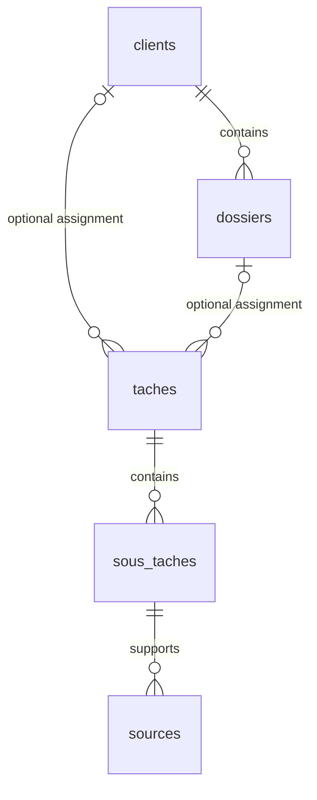

# Original SQLite data model

> Historical reference. This document preserves the original supplied schema and its earlier review notes. Its open questions and implementation guidance may be superseded. Use the [current data model](../DATABASE.md) and [requirements](../REQUIREMENTS.md) for the accepted design. No migration of this original schema exists.

This document transcribes the supplied schema. It describes TimeKeeper's local application database, separate from Screenpipe's internal storage. No SQL migration has been executed.

Database identifiers remain unchanged from the supplied diagram. The table names mean clients, cases (`dossiers`), tasks (`taches`), subtasks (`sous_taches`), sources, and settings (`parametres`). Translating the documentation does not rename the schema.

## Relationships

A task can reference a client and a case. Both references are nullable in the supplied schema. A case belongs to a client. A subtask references a task, and a source references a subtask. No minimum number of child records is specified. `parametres` holds global settings, with one expected row whose identifier is `1`.

## Tables and fields

Types follow the supplied image. Identifier types and unspecified constraints must be defined in the migration. PK means primary key, and FK means foreign key.

### `clients`

| Field | Schema type or constraint |
| --- | --- |
| `id` | PK |
| `nom` | TEXT |
| `actif` | INTEGER |
| `cree_le` | TEXT |

### `dossiers`

| Field | Schema type or constraint |
| --- | --- |
| `id` | PK |
| `client_id` | FK to `clients.id` |
| `reference` | TEXT |
| `intitule` | TEXT |
| `tarif_horaire` | REAL, `NULL` means use the global rate |
| `statut` | TEXT |
| `cree_le` | TEXT |

### `taches`

| Field | Schema type or constraint |
| --- | --- |
| `id` | PK |
| `client_id` | FK to `clients.id`, nullable |
| `dossier_id` | FK to `dossiers.id`, nullable |
| `titre` | TEXT |
| `facture` | INTEGER, `0` or `1` |
| `facture_le` | TEXT |
| `tarif_applique` | REAL |
| `cree_le` | TEXT |
| `modifie_le` | TEXT |

### `sous_taches`

| Field | Schema type or constraint |
| --- | --- |
| `id` | PK |
| `tache_id` | FK to `taches.id` |
| `description` | TEXT |
| `debut` | TEXT |
| `fin` | TEXT |
| `duree_minutes` | INTEGER |
| `duree_detectee_minutes` | INTEGER |
| `origine` | TEXT, automatic or manual |
| `statut` | TEXT, validation |

`duree_minutes` stores the retained duration after any correction. `duree_detectee_minutes` distinguishes the detected duration. The consistency rule between start, end, and corrected duration remains undecided.

### `sources`

| Field | Schema type or constraint |
| --- | --- |
| `id` | PK |
| `sous_tache_id` | FK to `sous_taches.id` |
| `screenpipe_frame_id` | INTEGER |
| `horodatage` | TEXT |
| `app_name` / `window_name` | TEXT, exact representation to be confirmed |
| `url` | TEXT |
| `statut` | TEXT, validation |

The diagram groups `app_name / window_name` on one line. Whether these are two separate columns needs confirmation. `screenpipe_frame_id` is an external Screenpipe reference, not a foreign key to a local table defined here. Opening a recording through this reference still needs verification.

### `parametres`

| Field | Schema type or constraint |
| --- | --- |
| `id` | PK, expected value `1` |
| `tarif_horaire_global` | REAL |
| `devise` | TEXT |
| `modifie_le` | TEXT |

## Calculations and states

The interface calculates summaries from subtask durations based on reviewed Screenpipe memory and lawyer corrections. Preserve detected duration separately from the corrected duration; replay must not overwrite corrections. Returning to an existing case creates a new period, not a duplicate case. Only case hourly rates and a global hourly fallback are in scope. SQLite stores the details without calculating aggregate totals. Which entries contribute to each total and how to round them remain undecided.

Time validation uses `sous_taches.statut`, source validation uses `sources.statut`, and billing uses `taches.facture`. These states are distinct. Allowed values and validation transitions remain undecided.

## Automatic-assignment requirements

The [integration research](../SCREENPIPE_INTEGRATION.md) proposes case-matching metadata, source provenance, assignment decisions, retrieval progress, and stale-result protection. These are not present in the supplied schema and have not been added as migrations. Case assignment still belongs to the parent task, so moving one subtask requires an explicit split/move rule.

## Decisions required before migration

- Define consistency between `taches.client_id` and the assigned case's client, including nullable references.
- Define when `tarif_applique` is fixed and what happens when a billed task is corrected.
- Confirm monetary representation. The diagram uses `REAL`; decide between that representation and integer monetary units before implementing billing calculations.
- Define date formats, time zones, nullability, defaults, constraints, and deletion rules.
- Define source deduplication and handling of recordings deleted from Screenpipe.
- Define boolean constraints and enforcement of the single settings row.

See the [design review](../DESIGN_REVIEW.md) for additional gaps and acceptance examples.

Return to the [architecture](../ARCHITECTURE.md) or [README](../../README.md).

## Assignment delivery state

The updated [architecture](../ARCHITECTURE.md) requires delivery of case associations to Screenpipe. Assignment revisions, idempotency identifiers, pending/failed/acknowledged delivery state, and external association references are additional persistence needs not represented in the supplied schema. No migration has been created.

## Session lifecycle requirements

The confirmed workflow needs persisted sessions with identity, start/end timestamps and state, links between sessions and work periods, and idempotency/revision checks for start, assignment, and end commands. The supplied six-table model does not yet represent these fields. Add them only through the agreed schema implementation; no migration exists.

Application exit does not set a session end timestamp or close the active work period. Reopening resumes the existing active session. The explicit Screenpipe end command supplies the session end boundary, including when its persistence must be reconciled after the backend restarts.
