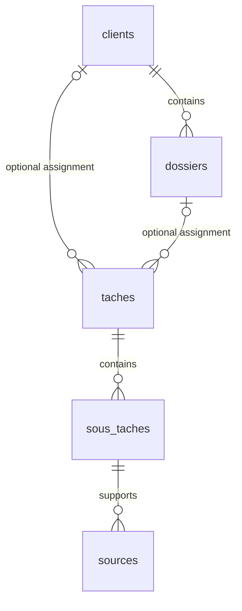

# Original SQLite data model

Historical transcription of the supplied six-table schema. Preserve its French identifiers. It is not the implemented work-period model; use the [current data model](../DATABASE.md), [requirements](../REQUIREMENTS.md), and [canonical migrations](../../src/backend/adapters/sqlite/migrate.ts).

## Relationships

A task can reference a client and a case. Both references are nullable in the supplied schema. A case belongs to a client. A subtask references a task, and a source references a subtask. No minimum number of child records is specified. `parametres` holds global settings, with one expected row whose identifier is `1`.

## Tables and fields

Types follow the supplied image. Identifier types and unspecified constraints must be defined in the migration. PK means primary key, and FK means foreign key.

### `clients`

| Field     | Schema type or constraint |
| --------- | ------------------------- |
| `id`      | PK                        |
| `nom`     | TEXT                      |
| `actif`   | INTEGER                   |
| `cree_le` | TEXT                      |

### `dossiers`

| Field           | Schema type or constraint              |
| --------------- | -------------------------------------- |
| `id`            | PK                                     |
| `client_id`     | FK to `clients.id`                     |
| `reference`     | TEXT                                   |
| `intitule`      | TEXT                                   |
| `tarif_horaire` | REAL, `NULL` means use the global rate |
| `statut`        | TEXT                                   |
| `cree_le`       | TEXT                                   |

### `taches`

| Field            | Schema type or constraint     |
| ---------------- | ----------------------------- |
| `id`             | PK                            |
| `client_id`      | FK to `clients.id`, nullable  |
| `dossier_id`     | FK to `dossiers.id`, nullable |
| `titre`          | TEXT                          |
| `facture`        | INTEGER, `0` or `1`           |
| `facture_le`     | TEXT                          |
| `tarif_applique` | REAL                          |
| `cree_le`        | TEXT                          |
| `modifie_le`     | TEXT                          |

### `sous_taches`

| Field                    | Schema type or constraint |
| ------------------------ | ------------------------- |
| `id`                     | PK                        |
| `tache_id`               | FK to `taches.id`         |
| `description`            | TEXT                      |
| `debut`                  | TEXT                      |
| `fin`                    | TEXT                      |
| `duree_minutes`          | INTEGER                   |
| `duree_detectee_minutes` | INTEGER                   |
| `origine`                | TEXT, automatic or manual |
| `statut`                 | TEXT, validation          |

`duree_minutes` stores the retained duration after any correction. `duree_detectee_minutes` distinguishes the detected duration. The consistency rule between start, end, and corrected duration remains undecided.

### `sources`

| Field                      | Schema type or constraint                  |
| -------------------------- | ------------------------------------------ |
| `id`                       | PK                                         |
| `sous_tache_id`            | FK to `sous_taches.id`                     |
| `screenpipe_frame_id`      | INTEGER                                    |
| `horodatage`               | TEXT                                       |
| `app_name` / `window_name` | TEXT, exact representation to be confirmed |
| `url`                      | TEXT                                       |
| `statut`                   | TEXT, validation                           |

The diagram groups `app_name / window_name` on one line. Whether these are two separate columns needs confirmation. `screenpipe_frame_id` is an external Screenpipe reference, not a foreign key to a local table defined here. Opening a recording through this reference still needs verification.

### `parametres`

| Field                  | Schema type or constraint |
| ---------------------- | ------------------------- |
| `id`                   | PK, expected value `1`    |
| `tarif_horaire_global` | REAL                      |
| `devise`               | TEXT                      |
| `modifie_le`           | TEXT                      |

## Limits of the original model

The supplied schema omits sessions, independent period assignment, source aliases, revisions, command recovery, and assignment delivery. Field constraints and representation choices above reflect the original diagram, not current implementation rules. Do not use its task/subtask hierarchy or nullable client assignment to override the current model.
