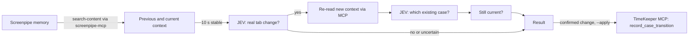

# JEV tab-change check

The chain **Screenpipe → MCP → JEV → result → TimeKeeper**. The check itself never writes (`applied: false` in each result). With `--apply`, or `--session-bound` as started by the Start button, the watcher sends confirmed changes to the active session through the TimeKeeper MCP tool `record_case_transition` ([API D10](../../../docs/API.md#d10-jev-confirmed-tab-changes-become-work-period-transitions)). It never writes to Screenpipe.



With `--apply`, the case candidates and the current case come from TimeKeeper (`list_cases`, `timekeeper_status`) instead of `cases.json`. Only a confirmed change on a still-current context is sent: a different existing case, or `null` for "no unique candidate" (unresolved period and a question for the lawyer). Everything else is logged as `timekeeper: nothing sent (<reason>)`. Set `TIMEKEEPER_APPLY=off` to keep the watcher read-only.

1. Starts `screenpipe-mcp` (pinned to 0.20.3) over stdio and reads recent `window_focus` and `app_switch` events with `search-content`.
2. Groups focus changes less than 10 seconds apart into one burst. Application and title identify each context. The previous context is the window held before the burst; the current context is the last window. A quick switch and return compares the tab with itself and lists the visited tab under "passed through". When an earlier focus event is out of range, the check retrieves evidence before the known switch boundary. Missing preceding evidence remains insufficient.
3. Waits until 10 seconds pass without a relevant update. In `--watch` mode, every new update restarts the delay.
4. Asks JEV `tab_change`: `yes`, `no`, or `uncertain`. A `yes` or `no` below `JEV_MIN_CONFIDENCE` becomes `uncertain`. Missing captures or permitted fields give `insufficient_data` without a request.
5. Only after `yes`, and when case candidates are available, re-reads the new context through MCP and asks JEV `case_selection` among aliased existing cases, with an explicit `unresolved` option. Applied mode reads candidates from TimeKeeper and needs no cases file.
6. Re-reads focus events and sets `display_proposal: true` only if the analysed application and window are still current.

Watch mode retains pending work across transient evidence, model, and delivery failures. Backoff rises from one to thirty seconds. An uncertain delivery retries the same original command without another inference or refreshed assignment guards. A newer focus event discards the older pending work. Accepted results, explicit conflicts, and permanent model failures end that check. [API D10](../../../docs/API.md#d10-jev-confirmed-tab-changes-become-work-period-transitions) defines the outcomes.

JEV does not call MCP itself: its API receives only `state` and `questions`. This tool performs the MCP retrieval and sends JEV two bounded contexts, never the history, screenshots, real case or client IDs, or timestamps. Response checks follow the [pipe](../pipes/timekeeper/pipe.md#handle-the-result).

## Setup

Requires the repository Node version, installed project dependencies, a running Screenpipe, and an explicitly installed `screenpipe-mcp@0.20.3`. Runtime uses `npx --no-install`; it does not download the MCP package. Bun is not required. The MCP package is not bundled with the desktop sidecar.

```powershell
cd integrations\screenpipe\jev-check
Copy-Item .env.example .env          # add your keys and JEV_ALLOWED_FIELDS locally
```

`JEV_ALLOWED_FIELDS` controls what is sent to TypeSafe's hosted API. Including `*.text` sends recorded screen text. Review the [JEV transition contract](../../../docs/API.md#d10-jev-confirmed-tab-changes-become-work-period-transitions) and configure permitted fields before inference.

Run `npm run setup:auth` from the repository root to fill its missing Screenpipe API key through the installed CLI. Root MCP commands and `npm run jev:watch` load that root `.env`. The shared configuration reader also reads the `.env` beside the watcher. Inherited variables override local values, including explicitly empty values. Direct commands in this folder use local configuration unless you explicitly load or export other values. The Screenpipe key does not replace `TYPESAFE_API_KEY`, and setup never chooses `JEV_ALLOWED_FIELDS`.

The launcher validates permitted fields and numeric settings before spawning. Windows WMI receives the same validated environment through stdin rather than command arguments. Both launch paths wait for the watcher readiness record before reporting `started`; failed launches stop their process. These source safeguards still need native acceptance on both platforms.

A cases file is a JSON array of `{ "id", "client_id", "reference", "title", "client_name" }`. It supports standalone checks without `--apply`. Applied workflows read the current catalogue from the application API. For an explicit synthetic dry-run fixture, copy `cases.example.json` to `cases.json` and use `--dry-run`. These fictional cases are not application records or part of normal setup.

## Run

```powershell
node --import tsx jev-check.ts --dry-run          # MCP only; approved request preview only in an interactive terminal
node --import tsx jev-check.ts                    # one check
node --import tsx jev-check.ts --case case-A      # include the current assignment
node --import tsx jev-check.ts --watch            # wait for changes, check after 10 s of stability
node --import tsx jev-check.ts --json             # machine-readable result
node --import tsx jev-check.ts --session-bound    # watch while a TimeKeeper session is active (single instance)
```

Normally you do not run `--session-bound` yourself: the TimeKeeper MCP tool `start_session` starts it in the background whenever a session is running ([architecture](../../../docs/ARCHITECTURE.md#start-and-end-buttons-and-tab-detection)). A transaction in `.watch.pid.sqlite` enforces one watcher; `.watch.pid` contains diagnostic ownership information. It checks `GET /api/sessions/active` every 10 seconds at `TIMEKEEPER_API_URL` (default `http://127.0.0.1:8787/api`) and exits when no session is active. An unreachable API keeps it running, because closing TimeKeeper does not end the session. Its redacted diagnostics go to `watch.log` in this folder. Logs contain timestamps, statuses, confidence, numeric frame IDs, and hashed case/client IDs. They exclude captured text, titles, URLs, catalogue labels, and provider error bodies. `tab_detection_status` also redacts older log formats. Existing raw logs are not rewritten automatically.

Unit tests, with fake MCP and JEV backends, from the repository root:

```powershell
npx vitest run tests/unit/jev-check
```

## Result

| Field                               | Meaning                                                                           |
| ----------------------------------- | --------------------------------------------------------------------------------- |
| `status`                            | `checked`, `not_stable`, `insufficient_data`, `dry_run`, or `error`.              |
| `previous`, `current`               | Capture timestamp and numeric frame ID. Captured content is omitted.              |
| `passed_through_count`              | Number of windows visited briefly inside the burst.                               |
| `tab_change`                        | JEV answer and confidence.                                                        |
| `assignment`                        | `proposal`, `unresolved`, or `skipped`; confidence and hashed IDs when available. |
| `still_current`, `display_proposal` | Freshness check before showing a proposal.                                        |
| `applied`                           | Always `false`.                                                                   |

## Verified so far

The following Windows observations predate the current launcher and environment-forwarding changes. They do not establish acceptance of those changes.

On Windows with Screenpipe 2.7.109 (CLI 0.4.52), `screenpipe-mcp` 0.20.3, and `jev-1.13.0`: a dry run and a live check read real focus events and captures through MCP, and JEV answered `no` with confidence 0.98 while the user stayed in one window. Started by `start_session` against a stand-in TimeKeeper API, the `--session-bound` watcher read real focus events through MCP, got a live JEV answer, opened no visible window, refused a second instance, and stopped within 10 seconds of the session ending. Deliberate tab-switch scenarios, quick returns, the Node API, and macOS have not been run. Unit tests cover parsing, context selection, the stability delay, request building, response validation, and the pipeline with fakes.

The watcher captures the active period ID and assignment revision before calling JEV. It sends that snapshot through `record_case_transition`. The API rejects results made stale by a lawyer correction. Repeated transitions retain the capture timestamp and deterministic period ID. A pending reconstruction is not reported as an applied period.

After the project build, run `node --env-file-if-exists=.env dist/src/mcp/server.js --http` from the repository root. The built watcher is `dist/integrations/screenpipe/jev-check/jev-check.js`. Its local JEV configuration must be beside that built entry, or supplied in the process environment. Configure permitted hosted fields explicitly. Building these entries does not package their configuration, Screenpipe MCP dependency, or login startup.

`--json` returns redacted diagnostics. An explicit `--dry-run` displays the permitted request only in an interactive terminal, outside watch mode. Redirected output and background logs never include that request.

## Retrospective history inference

The live watcher and explicit history generation are separate paths. `history.ts` evaluates bounded samples of sources already imported into TimeKeeper. Minute buckets bound inference work; they do not measure worked duration. Consecutive compatible observations can produce a draft window. Gaps, mixed cases, and an unresolved selection remain review information.

The Screenpipe `generate-work-periods` pipe calls TimeKeeper MCP `generate_history_proposals` for a job explicitly requested in Activity. This function uses the MCP process environment directly, not the watcher-local `.env`. It requires TypeSafe credentials and approved fields. The current history source reads `MODEL`, default `jev-latest`, while the live watcher reads `TYPESAFE_MODEL`.

Generation creates drafts only. The lawyer reviews the case, label, bounds, sources, and explicit worked duration before accepting a finished, unvalidated period. [History setup](../../../docs/SETUP.md#configure-history-proposals) and [API D14](../../../docs/API.md#d14-history-proposals-and-explicit-acceptance) define the connected source behavior and its pending runtime acceptance.
