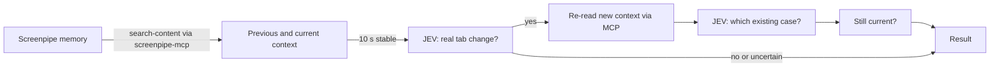

# JEV tab-change check

Command-line verification of the chain **Screenpipe → MCP → JEV → result**. It is read-only: it never changes an assignment, creates a period, or writes to Screenpipe or TimeKeeper. Every result reports `applied: false`.



1. Starts `screenpipe-mcp` (pinned to 0.20.3) over stdio and reads recent `window_focus` and `app_switch` events with `search-content`.
2. Groups focus changes less than 10 seconds apart into one burst. The previous context is the window held before the burst; the current context is the last window. A quick switch and return compares the tab with itself and lists the visited tab under "passed through". If no earlier window is in range, it compares two captures of the current window at least 10 seconds apart.
3. Waits until 10 seconds pass without a relevant update. In `--watch` mode, every new update restarts the delay.
4. Asks JEV `tab_change`: `yes`, `no`, or `uncertain`. A `yes` or `no` below `JEV_MIN_CONFIDENCE` becomes `uncertain`. Missing captures or permitted fields give `insufficient_data` without a request.
5. Only after `yes`, and only if a cases file exists, re-reads the new context through MCP and asks JEV `case_selection` among aliased existing cases, with an explicit `unresolved` option.
6. Re-reads focus events and sets `display_proposal: true` only if the analysed window is still current.

JEV does not call MCP itself: its API receives only `state` and `questions`. This tool performs the MCP retrieval and sends JEV two bounded contexts, never the history, screenshots, real case or client IDs, or timestamps. Response checks follow the [pipe](../pipes/timekeeper/pipe.md#handle-the-result).

## Setup

Requires a running Screenpipe and Bun. The Bun bundled with the Screenpipe desktop app works. The first run downloads `screenpipe-mcp`.

```powershell
cd integrations\screenpipe\jev-check
Copy-Item .env.example .env          # add your keys and JEV_ALLOWED_FIELDS locally
Copy-Item cases.example.json cases.json   # optional: your cases; cases.json is ignored by Git
```

`JEV_ALLOWED_FIELDS` controls what is sent to TypeSafe's hosted API. Including `*.text` sends recorded screen text. Window titles alone are less reliable; see the [design review](../../../docs/DESIGN_REVIEW.md).

A cases file is a JSON array of `{ "id", "client_id", "reference", "title", "client_name" }`. It stands in for TimeKeeper's case lookup until the application API exists.

## Run

```powershell
$bun = "$env:LOCALAPPDATA\screenpipe\bun.exe"   # or: bun
& $bun jev-check.ts --dry-run          # MCP only; prints the request, sends nothing
& $bun jev-check.ts                    # one check
& $bun jev-check.ts --case case-A      # include the current assignment
& $bun jev-check.ts --watch            # wait for changes, check after 10 s of stability
& $bun jev-check.ts --json             # machine-readable result
```

Unit tests, with fake MCP and JEV backends, from the repository root:

```powershell
& $bun test tests/unit/jev-check
```

## Result

| Field | Meaning |
| --- | --- |
| `status` | `checked`, `not_stable`, `insufficient_data`, `dry_run`, or `error`. |
| `previous`, `current` | App, window title, capture time, and frame ID of the compared contexts. |
| `passed_through` | Windows visited briefly inside the burst. |
| `tab_change` | JEV answer, the raw model choice, probabilities, confidence, and model. |
| `assignment` | `proposal`, `unresolved`, or `skipped` with a reason. |
| `still_current`, `display_proposal` | Freshness check before showing a proposal. |
| `applied` | Always `false`. |

## Verified so far

On Windows with Screenpipe 2.7.109 (CLI 0.4.52), `screenpipe-mcp` 0.20.3, and `jev-1.13.0`: a dry run and a live check read real focus events and captures through MCP, and JEV answered `no` with confidence 0.98 while the user stayed in one window. Real tab switches, quick returns, and `--watch` have not yet been run on this machine or on macOS. Unit tests cover parsing, context selection, the stability delay, request building, response validation, and the pipeline with fakes.
